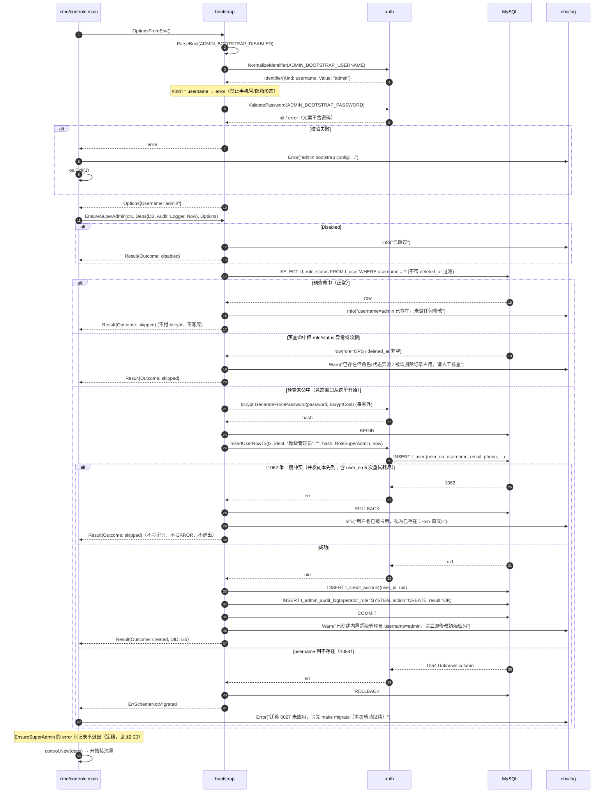
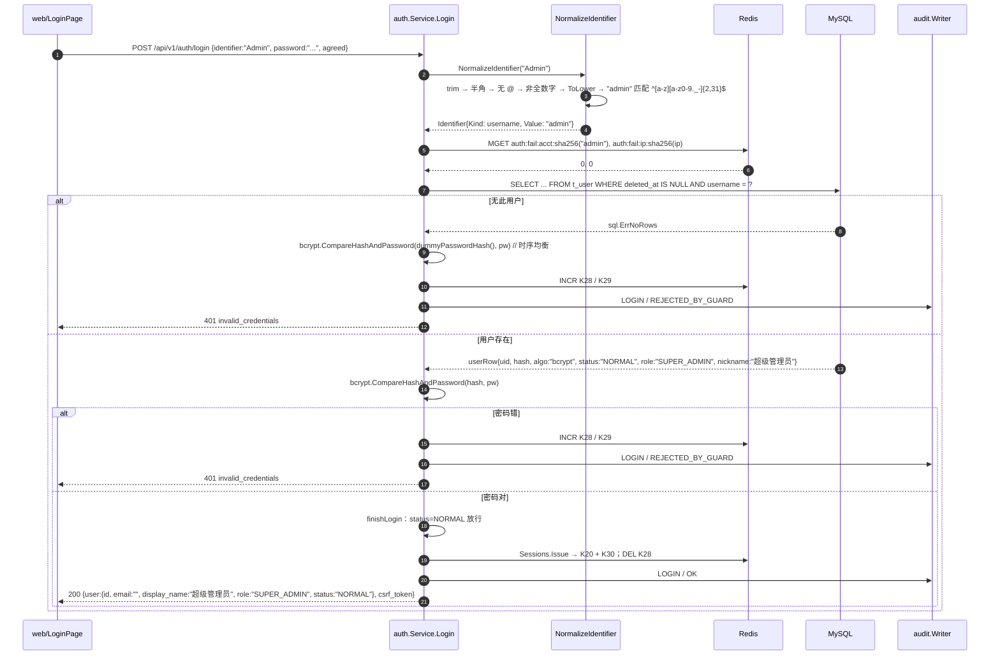
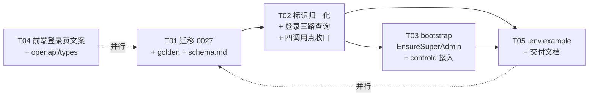

# 增量技术设计：内置超级管理员 admin 启动引导

| 项目 | 内容 |
| --- | --- |
| 对应 PRD | `docs/tasks/INC-admin-bootstrap-prd.md` |
| 变更类型 | 增量（迁移 + auth 语义扩展 + 启动引导 + 前端文案 + 文档） |
| 影响进程 | `controld`（引导）；`gatewayd` / `jobsd` **不受影响** |
| 迁移版本 | **0027**（PRD 写 0022 有误，见 §2.1） |
| 新增依赖 | **无**（bcrypt / go-sql-driver / 既有 obs、audit 全部复用） |

---

## 1. 方案结论速查（工程师只需看这一节就能确认口径）

| 决策点 | 结论 |
| --- | --- |
| 用户名规则 | `^[a-z][a-z0-9._-]{2,31}$`（首字符必须 ASCII 字母，长度 3..32 字节，全小写）。**全数字用户名禁止**（由"首字符为字母"自然得出） |
| 判定优先级 | 含 `@` → email；否则去分隔符后全数字且 6..20 → phone；否则 → username |
| 归一化 | trim → 全角转半角 → `ToLower`；入库与查询都用归一化后的值 |
| `Identifier` 结构 | 保持 `{Kind, Value}`，只新增 `KindUsername = "username"` 常量（不新增并列结构） |
| 迁移 | `0027_add_user_username.sql` + `.down.sql`，`username varchar(32) DEFAULT NULL` + `UNIQUE KEY uk_user_username`，位置 `AFTER user_no`；必须重生成 `checksums.golden` |
| 登录查询 | `findUser` 用 3 值 switch 选列；**列名永不取自客户端**；不存在的账号仍走 `dummyPasswordHash()` |
| 对外 JSON 契约 | **P0 不改**。`userView` 不加 `username`（P1-3 再做）。admin 的 `display_name` 由 `nickname='超级管理员'` 兜住 |
| 引导位置 | 新包 `internal/control/bootstrap`，在 `cmd/controld` 的 `auditWriter` 构造之后、`control.New(deps)` 之前调用 |
| 引导幂等 | **正确性由 `uk_user_username` 保证**：任何 `1062` 一律视为"已存在"（skipped），不写审计、不 ERROR、不退出。`SELECT` 预查只用于省掉每次重启的 bcrypt 成本，**不得**替代唯一键（见 §6.3） |
| 引导失败策略 | **两类，二选一**（主理人定稿，覆盖 PRD §5 末条）：配置非法 → ERROR + `os.Exit(1)`；**任何运行时 SQL 错误** → ERROR **不退出**，下次重启重试。没有中间档（见 §2 C3） |
| 审计表名 | `t_admin_audit_log`（`internal/control/audit/audit.go:82`）。PRD P0-6 写的 `t_audit_log` 是**笔误**，见 §2 C8 |
| 环境变量 | `ADMIN_BOOTSTRAP_DISABLED` / `ADMIN_BOOTSTRAP_USERNAME` / `ADMIN_BOOTSTRAP_PASSWORD`（沿用 PRD 命名，见 §2 冲突 C4） |
| 前端 | 只改登录 tab 的 label / placeholder / **1 处**空值提示 / 页脚说明（见 §8；PRD"三处"实为 1 处，见冲突 C6） |
| 新增错误码 | **无**。非法标识沿用 `invalid_credentials`（登录）/ `invalid_request_body` 带 field（注册类） |

---

## 2. 冲突与修正（PRD / 任务说明 vs 代码实测）

逐条以**代码为准**，工程师照本节执行，不要回头照 PRD 原文。

### C1 迁移版本号：PRD 写 0022，实际最大是 0026

`internal/platform/migrate/sql/mysql/` 实测最后两个文件是 `0026_integration.sql` / `0026_integration.down.sql`。**本次新迁移版本号必须是 0027**。

附带影响：`docs/go-live-checklist.md` 第 7 项写死了「末行版本为 `0026`」，**必须同步改为 `0027`**，否则发版当天按清单核对会误判为"迁移未到位"。

### C2 `uk_user_phone` 已不存在

任务说明提到「表里 `uk_user_email`/`uk_user_phone` 唯一」。实测 `0011`（`0011_*.sql`）已 **DROP `uk_user_phone`**，改为 `phone_hmac char(64)` + `uk_user_phone_hmac`，且 `phone_hmac` 目前**没有任何 Go 代码写入**。

结论：本次只新增 `uk_user_username`，**不碰** email/phone/phone_hmac 的任何唯一性。该历史缺口记入 §16 风险 R4，不在本次修复。

### C3 引导失败是否阻断启动：PRD §5「一律阻断」被主理人定稿覆盖为**两类二分**

PRD §5 原文：「引导失败（如 DB 不可写）应使进程启动失败」。**本条已被主理人定稿覆盖**，以定稿为准：

| 错误类型 | 例子 | 结论 |
| --- | --- | --- |
| 配置非法 | 用户名不合规、密码不满足 8..72 字节、`ADMIN_BOOTSTRAP_DISABLED` 不是布尔 | **fail fast**：ERROR 打印明确原因 + `os.Exit(1)`（PRD P0-7 的硬要求，且这类错误永远不会自愈） |
| 运行时 SQL 错误 | DB 暂不可写、连接超时、只读实例、死锁、审计表只读、**MySQL 1054 `Unknown column 'username'`（迁移未应用）** | **只 ERROR，继续启动**，下次重启重试 |

**没有中间档**：1054（schema 未迁移）也归入第二类，**不退出**。理由有两条，都支持"继续跑"：

1. `username` 缺失只影响**用户名登录**这一条路径；`email` / `phone` 登录、以及全部运营后台路由都不经过这一列。为了一个尚未启用的登录方式把**存量客户的流量**切断，方向反了——「不能因为引导失败切断线上客户流量」是定稿的原话。
2. 引导是一次性动作，把它变成所有副本的启动硬依赖，会让一次 DB 抖动 / 账号权限收敛把整个运营后台打下来。

代价是"服务在跑但可能没有超管"。这个状态是**可观测**（ERROR 日志，1054 时日志里明确写「请先执行 `make migrate` 再启动 controld」）且**可补救**（跑迁移后重启即自动收敛）的，与"整站不可用"不是一个量级。

因此代码结构固定为：`bootstrap.EnsureSuperAdmin` 永远只 **返回** error（不自己 `os.Exit`），`cmd/controld` 里只有 `OptionsFromEnv` 的错误分支会退出。`ErrSchemaNotMigrated` 这个哨兵错误**保留**，唯一用途是让日志能给出人话而不是让运维从 1054 里猜——**它不再导致退出**。

### C4 环境变量命名：任务说明建议 `BOOTSTRAP_ADMIN_*`，本设计取 PRD 的 `ADMIN_BOOTSTRAP_*`

PRD P0-7 已把三个变量名写进验收标准，`docs/*` 与 `.env.example` 也会照它写。**只保留一套名字，不做别名**（双读会让"我明明改了却没生效"变成排查黑洞）。若主理人坚持另一套，改这一处即可，其余设计不受影响。

### C5 「用户名必须含至少一个字母」与「首字符为字母」冗余

PRD P0-2 同时写了「首字符为字母」和「必须含至少一个字母」。后者被前者蕴含。取**更强且更简单**的一条：`^[a-z][a-z0-9._-]{2,31}$`。副产品：任何合法用户名都不可能全数字，因此**永远不可能与手机号歧义**（这也正是 PRD §4 想表达的意思）。

### C6 登录页"三处错误提示"实为 1 处

`web/src/pages/site/LoginPage.tsx` 里 `请输入邮箱或手机号。` 共 4 处：

| 行 | 所属 | 是否改 |
| --- | --- | --- |
| 146 | `handleLogin` 空值 | **改**为「请输入邮箱、手机号或用户名。」 |
| 183 | `handleRegister` 空值 | 不改（注册只支持邮箱/手机） |
| 223 | `handleSendCode` 空值 | 不改（验证码只能发邮箱，见 `verifycode.go:131` 的 `ident.Kind != "email"` 拒绝） |
| 263 | `handleReset` 空值 | 不改（重置链路尚未开放） |

结论：**只改 146 一行**。登录页本来就没有邮箱正则校验（`handleLogin` 只判空），所以不需要为用户名删任何校验。

### C7 改 `openapi.yaml` 会改到 `web/src/api/types.ts`

`web/package.json` 的 `gen:api` 是 `openapi-typescript`，生成的 `types.ts` **会保留 `@description` 注释**。因此 `LoginRequest.identifier` 的 description 一改，`types.ts` 必然出现一行注释 diff。

结论：照改 description + 重跑 `npm run gen:api`，并在 code review 里确认 **diff 只含注释行**（若出现类型变化说明手改错了文件）。

### C8 审计表名：PRD 写 `t_audit_log`，实际表是 `t_admin_audit_log`

PRD P0-6 写「写入 `t_audit_log`」。真实表名是 **`t_admin_audit_log`**（`internal/control/audit/audit.go:82` 的 INSERT 语句，也是 `0003_fund_usage_ops.sql` 建的 60 张表之一）。**PRD 该处为笔误**，本设计全文一律按 `t_admin_audit_log` 写；工程师照本设计执行，不要按 PRD 原文去找 `t_audit_log`（那会得到一个不存在的表，直接 1146）。

顺带两个由 `audit.Writer` 决定的、**无需处理但要知情**的细节：

1. `trace_id` 列 `NOT NULL`：无请求上下文时 writer 回退为 `"seed"`（`audit.go:75-81`）。引导没有 HTTP 请求，所以那条审计的 `trace_id` 会是 `seed`——这是既有约定，**不要**为引导单独造 trace id。
2. `operator_ip` 用 `nullableBytes` 写入，引导不传 → 落 NULL，符合"系统动作"的语义。

---

## 3. 用户名规则（唯一口径）

```
输入 raw
  ↓ trim(全角空格)→全角转半角            （复用 toHalfWidth + TrimSpace）
  ↓ 含 '@' ？
     ├─ 是 → email：ToLower + 既有邮箱校验（254 / 单 @ / 域名含点 / 无控制字符）
     └─ 否 → stripPhoneSeparators(s)
             ↓ 全为数字 且 len 6..20 ？
                ├─ 是 → phone（行为与今天完全一致）
                └─ 否 → username：ToLower 后匹配 ^[a-z][a-z0-9._-]{2,31}$
```

要点：

- **字符集只允许 `a-z 0-9 . _ -`**，因此大写字母在归一化后消失，中文/emoji/空格全部非法（`utf8mb4_0900_as_cs` 是大小写敏感排序规则，不归一化就会允许 `Admin` 与 `admin` 双份账号）。
- **长度按字节算 3..32**（字符集是纯 ASCII，字节数 == 字符数，与列宽 `varchar(32)` 严格对齐）。
- **禁止首字符非字母**（数字开头、"`.`/`-`/`_` 开头都不允许）。全数字用户名由此被禁止。
- **允许内部连续分隔符**（`a..b`、`a--b` 合法）。不额外限制：多一条正则就多一份要同步的前端/文档口径，而它们既不可利用也不歧义。
- **不新增错误码**。登录侧归一化失败 → `invalid_credentials`（401，与今天的 `login.go:58` 分支完全一致，且继续写 `REJECTED_BY_GUARD` 审计）。注册类接口 → `mw.InvalidField("identifier")`（400 `invalid_request_body`）。
- **判定优先级不可配置、不可由客户端指定**：客户端只提交 `identifier` 一个字段。

---

## 4. 数据模型

### 4.1 迁移 `0027_add_user_username`

文件名（须匹配 `^\d{4}_[a-z0-9_]+(\.down)?\.sql$`）：

- `internal/platform/migrate/sql/mysql/0027_add_user_username.sql`
- `internal/platform/migrate/sql/mysql/0027_add_user_username.down.sql`

**up**：

```sql
ALTER TABLE t_user
  ADD COLUMN username varchar(32) DEFAULT NULL
    COMMENT '运营/超管登录用户名；小写归一，仅运营账号有值，普通用户为 NULL' AFTER user_no,
  ADD UNIQUE KEY uk_user_username (username);
```

**down**：

```sql
ALTER TABLE t_user
  DROP INDEX uk_user_username,
  DROP COLUMN username;
```

设计说明：

1. **位置 `AFTER user_no`**：身份标识三列（`user_no` / `username` / `email`）排在一起，后续读 `SHOW CREATE TABLE` 的人一眼能看出 username 是登录标识而不是展示名。
2. **`DEFAULT NULL` 而非 `NOT NULL DEFAULT ''`**：存量行不写回填、不锁表；且必须可空才能进唯一索引（见 3）。**迁移不更新任何存量行**。
3. **多 NULL 在 MySQL 唯一索引下的行为**：InnoDB 的唯一索引把 `NULL` 当作互不相等，**任意多行 `username=NULL` 都允许**。这正是本设计依赖的性质——所有已存在的客户账号（以及所有 `email`/`phone` 登录的运营账号）保持 NULL，不会因为"NULL 重复"撞键。0011 回滚注释里已经写过同一条性质，口径一致。
4. **不需要改名/建视图/改种子**：
   - `t_user` 没有配套视图，也没有触发器。
   - `deploy/seed/*.sql` 不直接 `INSERT INTO t_user`（`@uid` 由调用方给出），新列不影响。
   - 只有 Go 侧 `INSERT` 需要加列（见 §5.3）。
5. **迁移文件的守卫测试约束**（`internal/platform/migrate/guard_test.go`，**不得改它**）：
   - 全文（含注释）**不得出现 `timestamp`**（`TestNoTimestampKeyword` 对 include 注释做 `ToLower` 包含判断）——注释里要写时间列就写 `datetime(3)`。
   - 全文**不得出现 `decimal` / `float` / `double`** 三个单词（`TestDecimalOnlyForSuccessRate` 按行正则命中）。
   - 不得有 `FOREIGN KEY`。
   - `CREATE TABLE` 数必须等于 `ENGINE=InnoDB DEFAULT CHARSET=utf8mb4 COLLATE=utf8mb4_0900_as_cs` 出现次数——本次是 `ALTER`，两者都是 0，天然通过。
   - `wantTables`（60 张表）**不受影响**：本次不加表，只加列。**不要去改 `guard_test.go`**。
6. **必须重生成 golden**：`bash scripts/gen-migration-checksums.sh`（或 `cd internal/platform/migrate && go run gen_checksums.go`）。不重生成 → `TestEmbeddedMigrationsMatchGoldenChecksums` 必红。同时确认 `git diff` 里**只新增 0027 一行**，没有别的版本行变化（有变化说明动到了历史文件，必须回退）。
7. **`migrate_test.go` 也钉死了版本**：该文件有 `wantMigrationCount = 24` 与一个显式的版本列表，加 0027 后必须同步为 `25` 并在列表末尾追加 `"0027"`，否则 `TestMigrationCountMatchesFiles` 红。这是本次**唯一**需要改动的既有测试文件（设计初版漏了它，见 §17 第 4b 项）。

### 4.2 相关文档同步

| 文件 | 改什么 |
| --- | --- |
| `docs/schema.md` §变更记录 | 新增一行：`0027` / `t_user` / 加 `username varchar(32) NULL` + `uk_user_username` |
| `docs/schema.md` 表清单里 `t_user` 那行（约 72 行） | 唯一键列表补 `uk_user_username` |

`api/openapi.yaml` 的 schema 部分**不涉及数据库结构**，见 §8。

---

## 5. 登录改造

### 5.1 `internal/control/auth/normalize.go`

```go
const (
    KindEmail    = "email"
    KindPhone    = "phone"
    KindUsername = "username" // 新增
)

// 用户名规则的唯一实现：首字符字母 + 3..32 字节 + 仅小写字母/数字/._-
var usernameRE = regexp.MustCompile(`^[a-z][a-z0-9._-]{2,31}$`)

func NormalizeIdentifier(raw string) (Identifier, error)  // 签名与语义扩展，三路判定
func RequireEmailOrPhone(ident Identifier) error          // 新增：不是 email/phone 就报错
```

- `NormalizeIdentifier` 的三路顺序**必须**按 §3 的流程图写，且 phone 分支的判定条件与今天逐字相同（全数字 + 6..20），保证既有纯数字账号行为零变化。
- `RequireEmailOrPhone` 存在的意义：注册、发验证码、运营建号、`seedctl` 四条路径**根本无法处理用户名**（发不了验证码 / 不该凭空造运营账号），必须**显式拒绝**而不是"归一化后悄悄当成邮箱处理"。集中成一个函数，避免四处各写一遍 `if kind == KindUsername`。
- `maskIdentifier` **不改**：非 email 分支（`len<=4 → "***"`，否则首 3 + `****` + 末 2）对 `admin`（5 字节）给出 `adm****in`，够审计读者辨认，且保持"一套脱敏规则"。

### 5.2 `internal/control/auth/login.go`

`findUser` 改成 3 值 switch：

```go
column := "email"
switch ident.Kind {
case KindPhone:
    column = "phone"
case KindUsername:
    column = "username"
}
q := `SELECT id, password_hash, password_algo, status, role,
             COALESCE(email, ''), COALESCE(phone, ''), nickname
        FROM t_user
       WHERE deleted_at IS NULL AND ` + column + ` = ?`
```

要点：

- **列名只能来自这 3 个字面量**，`ident.Value` 永远走占位符。这是一条安全边界，注释里要写明「column 是编译期常量集合，不是客户端输入」。
- **`userRow` 不加 `username` 字段**：`finishLogin` / `view()` 用不到它，加字段只会扩大改动面。
- **时序均衡不变**：`sql.ErrNoRows` 分支仍执行 `bcrypt.CompareHashAndPassword(dummyPasswordHash(), ...)`。用户名不存在与邮箱不存在在时间上不可区分。
- **锁定键不变**：`redisx.LoginAccountFailKey(ident.Value)` 内部是 `sha256(value)`，`sha256("admin")` 稳定且与任何邮箱/手机号不同值，无需改 `internal/redisx/keys.go`（该文件的测试还钉死了键条数 30，改它会连带红）。
- **锁定不可豁免**：admin 与普通账号共用 5 次/15 分钟（账号维度）与 20 次/10 分钟（IP 维度）。已知口令是公开弱口令，这里**不能**开特例（PRD §5 明确要求）。

### 5.3 `internal/control/auth/register.go`（`insertUserRow`）

`InsertUserRowTx` 的**签名不变**（这很关键：`ops.CreateOperatorUser` 与未来的调用方零改动）。改动只发生在私有实现：

```go
const q = `INSERT INTO t_user
    (user_no, username, email, phone, password_hash, password_algo, password_updated_at,
     nickname, role, status, agreement_version, agreed_at, created_at, updated_at)
    VALUES (?,?,?,?,?,'bcrypt',?,?,?,'NORMAL',?,?,?,?)`
...
var email, phone, username any
switch ident.Kind {
case KindEmail:
    email = ident.Value
case KindPhone:
    phone = ident.Value
case KindUsername:
    username = ident.Value
}
```

- 顺带把该函数上方注释里的「the same thirteen columns」改为「fourteen columns」——注释里的数字是契约，不能留错。
- 重复键处理**保持原样**：只有 `uk_user_no` 冲突才重试（5 次），其它 1062 立刻返回。引导复用这个函数就自动继承了 `uk_user_no` 的重试，**不要在 bootstrap 里再套一层重试**；引导在外面把任何冒泡的 1062 都判成"已存在"（§6.3）。
- 新增导出常量（放在 `RolePersonal` 旁边，同一套「`t_user.role` 存储词汇」）：

```go
const RoleSuperAdmin = "SUPER_ADMIN"
```

`internal/control/ops` 里已有的 4 个私有 role 常量**不动**（那是另一份刻意重复的副本，改动它超出本次范围）。

### 5.4 四个非登录调用点（必须逐点显式拒绝用户名）

| 调用点 | 处理 |
| --- | --- |
| `auth/register.go:62` | `if err := RequireEmailOrPhone(ident); err != nil { mw.InvalidField("identifier").WithHint("用户名仅用于运营账号，请使用邮箱或手机号") }` |
| `auth/verifycode.go:116` | 同上（无地址可发码） |
| `ops/users_operator.go:87` | 同上（运营建号不给用户名：这类账号没有 email/phone，日后忘记密码**没有任何找回路径**，开了就是造一个无法自救的账号） |
| `cmd/seedctl/main.go:64` | `return fmt.Errorf("seedctl 不接受用户名标识：%s", identRaw)`（本地种子工具，直接返回错误即可） |

### 5.5 对外契约

**P0 不改任何 JSON 字段。**`userView` 仍是 `{id, email, display_name, role, status}`。

admin 的 `display_name` 依赖 `nickname='超级管理员'`（`view()` 的兜底顺序是 nickname → email → phone），所以引导程序**必须**写 nickname；否则运营后台顶部会显示空名字。

`email` 字段对 admin 返回空串——接受这个 P0 限制。`GET /api/admin/users` 不受影响：`ops.scanUser` 用 `sql.NullString` 接 `email`/`phone`，NULL 安全（已核实 `internal/control/ops/users.go:410`）。P1-3（`userView` 附加 `username`）留下次。

---

## 6. 启动引导

### 6.1 包位置：`internal/control/bootstrap`（新包）

理由（对比 `internal/boot`）：

1. `internal/boot` 现有职责是**配置快照 / 价格缓存 / 定时刷新**（`route_snapshot.go`、`price_cache.go`），被 `cmd/controld`、`cmd/seedctl`、`internal/acceptance` 引用。把"建账号"塞进去，会让这个包的名字与职责继续脱钩。
2. 引导需要 import `internal/control/auth`（`InsertUserRowTx` / `BcryptCost` / `ValidatePassword` / `NormalizeIdentifier`）与 `internal/control/audit`。放在 `internal/control/` 下，依赖方向是 `control → control`，语义闭合。
3. 未来若 `gatewayd`/`jobsd` 也引用 `internal/boot`，引导逻辑不会跟着被拖进数据面二进制。

### 6.2 接口

```go
package bootstrap

// Options 是引导的全部输入。Role/Nickname 是代码常量，不开放成环境变量：
// 允许运维改 role 等于允许"把内置账号建成普通客户"，那不是配置项，是 bug。
type Options struct {
    Disabled bool   // ADMIN_BOOTSTRAP_DISABLED
    Username string // ADMIN_BOOTSTRAP_USERNAME，默认 "admin"
    Password string // ADMIN_BOOTSTRAP_PASSWORD，默认 "12345678"
}

// OptionsFromEnv 读环境变量并做**全部校验**（不触库）。
// 返回 error 时调用方必须拒绝启动：这类错误永远不会自愈。
func OptionsFromEnv() (Options, error)

type Deps struct {
    DB     *sql.DB
    Audit  *audit.Writer
    Logger *obslog.Logger
    Now    clock.Clock
}

type Outcome string

const (
    OutcomeDisabled Outcome = "disabled" // 被开关关掉
    OutcomeCreated  Outcome = "created"  // 本次真的插入了
    OutcomeSkipped  Outcome = "skipped"  // 已存在，未改动
)

type Result struct {
    Outcome  Outcome
    UID      int64  // 仅 Created 有值
    Username string // 归一化后的用户名
}

// ErrSchemaNotMigrated：MySQL 1054（username 列不存在）。
// 独立成哨兵错误，只为让 main 能给出"请先执行 make migrate"这一句人话，
// 而不是让运维从 1054 里猜。它**不表示"应当退出"**：调用方记录后照常启动（§2 C3）。
var ErrSchemaNotMigrated = errors.New("bootstrap: t_user.username 不存在，迁移 0027 未应用")

// EnsureSuperAdmin 只返回 error，从不 os.Exit：
// 是否退出由 main 决定，且只有配置错误会退出。
func EnsureSuperAdmin(ctx context.Context, deps Deps, opts Options) (Result, error)
```

`OptionsFromEnv` 的校验清单（顺序执行，第一个失败即返回）：

| 校验 | 失败返回 |
| --- | --- |
| `ADMIN_BOOTSTRAP_DISABLED` 只接受 `""`/`false`/`0`/`true`/`1`（`strconv.ParseBool` 语义） | `ADMIN_BOOTSTRAP_DISABLED 必须是布尔值` |
| **短路**：`Disabled=true` 时**不校验**用户名与密码，直接返回 | —（见下面的说明） |
| `ADMIN_BOOTSTRAP_USERNAME` 默认 `admin`；归一化后 `Kind` 必须是 `KindUsername` | `ADMIN_BOOTSTRAP_USERNAME 必须是合法用户名（3..32 字节，字母开头，仅 a-z0-9._-；不能是邮箱或手机号）` |
| `ADMIN_BOOTSTRAP_PASSWORD` 默认 `12345678`；走 `auth.ValidatePassword`（8..72 字节、非纯空白） | 把 `auth.ValidatePassword` 的错误原样包一层（**它的错误文案不含密码值**，安全） |

错误信息里**不得拼接 env 的原始值**（用户名可以出现在错误里——它不是秘密；密码绝对不行）。

**为什么 `Disabled=true` 要短路**：文档承诺的是「`ADMIN_BOOTSTRAP_DISABLED=true` 时**完全跳过**引导」。如果一个已经把引导关掉的部署，因为同一个 `.env` 里一个**从不被使用**的过期变量而启动不起来，那是把一个 no-op 变成了故障。校验只应发生在真正要建号的分支上。相应地：`Disabled=true` 时 `Options.Password` 置空（不保留一个用不到的密钥），`EnsureSuperAdmin` 必须在**校验之前**先看 `Disabled` 并返回。

**默认值住在哪**：`12345678` 这个字面量**只能有一处**，即 `bootstrap` 包里的 `defaultPassword` 常量（PRD 的"未设置则默认 `12345678` 生效"要求它必须存在于代码里；只写在 `.env.example` 而代码无默认值，会让变量未设置时密码为空、进而 `ValidatePassword` 失败、进而**所有存量部署在升级时起不来**）。约束不是"代码里不许出现"，而是：**只许一处 + 注释里说明它是公开弱口令 + 任何日志/错误/审计都不得复述它**（日志只允许打印变量名 `ADMIN_BOOTSTRAP_PASSWORD`，不打印值）。

### 6.3 `EnsureSuperAdmin` 执行流程

```
if opts.Disabled  → (OutcomeDisabled, nil)                    打 1 条 INFO，不触库

ident = NormalizeIdentifier(opts.Username)                    （OptionsFromEnv 已保证成功）

-- 阶段 1：预查（只为省成本，不承担正确性）--
row, err := SELECT id, role, status, deleted_at FROM t_user WHERE username = ?
--          ↑ deleted_at 必须出现在 SELECT 列表里（要靠它分辨软删占用）
--          ↑ 但绝不能出现在 WHERE 里（uk_user_username 不含 deleted_at，软删行仍占键）
if err        → 1054 归 ErrSchemaNotMigrated；其它返回 err（运行时 SQL 错误，main 只 ERROR 不退出）
if found      → 打 INFO/WARN 后返回 (OutcomeSkipped, nil)      ← 不付 bcrypt、不写库、不写审计

-- 阶段 2：真正的创建 --
hash = bcrypt.GenerateFromPassword(opts.Password, auth.BcryptCost)      ← 事务外，~100ms
now  = deps.Now.Now().UTC()
tx   = DB.BeginTx
  uid = auth.InsertUserRowTx(ctx, tx, ident, "超级管理员", "", string(hash), auth.RoleSuperAdmin, now)
  INSERT INTO t_credit_account (user_id, created_at, updated_at) VALUES (uid, now, now)
  deps.Audit.Insert(ctx, tx, audit.Entry{...})                          ← 写 t_admin_audit_log
tx.Commit
if 1062 → ROLLBACK + (OutcomeSkipped, nil)                     ← 并发副本先到，属正常
if 其它 → ROLLBACK + err
```

关键点，逐条都有理由：

1. **正确性只由唯一键 `uk_user_username` 保证；预查只是优化。**
   阶段 1 的 `SELECT` **不能**被当作幂等实现：两个副本可能同时查不到、同时插入。它的价值是"每次重启少付一次 bcrypt（~100ms）+ 少一次无效写入 + 能拿到 `role`/`status` 打准确的日志"。
   因此代码里必须把这句话写成注释（`// 预查只为省一次 bcrypt；正确性由 uk_user_username 保证`），否则下一个人很容易"优化"掉唯一键兜底。
2. **预查的 SQL 不带 `deleted_at IS NULL`**——这是本设计最容易写错的一处。
   `uk_user_username` **不含 `deleted_at`**，所以一行软删除的 `username='admin'` 依然占着唯一键。若预查加了 `deleted_at IS NULL`，就会得出"不存在"，插入时撞 1062，最后被判成"已存在"——但登录用的 `findUser` 带 `deleted_at IS NULL`，永远查不到它。结果是**一个静默的死锁状态**：引导说"已存在"，用户说"登录不了"。
   正确做法：预查不带软删过滤。命中且 `deleted_at IS NOT NULL` → 打 **WARN**「username=admin 被一条软删除记录占用，需人工处理（引导不会复活它）」，返回 skipped。**不复活**软删行：复活是数据修复，不是引导该做的事。
3. **1062 一律视为"已存在"**（主理人定稿）：任何 `auth.IsDuplicate(err)` → `OutcomeSkipped`，**不写审计、不打 ERROR、不退出**。

   ```go
   if err != nil {
       if auth.IsDuplicate(err) {
           // uk_user_no 的冲突已在 auth.insertUserRow 内部重试 5 次，冒泡到这里
           // 基本只剩 uk_user_username；无论哪个键，都按"已存在"处理不阻断启动。
           deps.Logger.Info(ctx, "admin bootstrap: 用户名已被占用，视为已存在："+err.Error(),
               obslog.Fields{Stage: "startup.bootstrap"})
           return Result{Outcome: OutcomeSkipped, Username: ident.Value}, nil
       }
       if isUnknownColumn(err) { return Result{}, ErrSchemaNotMigrated }   // 1054，带人话，但**不退出**
       return Result{}, err
   }
   ```

   - **`uk_user_no` 的提醒**：`user_no` 也有唯一键 `uk_user_no`，`auth.insertUserRow` 内部已经是"最多 5 次重试、只对 `uk_user_no` 冲突重试"的循环。引导**不自己写 INSERT**，走 `InsertUserRowTx` 就自动继承这套重试，**不要**在 bootstrap 里再套一层重试。
   - 唯一需要人盯的边角：假如 5 次 `user_no` 重试全撞（分配器异常，非"已存在"），冒泡的 1062 会被上式判成 skipped 而静默。所以日志里**必须带上 `err.Error()` 原文**（含键名），运维在 INFO 里能看出是 `uk_user_no` 还是 `uk_user_username`。
4. **`t_credit_account` 必插**。`ops.CreateOperatorUser` 的注释已经踩过这个坑：「Without it SUPER_ADMIN's own `/api/console/overview` answers `exists=false` and the balance block reads as broken」。漏了这条，admin 登录后运营后台首页余额块就是坏的——这是本次最容易漏、且验收时一眼可见的缺陷。
5. **不覆盖原则**：`username='admin'` 存在时**一律跳过**，即使它的 `role` 不是 `SUPER_ADMIN` 或 `status != NORMAL`。此时打 1 条 **WARN** 带上实际 `role`/`status`（阶段 1 顺手读到的，不额外查），提示"引导未做任何修改，请人工核查"。
   - 不做这件事的理由：自动"修复"意味着**重启一次就可能被悄悄提权/解禁**，那比没有超管危险得多。
6. **审计内容**（仅 Created 时写，落 `t_admin_audit_log`）：

   | 字段 | 值 |
   | --- | --- |
   | `OperatorID` | `0` |
   | `OperatorRole` | `"SYSTEM"` |
   | `OperatorIP` | 不写（无请求上下文 → NULL） |
   | `Module` | `"USER"` |
   | `Action` | `"CREATE"` |
   | `TargetType` | `"t_user"` |
   | `TargetID` | `strconv.FormatInt(uid, 10)` |
   | `After` | `{"identifier": auth.MaskIdentifier(kind, value), "identifier_kind": "username", "role": "SUPER_ADMIN", "status": "NORMAL", "agreement_version": ""}` |
   | `Result` | `"OK"` |

   说明：`action` 用 `CREATE`（不是 `ops` 的 `CREATE_OPERATOR`），区分子靠 `operator_role=SYSTEM`；`after_json` 的 identifier 走 `auth.MaskIdentifier` 保持"一套脱敏规则"（`admin` → `adm****in`，可辨认）。`trace_id` 由 writer 回退为 `"seed"`，见 §2 C8。
7. **事务边界**：用户、信用账户、审计在**同一个事务**里提交或一起回滚。审计写失败 → 整个引导失败（不能出现"建了超管但没留痕"）；该失败属于运行时错误，只 ERROR、不退出。
8. **日志文案**（`Stage: "startup.bootstrap"`）：

   | 场景 | 级别 | 文案要点 |
   | --- | --- | --- |
   | 预查已存在（正常） | INFO | `admin bootstrap: username=admin 已存在，未做任何修改` |
   | 预查已存在但角色/状态异常 | **WARN** | `... 已存在但 role=OPS status=NORMAL，引导未做任何修改，请人工核查` |
   | 预查命中软删行 | **WARN** | `... username=admin 被软删除记录占用，需人工处理` |
   | 实际创建 | **WARN** | `admin bootstrap: 已创建内置超级管理员 username=admin（role=SUPER_ADMIN）；初始密码为环境变量中配置的值，请立即修改初始密码` |
   | 竞态撞唯一键 | INFO | `... 用户名已被占用，视为已存在：<err>`（**带 err 原文**） |
   | 被开关关闭 | INFO | `... ADMIN_BOOTSTRAP_DISABLED=true，已跳过` |
   | 运行时失败 | ERROR | `admin bootstrap failed: <err>`（err 里不含密码）；1054 时附「请先执行 make migrate」 |

   **日志红线**：任何一条都不得包含 `ADMIN_BOOTSTRAP_PASSWORD` 的**值**、不得包含 bcrypt hash、不得包含 DSN。WARN 文案只允许出现**变量名** `ADMIN_BOOTSTRAP_PASSWORD`（提示运维去改哪个变量），不允许复述默认值——代码里那个 `defaultPassword` 常量是唯一的字面量出处（§6.2「默认值住在哪」），日志再复述一遍就成了第二处事实来源。

### 6.4 `cmd/controld/main.go` 接入点

位置：`auditWriter := &audit.Writer{DB: mainDB, Now: clock.Real{}}`（约 116 行）之后、`control.New(deps)`（约 216 行）之前。

```go
// 只有配置错误会拒绝启动；引导本身失败一律只记录，不切断存量流量。
bootOpts, err := bootstrap.OptionsFromEnv()
if err != nil {
    logger.Error(rootCtx, "admin bootstrap config: "+err.Error(), obslog.Fields{Stage: "startup", Status: 1})
    os.Exit(1)
}
if _, err := bootstrap.EnsureSuperAdmin(rootCtx, bootstrap.Deps{
    DB: mainDB, Audit: auditWriter, Logger: logger, Now: clock.Real{},
}, bootOpts); err != nil {
    msg := "admin bootstrap failed: " + err.Error()
    if errors.Is(err, bootstrap.ErrSchemaNotMigrated) {
        msg += "；迁移 0027 未应用，请先执行 make migrate（本次启动继续，用户名登录在迁移前不可用）"
    }
    logger.Error(rootCtx, msg, obslog.Fields{Stage: "startup.bootstrap"})
}
```

- **`EnsureSuperAdmin` 的 error 分支里没有 `os.Exit`**，这是定稿的硬约束（§2 C3）。`main` 新增的退出点只允许 2 处：`OptionsFromEnv` 返回处、`errors.Is(err, ErrInvalidConfig)` 分支；`ErrSchemaNotMigrated` 分支内为 0（见 §17 第 14 项）。
- 引导**在 `control.New` 之前**：让"登录接口能查到 admin"与"进程开始接流量"之间没有窗口。
- 不做 `db.Ping` 预热：`EnsureSuperAdmin` 的第一次查询就会暴露连接问题，多一次 Ping 只是多一次 RTT。
- **`gatewayd` / `jobsd` 不加这段**：引导只属于控制面，否则三个进程同时抢建。
- 若 P2-1（`admin_bootstrap_total{result}`）将来要做，`rec` 已在同一个 `main` 作用域里，`Deps` 加一个 `Metrics` 字段即可，无需重构。

---

## 7. 文件清单

| 类型 | 路径 | 动作 |
| --- | --- | --- |
| 迁移 | `internal/platform/migrate/sql/mysql/0027_add_user_username.sql` | 新增 |
| 迁移 | `internal/platform/migrate/sql/mysql/0027_add_user_username.down.sql` | 新增 |
| 迁移 | `internal/platform/migrate/checksums.golden` | **重生成**（只增 0027 一行） |
| 后端 | `internal/control/auth/normalize.go` | 改：`KindUsername`、`usernameRE`、三路判定、`RequireEmailOrPhone` |
| 后端 | `internal/control/auth/login.go` | 改：`findUser` 选列 switch |
| 后端 | `internal/control/auth/register.go` | 改：`insertUserRow` 写 username、`RoleSuperAdmin`、拒绝用户名 |
| 后端 | `internal/control/auth/verifycode.go` | 改：拒绝用户名 |
| 后端 | `internal/control/ops/users_operator.go` | 改：拒绝用户名 |
| 后端 | `cmd/seedctl/main.go` | 改：拒绝用户名 |
| 后端 | `internal/control/bootstrap/admin.go` | 新增：`Options` / `OptionsFromEnv` / `EnsureSuperAdmin` |
| 后端 | `cmd/controld/main.go` | 改：接入引导（§6.4） |
| 测试 | `internal/control/bootstrap/admin_test.go` | 新增：配置解析单测 + 幂等/并发集成测试 |
| 测试 | `internal/control/bootstrap/main_test.go` | 新增：`TestMain` 用 `ctltest.SetupDB()` + `redistest` |
| 测试 | `internal/control/auth/normalize_test.go` | 改：用户名规则表驱动用例 |
| 测试 | `internal/control/auth/auth_test.go` | 改：用户名登录 / 大小写 / 错密码 集成用例 |
| 前端 | `web/src/pages/site/LoginPage.tsx` | 改：4 处文案（§8） |
| 契约 | `api/openapi.yaml` | 改：`LoginRequest.identifier` 的 description、`/auth/login` 的 summary |
| 契约 | `web/src/api/types.ts` | **重生成**（`npm run gen:api`，只应出现注释行 diff） |
| 配置 | `.env.example` | 增：3 个 `ADMIN_BOOTSTRAP_*` |
| 文档 | `docs/control-api.md` | 增：登录标识三分类 + 内置管理员说明 |
| 文档 | `docs/schema.md` | 增：0027 变更记录、`t_user` 唯一键 |
| 文档 | `docs/ops-runbook.md` | 增：「内置超级管理员」一节 |
| 文档 | `docs/go-live-checklist.md` | 改：第 7 项版本号 0026→0027；增 1 项改密检查并顺延编号 |
| 文档 | `README.md` | 改：快速开始的两条路径各加一句 admin 凭据 |
| 文档 | `deploy/README.md` | 改：全栈部署的 env 清单 + 首次登录 |
| 部署 | `deploy/docker-compose.stack.yml` | 改：`x-app-env` **白名单**里加三个 `ADMIN_BOOTSTRAP_*`（漏了不报错，只会静默失效并退回代码默认口令） |
| 部署 | `deploy/.env.stack.example` | 改：末尾加三个 `ADMIN_BOOTSTRAP_*` 与说明 |

**不改动**：`internal/platform/migrate/guard_test.go`、`00xx_*` 任何既有迁移、`internal/redisx/keys.go`、`internal/control/mw/*`、`internal/control/ops/users.go`（`scanUser` 已 NULL 安全）、`web/src/lib/*`。

---

## 8. 前端与契约改动

### 8.1 `web/src/pages/site/LoginPage.tsx`（登录 tab，共 4 行）

| 行 | 现在 | 改为 |
| --- | --- | --- |
| 146 | `setError('请输入邮箱或手机号。')` | `setError('请输入邮箱、手机号或用户名。')` |
| 312 | `<Input label="邮箱"` | `<Input label="账号"` |
| 316 | `placeholder="you@example.com"` | `placeholder="邮箱 / 手机号 / 用户名"` |
| 377 | `暂只支持邮箱登录；短信验证码未开放。` | `支持邮箱、手机号或用户名登录；短信验证码未开放。` |

**不要动**：183 / 223 / 263 三处空值提示（理由见 §2 C6）、注册 tab 的 `label="邮箱"`（424 行）与 `注册只支持邮箱`（433 行）、`VERIFICATION_CODE_RE` 与 `handleSendCode` 里的 `!account.includes('@')` 拦截（验证码只发邮箱，这是现状而非本次缺陷）。

不加用户名正则校验：`handleLogin` 只判空，服务端归一化是唯一事实来源。前端加一份正则只会造成"客户端放行、服务端拒绝"的第二套口径。

### 8.2 `api/openapi.yaml`

- `/api/v1/auth/login` 的 `summary`：`邮箱/手机号 + 密码登录` → `邮箱/手机号/用户名 + 密码登录`。
- `LoginRequest.identifier` 的 `description`：`邮箱或手机号；手机号支持 +86 前缀` → `邮箱、手机号或运营账号用户名；含 @ 判为邮箱，去分隔符后全为数字且 6..20 位判为手机号，其余按用户名（3..32 字节、字母开头、小写归一）`。
- `RegisterRequest.identifier` 的 description **不改**（注册仍只收邮箱/手机）。

### 8.3 `web/src/api/types.ts`

`cd web && npm run gen:api` 重生成。**验收：`git diff web/src/api/types.ts` 只有注释/无变化**；若出现类型增删，说明手改了 `openapi.yaml` 的类型而非描述，回退。

---

## 9. 数据结构与接口（类图）

> Go 没有类：下面是"结构体 + 包级函数"的等价表达。方法接收者写成 Go 签名。

```mermaid
classDiagram
    class Identifier {
        +string Kind
        +string Value
        +valueFor(kind string) string
    }

    class NormalizeFunctions {
        <<package auth>>
        +NormalizeIdentifier(raw string) (Identifier, error)
        +RequireEmailOrPhone(ident Identifier) error
        +MaskIdentifier(kind string, value string) string
        +toHalfWidth(s string) string
        +stripPhoneSeparators(s string) string
        +usernameRE 正则 ^[a-z][a-z0-9._-]{2,31}$
    }

    class IdentifierKinds {
        <<const>>
        +KindEmail = "email"
        +KindPhone = "phone"
        +KindUsername = "username"
    }

    class LoginService {
        <<auth.Service>>
        +findUser(ctx context.Context, ident Identifier) (userRow, error)
        +Login(w http.ResponseWriter, r *http.Request)
        +finishLogin(w, r, row userRow, ident Identifier)
        +loginLockState(ctx, ident, ip) (loginLock, error)
        +recordLoginFailure(ctx, ident, ip)
        +clearAccountFailures(ctx, ident)
    }

    class userRow {
        +int64 uid
        +string hash
        +string algo
        +string status
        +string role
        +string email
        +string phone
        +string nickname
    }

    class UserRowWriter {
        <<package auth>>
        +InsertUserRowTx(ctx, tx *sql.Tx, ident Identifier, nickname, agreement, passwordHash, role string, now time.Time) (int64, error)
        -insertUserRow(ctx, tx, ident, nickname, agreement, hash, role, now) (int64, error)
        +RolePersonal = "PERSONAL"
        +RoleSuperAdmin = "SUPER_ADMIN"
        +BcryptCost = 12
        +ValidatePassword(pw string) error
        +IsDuplicate(err error) bool
    }

    class userView {
        +string ID
        +string Email
        +string DisplayName
        +string Role
        +string Status
    }

    class BootstrapOptions {
        +bool Disabled
        +string Username
        +string Password
    }

    class BootstrapResult {
        +Outcome Outcome
        +int64 UID
        +string Username
    }

    class BootstrapOutcome {
        <<enum>>
        OutcomeDisabled
        OutcomeCreated
        OutcomeSkipped
    }

    class BootstrapPackage {
        <<package bootstrap>>
        +OptionsFromEnv() (Options, error)
        +EnsureSuperAdmin(ctx, deps Deps, opts Options) (Result, error)
        -lookupExisting(ctx, db *sql.DB, username string) (existingRow, bool, error)
        +ErrSchemaNotMigrated 哨兵错误（不表示应退出）
    }

    class existingRow {
        +int64 UID
        +string Role
        +string Status
        +bool SoftDeleted
    }

    class BootstrapDeps {
        +*sql.DB DB
        +*audit.Writer Audit
        +*obslog.Logger Logger
        +clock.Clock Now
    }

    class AuditEntry {
        <<audit.Entry>>
        +int64 OperatorID
        +string OperatorRole
        +[]byte OperatorIP
        +string Module
        +string Action
        +string TargetType
        +string TargetID
        +[]byte After
        +string Result
    }

    NormalizeFunctions ..> Identifier : 产出
    IdentifierKinds ..> Identifier : Kind 取值
    LoginService ..> Identifier : 入参
    LoginService ..> userRow : 查询结果
    userRow ..> userView : view() 投影
    UserRowWriter ..> Identifier : 按 Kind 写列
    BootstrapPackage ..> BootstrapOptions : 解析自环境变量
    BootstrapPackage ..> BootstrapDeps : 依赖
    BootstrapPackage ..> BootstrapResult : 产出
    BootstrapResult ..> BootstrapOutcome : 状态
    BootstrapPackage ..> UserRowWriter : 复用 INSERT
    BootstrapPackage ..> AuditEntry : 写审计
    BootstrapPackage ..> existingRow : 预查结果（不承担正确性）
    LoginService ..> UserRowWriter : 复用 IsDuplicate
```

---

## 10. 程序调用流程（时序）

### 10.1 启动引导（含多副本并发）



### 10.2 用户名登录



---

## 11. 依赖包

**无新增第三方依赖。**全部复用仓库已有的：

```
- golang.org/x/crypto/bcrypt@现有版本            密码哈希（成本 12，auth.BcryptCost）
- github.com/go-sql-driver/mysql@现有版本        1062 重复键 / 1054 未知列的判定
- yunshu.dev/core/internal/control/auth           InsertUserRowTx / BcryptCost / ValidatePassword / NormalizeIdentifier / MaskIdentifier / IsDuplicate
- yunshu.dev/core/internal/control/audit          audit.Writer.Insert / audit.Entry
- yunshu.dev/core/internal/obs/log                obslog.Logger（Info/Warn/Error + Fields）
- yunshu.dev/core/internal/platform/clock         clock.Clock（测试注入 Now）
- yunshu.dev/core/internal/control/ctltest        集成测试基座（真实 MySQL + Redis）
```

前端不新增依赖（只改文案 + 重跑既有 `gen:api`）。

---

## 12. 任务列表（按实现顺序，5 个任务）

> 每个任务都可一次性批量写完并独立编译/测试通过。**T01 → T02 → T03 是硬序**，T04 / T05 可与 T02 / T03 并行。

### T01 数据库迁移与迁移门禁（P0，无依赖）

**涉及文件**
- `internal/platform/migrate/sql/mysql/0027_add_user_username.sql`（新增）
- `internal/platform/migrate/sql/mysql/0027_add_user_username.down.sql`（新增）
- `internal/platform/migrate/checksums.golden`（重生成）
- `docs/schema.md`（0027 变更记录 + `t_user` 唯一键）

**要点**：按 §4.1 逐字实现。写 down 前先确认 `DROP INDEX` 在 `DROP COLUMN` 之前（虽然单列索引会被 `DROP COLUMN` 隐式删除，显式写出来才是可读的回滚脚本）。

**验收标准**
1. `go test ./internal/platform/migrate/...` 全绿，含 `TestEmbeddedMigrationsMatchGoldenChecksums`。
2. `git diff internal/platform/migrate/checksums.golden` **只有 +0027 一行**。
3. `bash scripts/check-eol.sh` 退出 0。
4. 迁移文件全文（含注释）不含 `timestamp` / `decimal` / `float` / `double`（用 `grep -in` 自查）。
5. `make migrate` 在本地库执行成功；`go run ./cmd/migrate status` 末行 `0027 APPLIED`；随后 `go run ./cmd/migrate down 1` → `status` 回到 0026 且 `t_user` 无 `username` 列；再 `up` 回到 0027。（**这一步会重建本地 schema，跑前确认 `.env` 指向本地库**）
6. `SHOW CREATE TABLE t_user` 中 `username` 位于 `user_no` 之后、`uk_user_username` 存在。
7. `guard_test.go` **未被修改**（`git diff` 无该文件）。

### T02 登录标识扩展 + 四个调用点收口（P0，依赖 T01）

**涉及文件**
- `internal/control/auth/normalize.go`
- `internal/control/auth/login.go`
- `internal/control/auth/register.go`
- `internal/control/auth/verifycode.go`
- `internal/control/ops/users_operator.go`
- `cmd/seedctl/main.go`
- `internal/control/auth/normalize_test.go`

**要点**：§3、§5.1–5.4。

**验收标准**
1. `go build ./...` + `go vet ./...` 通过。
2. 单测（**不依赖数据库**）覆盖：
   - `admin` / `Admin` / ` admin ` / `ＡＤＭＩＮ`（全角）→ 都是 `{username, "admin"}`。
   - `ab`（2 字节）、33 字节、`_admin`、`1admin`、`admin$`、`admin 名称`、`admin@` 全部报错。
   - 回归：`alice@example.com` 仍 email；`+86 (138) 0013-8000` 仍 `{phone,"8613800138000"}`；纯数字 `12345678901` 仍 phone；`12345` 仍报错（长度不足，且数字开头也使 username 规则失败——两种理由都拒绝）。
   - `RequireEmailOrPhone(username)` 返回 error；对 email/phone 返回 nil。
3. 集成测试（依赖本地 MySQL `127.0.0.1:13306` + Redis，沿用 `ctltest`）：
   - 用引导或 `InsertUserRowTx` 造一个 `username` 账号后，`POST /api/v1/auth/login` 用 `ADMIN` 大写也能登录成功（证明归一化到列查询的闭环）。
   - 错密码 → `401 invalid_credentials`；不存在的用户名 → `401 invalid_credentials`（**不出现** `resource_not_found` / `account_exists`）。
   - 同一用户名连续 5 次失败后第 6 次正确密码 → `429 login_locked`（证明锁定未因新 kind 被绕过）。
   - `POST /api/v1/auth/register` 传 `identifier: "newuser"` → `400 invalid_request_body` + field `identifier`。
   - `POST /api/v1/auth/verification-code` 传用户名 → 400。
   - `POST /api/admin/users`（需超管会话）传用户名 → 400 + field `identifier`。
4. `go run ./cmd/seedctl -email "" -phone ""` 之类的用户名路径返回明确错误（人工验证即可，seedctl 无自动化测试基座）。
5. `grep -n "NormalizeIdentifier" -r --include=*.go .` 的 5 个非测试调用点**每一个**都有对应的接受/拒绝分支（review 检查项）。

### T03 controld 启动引导 EnsureSuperAdmin（P0，依赖 T02）

**涉及文件**
- `internal/control/bootstrap/admin.go`（新增）
- `internal/control/bootstrap/admin_test.go`（新增）
- `internal/control/bootstrap/main_test.go`（新增，`TestMain` 走 `ctltest.SetupDB()`）
- `cmd/controld/main.go`

**要点**：§6 全部。`main.go` 只加一个接入块，**不要**动其它初始化顺序。三条硬约束：① `bootstrap` 包内不出现 `os.Exit`/`log.Fatal`；`main` 的 `os.Exit` 相对基线 **只多 2 处**（`OptionsFromEnv` 失败 + `ErrInvalidConfig`），`ErrSchemaNotMigrated` 分支内为 0；② 预查的 `deleted_at` 只在 SELECT 列表、不进 `WHERE`，正确性由 `uk_user_username` 保证；③ `Disabled=true` 短路，不校验用户名/密码。

**验收标准**
1. `go build ./...` 通过；`gatewayd` / `jobsd` 的 `main.go` **未被修改**。
2. 配置单测（不触库）：`Disabled` 的 5 种输入；用户名非法（`13800138000` / `a@b.com` / `ab` / `Admin!`）；密码 7 字节 / 73 字节 → 均返回 error；默认值 → `{false, "admin", "12345678"}`。
   **另需覆盖短路**：`DISABLED=true` + 非法密码/非法用户名 → `OptionsFromEnv` 返回 **nil error**（见 §6.2「为什么 `Disabled=true` 要短路」）。
3. **失败处置二分**（review + 人工各验一次，见 §2 C3）：
   - 配置非法：`ADMIN_BOOTSTRAP_PASSWORD=12345` 启动 → **退出码 1**，日志含明确原因，且**不含** `12345`。
   - 运行时 SQL 错误：**不退出**。`DB_DSN` 改错的验证路径不可行（controld 会先因会话初始化失败退出），用单测覆盖：给 `Deps.DB` 注入一个已 `Close()` 的 `*sql.DB` → 断言 `EnsureSuperAdmin` **返回 error、不 panic**；并断言该 error **不是** `ErrInvalidConfig`（否则 main 会退出）。
   - `os.Exit` 位置：`grep -c "os.Exit" cmd/controld/main.go` 相对基线 **+2**（`OptionsFromEnv` 失败 + `ErrInvalidConfig`），且 `ErrSchemaNotMigrated` 分支内为 0。
   - 1054（迁移未应用）：临时 `migrate down 1` 后启动 → 进程**照常启动**、healthz 200，日志 1 条 ERROR 含「请先执行 make migrate」；`up` 回来后重启即自动建号。**注意 1054 最先出现在预查 `SELECT ... username`，不是 INSERT**，两个分支都要归到 `ErrSchemaNotMigrated`。
4. 集成测试（依赖本地 MySQL + Redis）：
   - 首次 `EnsureSuperAdmin` → `OutcomeCreated`，`SELECT COUNT(*) FROM t_user WHERE username=?` = 1，`role=SUPER_ADMIN`、`status=NORMAL`、`password_algo='bcrypt'`、`nickname='超级管理员'`、`email IS NULL`、`phone IS NULL`，且 `t_credit_account` 有对应行。
   - 连续执行 **3 次**：第 2、3 次 `OutcomeSkipped`，`COUNT(*)` 恒为 1，`password_updated_at` 三次读到的值完全相同。
   - 审计：`SELECT COUNT(*) FROM t_admin_audit_log WHERE module='USER' AND action='CREATE' AND operator_role='SYSTEM' AND target_id=?` 恒为 1（重复执行不新增），且该行 `operator_id=0`、`trace_id='seed'`、`operator_ip IS NULL`。
   - 并发：两个 goroutine 同时调 `EnsureSuperAdmin`（同一用户名）→ 一个 `created`、一个 `skipped`，`COUNT(*)` = 1，**两个都返回 nil error**（证明 1062 被当"已存在"而非失败）。
   - 覆盖原则：预置一行 `username=X, role='OPS'`，再跑引导 → `OutcomeSkipped`，且该行 `role` **仍是 `OPS`**（未被提权）、`password_hash` 未变。
   - **软删除占位**：预置一行 `username=X, deleted_at=now()`，再跑引导 → `OutcomeSkipped` + WARN，`COUNT(*)` 仍为 1（**没有**插入第二行、**没有**复活软删行）。这条是 §6.3 第 2 点的回归保护，必须写。
   - `Disabled=true` → `OutcomeDisabled` 且不产生任何行。
   - 测试用**唯一用户名**（如 `boot` + 随机后缀）并在 `t.Cleanup` 里 `DELETE FROM t_user WHERE username=?` + `DELETE FROM t_credit_account WHERE user_id=?` + `DELETE FROM t_admin_audit_log WHERE target_id=?`，避免污染共享 `yunshu_test` 库、也避免与其它包的并行测试互相干扰。
5. 端到端（人工，本地）：清空 admin 行 → `make run-controld` → 日志中出现 1 条 WARN「请立即修改初始密码」且**不含密码值**；再启动一次 → 出现 1 条 INFO「已存在」，无新行、无第二条审计。
6. `grep -rn "12345678" --include=*.go internal/ cmd/` **恰好命中 1 行**（`defaultPassword` 常量声明，见 §6.2「默认值住在哪」）。0 处或 ≥2 处都算不合格。
7. `admin.go` 里有一行注释说明「预查只为省一次 bcrypt；正确性由 `uk_user_username` 保证」（`grep -n "uk_user_username" internal/control/bootstrap/admin.go` 能命中该注释）。

### T04 前端登录页文案 + API 契约（P0，可与 T02/T03 并行）

**涉及文件**
- `web/src/pages/site/LoginPage.tsx`
- `api/openapi.yaml`
- `web/src/api/types.ts`（重生成）

**要点**：§8。

**验收标准**
1. `cd web && npm run lint && npm run build` 通过；`npm run test` 通过。
2. 视觉核对（本地起 `npm run dev`）：登录 tab 的 label 为「账号」、placeholder 为「邮箱 / 手机号 / 用户名」；清空账号提交 → 提示「请输入邮箱、手机号或用户名。」；页脚为「支持邮箱、手机号或用户名登录；短信验证码未开放。」
3. 注册 tab **零变化**（label 仍「邮箱」，提示仍「请输入邮箱或手机号。」，副标题仍「注册只支持邮箱」）。
4. `git diff web/src/api/types.ts` 只有注释行 / 或空 diff；**不出现**类型结构变化。
5. 用 `admin / 12345678` 真实登录一次，确认跳到运营后台且顶部显示「超级管理员」而非空名字。

### T05 配置样例与交付文档（P0，可与 T02/T03 并行）

**涉及文件**
- `.env.example`
- `docs/control-api.md`
- `docs/ops-runbook.md`
- `docs/go-live-checklist.md`
- `README.md`
- `deploy/README.md`

**要点与文案**

1. `.env.example`：在 `FP_HMAC_KEY` 之后插入一段（说明必须写清"默认口令是公开弱口令"）：

```
# 内置超级管理员引导（controld 启动时执行，多副本并发安全，已存在则跳过）。
# 密码长度必须 8..72 字节，不合法会使 controld 拒绝启动；日志不会打印密码。
# 生产环境必须在首次启动前覆盖 ADMIN_BOOTSTRAP_PASSWORD，并在首登后立即修改。
# ADMIN_BOOTSTRAP_DISABLED=true 完全跳过引导（存量环境已有超管时使用）。
ADMIN_BOOTSTRAP_USERNAME=admin
ADMIN_BOOTSTRAP_PASSWORD=12345678
ADMIN_BOOTSTRAP_DISABLED=false
```

2. `docs/control-api.md`：§登录相关章节（约 340–400 行区域）补
   - 登录标识三分类与判定顺序（含"用户名仅运营账号"）；
   - 一条「内置超级管理员」说明：`admin` 由 controld 启动引导创建，初始密码取 `ADMIN_BOOTSTRAP_PASSWORD`，首登后 `POST /api/v1/auth/password` 改密；
   - 明确「注册 / 发验证码 / 运营建号不接受用户名」。
3. `docs/ops-runbook.md`：新增一节「内置超级管理员（admin）」，覆盖：① 首次部署凭据从哪来；② 自助改密（`POST /api/v1/auth/password`，需旧密码）；③ **忘记密码的兜底**——见下面的 §12.1，**仓库没有重置接口，只能 DBA 直改**；④ `ADMIN_BOOTSTRAP_DISABLED=true` 的适用场景；⑤ `username='admin'` 被**软删除**记录占用时引导会 skipped（需人工把 `deleted_at` 置 NULL 或换用户名）；⑥ 迁移 0027 未应用时 controld **照常启动**、日志报 ERROR，处置是 `make migrate` 后重启；⑦ 审计表名是 `t_admin_audit_log`（不是 `t_audit_log`）。
4. `docs/go-live-checklist.md`：
   - **第 7 项**：`末行版本为 0026` → `末行版本为 0027`。
   - **E 段新增 1 项**（当前 E 段是 24–27、F 段是 28–30）：新项插在 26 与 27 之间成为 **27**，原 27 顺延为 **28**；F 段 28/29/30 顺延为 **29/30/31**。
     同步改：文首标题「30 项」→「31 项」；段标题 `E 安全与合规（24–27）` → `（24–28）`；`F 灰度与回滚（28–30）` → `（29–31）`。改完用编号连续性自查（24→31 无跳号、无重复）。新项内容：
     > | 27 | 内置超管初始口令已修改 | 用 `admin` + `ADMIN_BOOTSTRAP_PASSWORD` 登录 → `POST /api/v1/auth/password` 改密 → 重新登录成功；`SELECT COUNT(*) FROM t_admin_audit_log WHERE module='USER' AND action='UPDATE' AND result='OK' AND target_id=(SELECT CAST(id AS CHAR) FROM t_user WHERE username='admin')` ≥ 1 | 未改密即视为未完成上线：初始口令是公开弱口令，改密是唯一 mitigating control |

     **注意 `action` 只能是 `'UPDATE'`**：`POST /api/v1/auth/password` 成功路径写的就是 `module='USER', action='UPDATE', result='OK', target_id=<uid>`（`internal/control/auth/password.go` 的 `s.Audit.Insert`）。写成 `PASSWORD_CHANGE` 的 SQL 会永远返回 0，把一条真实通过的检查判成不通过。`target_id` 是 `varchar(64)`，与 `bigint` 的 `id` 比较要走 `CAST(id AS CHAR)`，否则依赖隐式转换。
5. `README.md`：「1. 本地开发」与「2. 全栈容器化部署」两处各加一行：首次启动后用 `admin` / `ADMIN_BOOTSTRAP_PASSWORD`（默认 `12345678`）登录 `/admin`，并必须立即改密。
6. `deploy/README.md`：全栈部署的环境变量清单里加三个 `ADMIN_BOOTSTRAP_*`，并在「首次部署」步骤里插入「登录 → 改密」两步。

### 12.1 `ops-runbook.md` 的兜底改密步骤（可直接抄进文档）

**前提**：`POST /api/admin/users/{id}/reset-password` 这类接口**在仓库里不存在**（`internal/`、`api/`、`web/src/` 全域 grep `reset-password|ResetPassword` 零命中）。唯一带密码写入的入口是 `POST /api/v1/auth/password`（自助、需旧密码）。所以"超管忘了密码"只有 DBA 直改一条路，且**必须四步都做**，少一步就是留后门：

1. **生成 bcrypt 哈希**（cost 12，任何能产出 `$2a$`/`$2b$`/`$2y$` 的工具都行，Go 的 `bcrypt.CompareHashAndPassword` 接受这三种 minor version）：
   ```bash
   htpasswd -bnBC 12 "" '新密码' | tr -d ':\n'
   ```
2. **改库**（三列都要动，`password_algo` 保持 `bcrypt`）：
   ```sql
   UPDATE t_user
      SET password_hash = '<第 1 步的输出>', password_algo = 'bcrypt',
          password_updated_at = NOW(3), updated_at = NOW(3)
    WHERE username = 'admin' AND deleted_at IS NULL;
   ```
   **改之前先确认这是最后一个超管**：`SELECT COUNT(*) FROM t_user WHERE role='SUPER_ADMIN' AND status='NORMAL' AND deleted_at IS NULL;`
3. **清会话**（这步最容易漏）。`ChangePassword` 改完库会调 `Sessions.RevokeAll(uid)`（K30 索引 → 逐个 DEL K20）。直改库绕过了它，**旧会话仍然有效**，等于密码改了但攻击者的 cookie 还能用。手工等价操作：
   ```bash
   UID=$(mysql -N -e "SELECT id FROM yunshu.t_user WHERE username='admin'")
   for SID in $(redis-cli SMEMBERS "sess:admin:uid:$UID"); do redis-cli DEL "sess:admin:$SID"; done
   redis-cli DEL "sess:admin:uid:$UID"
   ```
4. **补审计**（直改库不产生任何审计行，这是"没有留痕的提权"）。插一条：
   ```sql
   INSERT INTO t_admin_audit_log
     (trace_id, operator_id, operator_role, module, action, target_type, target_id,
      after_json, reason, result, created_at)
   VALUES
     ('manual-reset', 0, 'SYSTEM', 'USER', 'UPDATE', 't_user', '<uid>',
      '{"password_reset":"manual","by":"dba"}', 'DBA 手工重置 admin 密码；工单 #<单号>；执行人 <姓名>', 'OK', NOW(3));
   ```
   - `action` 用 `'UPDATE'`（与自助改密一致），**不要**发明 `PASSWORD_RESET`；
   - `operator_role` 用 `'SYSTEM'`（无会话的系统级操作），人与人/单号写进 `reason`——审计表没有"操作来源"维度，`reason` 是唯一能落人/单号的地方；
   - `after_json` **绝不能**放密码或 hash（表的列注释也写了"敏感字段落库前已掩码"）。

**验收标准**
1. 文中所有环境变量名与代码/`.env.example` 逐字一致（`grep` 交叉核对 3 个名字）。
2. `docs/go-live-checklist.md` 编号连续无重复、无跳号；文首项数 = E 段末项编号。
3. 任何文档里**不出现** bcrypt hash、不出现除 `12345678`（作为公开默认值）以外的密码示例；且 `grep -rn "t_audit_log" docs/ README.md deploy/README.md \| grep -v t_admin_audit_log` **无命中**（审计表名必须是 `t_admin_audit_log`，见 §2 C8）。
4. 交付文档里不得引用不存在的 API：`grep -rn "reset-password\|ResetPassword" docs/control-api.md docs/ops-runbook.md docs/go-live-checklist.md README.md deploy/README.md` **无命中**（本设计文档自身会命中——它是在说明"该接口不存在"，属预期，故不纳入该 grep）。
5. 同理自查审计动作名：`grep -rn "PASSWORD_CHANGE" docs/control-api.md docs/ops-runbook.md docs/go-live-checklist.md README.md deploy/README.md` **无命中**（自助改密的审计 action 是 `UPDATE`）。
6. `grep -rn "0022" docs/tasks/INC-admin-bootstrap-design.md docs/go-live-checklist.md` 无「把 `0022` 当作本次迁移号」的错误表述。**判定口径**：本次迁移号是 `0027`，本文与 `go-live-checklist` 里凡指本次变更的迁移号都必须是 `0027`；正文引用既有迁移 `0022`（`t_request_body` 建表，见 §2 C1 与 `docs/schema.md`）属正常历史引用，不计为违规。
7. `docs/ops-runbook.md` 的新节里必须覆盖三个兜底场景：① 忘记 admin 密码（四步法，含清会话）；② `username='admin'` 被软删除占用（引导会 skipped）；③ 迁移 0027 未应用（引导只报 ERROR 不退出）。

### 并行关系

| 任务 | 依赖 | 可并行 |
| --- | --- | --- |
| T01 | — | 起点 |
| T02 | T01（集成测试需要列） | 与 T04、T05 并行 |
| T03 | T02（需 `InsertUserRowTx` 支持 username、`RoleSuperAdmin`） | 与 T04、T05 并行 |
| T04 | —（纯前端/契约） | 全程可并行 |
| T05 | —（文档，口径已在本文固定） | 全程可并行，但**最后合并**（要引用最终变量名） |

---

## 13. 任务依赖图



---

## 14. 共享约定（工程师必须遵守）

1. **用户名一律小写**：入库、查询、锁定键、审计都只用归一化后的值。唯一性是 `uk_user_username` 的事，不靠应用层查重。
2. **列名永不来自客户端**：`findUser` 的列名只能取自 `email` / `phone` / `username` 三个字面量。
3. **不新增错误码**：非法标识在登录侧复用 `invalid_credentials`，在注册类接口复用 `invalid_request_body` + field。
4. **日志红线**：任何日志/审计/接口响应都不得出现密码明文、bcrypt hash、DSN。引导的 WARN 只写用户名与动作。
5. **迁移只增不改**：`00xx_*` 既有文件一个字节都不动；新增迁移后必须 `bash scripts/gen-migration-checksums.sh`。
6. **`guard_test.go` 不改**：它钉死了 60 张表与文件名规则；本次只加列，天然通过。
7. **`migrate_test.go` 必须改 2 处**：它另有硬编码 `wantMigrationCount`（24）与版本列表，加 0027 后必须同步为 25 并在列表末尾加 `"0027"`，否则 `TestMigrationCountMatchesFiles` 红。这是**唯一**允许改动的既有测试文件（设计初版漏了它，工程师补上时请注意只改这两处）。
8. **引导只在 controld**：`gatewayd` / `jobsd` 不加任何引导代码。
9. **`operator_role=SYSTEM` 是系统动作的标记**：除引导外没有别的写入方，审计阅读者用它区分人工操作。
10. **时间一律 UTC `datetime(3)`**：`now := deps.Now.Now().UTC()`，与注册/建号路径一致。
11. **`InsertUserRowTx` 签名不变**：username 通过 `Identifier.Kind` 传进去，不给已有的两个调用方（register / ops）制造 churn。
12. **不引入新依赖**：需要哈希用 `auth.BcryptCost`，需要审计用 `audit.Writer`，需要日志用 `obslog`。
13. **幂等的唯一来源是唯一键**：`uk_user_username` 保证"最多一行"，`SELECT` 预查只是省成本的快路径。任何"因为有预查所以不必处理 1062"的想法都是错的；反之"用预查替代唯一键"更是错的。
14. **引导失败一律不切断流量**：`bootstrap` 包内**不出现** `os.Exit` / `log.Fatal`；退出决策只在 `cmd/controld`，且只对配置错误（含 `ErrInvalidConfig`）生效。`ErrInvalidConfig` **不得**包裹任何 SQL / I/O 错误。

---

## 15. 测试策略

### 15.1 不依赖外部服务的单测（CI 必跑，秒级）

| 位置 | 覆盖 |
| --- | --- |
| `internal/control/auth/normalize_test.go` | 用户名规则表驱动（合法/边界/非法/优先级回归）；`RequireEmailOrPhone` |
| `internal/control/bootstrap/admin_test.go` | `OptionsFromEnv` 的全部校验分支（用 `t.Setenv`）；默认值；`Disabled` 解析 |

### 15.2 依赖本地 MySQL `127.0.0.1:13306/yunshu_test` + 本地 Redis 的集成测试

沿用 `internal/control/ctltest.SetupDB()`（它会 `migrate` 到最新，因此**会自动应用 0027**）。`TestMain` 在 DB 不可用时会直接退出（既有行为），所以要保证本地依赖已起：MySQL 13306 / Redis 16379。

| 场景 | 断言 |
| --- | --- |
| 引导首次执行 | 1 行、字段值全对、`t_credit_account` 存在、1 条审计（`operator_role=SYSTEM`、`trace_id='seed'`） |
| 引导幂等 ×3 | `COUNT(*)=1`、`password_updated_at` 不变、审计仍 1 条（走预查快路径，不产生 1062） |
| 引导并发 ×2 | 一个 created 一个 skipped、`COUNT(*)=1`、**两个都 nil error**（1062 被当"已存在"） |
| 不覆盖原则 | 预置 `role=OPS` 的同行 → skipped 且 role 未变 |
| 软删除占位 | 预置 `username=X, deleted_at=now()` → skipped + WARN，`COUNT(*)=1`、不复活 |
| 预查不带软删过滤 | 断言 `admin.go` 的预查 SQL **不出现** `deleted_at`（review / grep） |
| 运行时 SQL 错误 | 注入不可用 DB → 返回 error、不 panic、不退出 |
| 引导后登录 | `admin` + 正确密码 → 200；大写 `ADMIN` → 200 |
| 错密码 / 不存在 | 均 401 `invalid_credentials` |
| 锁定 | 5 次失败后正确密码 → 429 `login_locked` |
| 注册 / 验证码 / 运营建号 | 用户名 → 400 `invalid_request_body` |

**测试数据卫生**：引导测试使用唯一用户名（`boot` + 随机后缀）并在 `t.Cleanup` 里清 `t_user` / `t_credit_account` / `t_admin_audit_log` 三张表，**不要**复用 `admin`（否则与其它包并行跑时互相踩，`admin` 的唯一性断言也会被前一次残留污染）。

### 15.3 迁移门禁

`go test ./internal/platform/migrate/...` 必须绿。`go run ./cmd/migrate checksum --verify` 必须输出 `checksum OK: N 个迁移与 checksums.golden 一致`（N = 现有条数 + 1）。

### 15.4 人工/端到端

- 空库 `make migrate && make run-controld` → 日志 WARN；浏览器 `admin / 12345678` 登录 → 运营后台首页（余额块不是"坏"的，证明 `t_credit_account` 写了）。
- 重启 3 次 → 无第二条 admin、密码未重置。
- `ADMIN_BOOTSTRAP_DISABLED=true` 启动 → INFO 跳过。
- `ADMIN_BOOTSTRAP_PASSWORD=123` 启动 → **退出码 1** + 错误日志，且日志不含 `123`。
- `migrate down 1` 后启动 → 进程**照常起来**，ERROR 日志含「请先执行 make migrate」；`migrate up` 后重启 → 自动建号成功（验证 §2 C3 的第二类不阻断）。
- 生产构建产物（`npm run build`）走一遍登录页，确认文案与 `dist` 一致。

---

## 16. 风险与后续

| # | 风险 | 影响 | 处置 |
| --- | --- | --- | --- |
| R1 | `12345678` 是公开弱口令 | 若上线后未改密，admin 可被直接登录 | 三重缓解：启动 WARN + `go-live-checklist` 强制项 + 登录锁定**不豁免** admin。P1-1（首次登录强制改密）是根治方案，留下次 |
| R2 | 引导的运行时错误不阻断启动（定稿，§2 C3） | ① 部署后可能出现"服务在跑、但没有超管"；② 迁移未应用时进程不会拒绝启动，靠日志暴露 | ERROR 日志带 `Stage=startup.bootstrap`；1054 时日志明确要求先 `make migrate`；`ops-runbook` 写明人工兜底。若要收紧只需把 `main.go` 里那个 `logger.Error` 分支改成 `os.Exit(1)` |
| R3 | `username='admin'` 被降级/禁用后引导不会修复 | admin 失去 `admin.all`，运营后台进不去 | **设计如此**（避免重启即提权）。须由另一个超管手工恢复，`ops-runbook` 记录该口径 |
| R4 | `t_user.phone` 自 0011 起**无唯一键**（唯一性在 `phone_hmac`，而 `phone_hmac` 目前无 Go 代码写入） | 手机号登录/注册理论上可能出现重复行，`findUser` 的 `QueryRow` 只取第一行 | **本次不修**（超出范围）。记为独立技术债，建议下个增量补 `phone_hmac` 写入或恢复 `uk_user_phone` |
| R5 | 禁用用户（`status=DISABLED`）没有"最后一个超管"保护 | 可以把唯一超管禁掉，导致无人能进运营后台（改角色有 `lockSuperAdminSet`，禁用没有） | **本次不做**（任务已明确）。建议下个增量把 `ops.DisableUser` 也接上 `lockSuperAdminSet` |
| R6 | 全数字用户名被禁止 | 若将来产品要 `13800138000` 之类的用户名，需要重新定义与手机号的歧义规则 | 已写进本文与 `docs/control-api.md`；真要做时只能引入显式 kind 字段（破坏"客户端不指定类型"的现有约定） |
| R7 | 运营后台用户列表不能按 `username` 搜索（`ListUsers` 只过滤 email/phone/user_no，`ops/users.go:112`） | 超管只能翻页找到 admin | P2：给过滤列表加一行 `{"username","u.username"}`。**不改**是因为它把 `ops` 耦合到 0027 的列上，放到下一个增量更安全 |
| R8 | 生产未强制覆盖 `ADMIN_BOOTSTRAP_PASSWORD` | 见 R1 | PRD 已拍板"不强制"。若收紧，只需在 `OptionsFromEnv` 加一个 `ENV=prod` + 未设置即报错的分支 |
| R9 | 登录页仍有"必须勾选用户协议"拦截 | 交付工程师首次用 admin 登录会被问"要不要同意用户协议" | 现状对所有账号一致，不改。若交付体验被投诉，P2 可对 `role=SUPER_ADMIN` 跳过该勾选（但那要在登录前知道角色，不现实）→ 更实际的做法是在文档里注明"需勾选协议" |
| R10 | `identifier` 的 description 改动会带动 `types.ts` diff | review 时容易被当成噪音 | T04 验收已要求"diff 只含注释行" |
| R11 | 软删除行占用 `uk_user_username` | 若 admin 被软删（`deleted_at` 非空），引导永远 skipped、登录永远查不到 → 静默无超管 | 预查**不带** `deleted_at` 过滤，命中软删行打 WARN「需人工处理」；**不复活**软删行（复活是数据修复，不是引导职责）。运维兜底写进 `ops-runbook` |
| R12 | 1062 一律判"已存在"，理论上会把 `uk_user_no` 5 次重试耗尽吞成 skipped | 概率极低（同日随机 3 位序号），但一旦发生是静默无超管 | 日志强制带 `err.Error()` 原文，运维可辨识键名；不额外加重试（避免与 `auth.insertUserRow` 的双层重试语义打架） |
| R13 | 预查要 `Scan` 时间列（`deleted_at` 用 `sql.NullTime`），依赖 `DB_DSN` 带 `parseTime=true` | 手写不带该参数的 DSN 时，`lookupExisting` 的 Scan 失败 → 引导只打 ERROR **从不建号**（进程照常起来）。这是全仓既有前提（`ops.scanUser` 等 50+ 处同理），但**引导的退化最安静**：别人几周后才发现没有超管 | 出厂模板（`.env.example` 三处、`deploy/docker-compose.stack.yml` 三个默认 DSN、`deploy/.env.stack.example`）都带该参数，属"按模板走就没事"。`docs/ops-runbook.md` 加一句排查线索：「引导从不建号且日志无 1062 时，先查 DSN 是否缺 `parseTime=true`」 |
| R14 | `deploy/docker-compose.stack.yml` 的 `x-app-env` 是后端进程的 **env 白名单** | 新变量漏加不会报错，只会让 `.env.stack` 里的值静默失效并退回代码默认口令——这正是"生产用了公开弱口令却没人发现"的典型路径 | 已在白名单里显式列出三个变量（设计初版漏了这条，见 §7 文件清单） |

**后续（P1/P2，均不在本次范围）**：P1-1 首次登录强制改密（需 `must_change_password` 列 + 全局路由拦截）、P1-2 顶部常驻弱口令红条、P1-3 `userView` 附加 `username`/`phone`、P1-4 重置密码 + 强制改密、P2-1 `admin_bootstrap_total{result}` 指标、P2-2 用户名修改。

---

## 17. 交付复核清单（架构师只读复核用）

工程师交付后按此逐条核对，**只读、不改代码**。每条都给出可复现的命令或文件位置。

| # | 检查 | 怎么验 | 判红条件 |
| --- | --- | --- | --- |
| 1 | 既有迁移未被改动 | `git diff --stat -- internal/platform/migrate/sql/mysql/` 只应出现 0027 两个新文件 | 出现 `00xx_*` 的改动 |
| 2 | golden 只增不移 | `git diff internal/platform/migrate/checksums.golden` | 除 `+0027` 外任何行变化 |
| 3 | 迁移守卫测试绿 | `go test ./internal/platform/migrate/...` | `TestEmbeddedMigrationsMatchGoldenChecksums` 或 `guard_test` 任何一条红 |
| 4 | `guard_test.go` 未被改 | `git diff internal/platform/migrate/guard_test.go` 为空 | 有任何改动 |
| 4b | `migrate_test.go` 的硬编码计数已同步 | `git diff internal/platform/migrate/migrate_test.go`：`wantMigrationCount` 24→**25**，版本列表末尾加 `"0027"` | 忘了改（`TestMigrationCountMatchesFiles` 必红）；或顺手改了什么别的（该文件只允许这两处） |
| 5 | 迁移文件禁用词 | `grep -inE "timestamp\|decimal\|float\|double" internal/platform/migrate/sql/mysql/0027_*` | 有任何命中（含注释） |
| 6 | 列名不来自客户端 | 看 `findUser` 的 `switch ident.Kind` | 出现 `ident.Value` 参与拼接列名 |
| 7 | 三路查询齐全 | `grep -n "case Kind" internal/control/auth/login.go` | 缺 username 分支 |
| 8 | 四个调用点都拒绝用户名 | `grep -rn "RequireEmailOrPhone" internal/ cmd/` 应命中 register / verifycode / ops / seedctl | 任一处漏调 |
| 9 | `InsertUserRowTx` 签名未变 | `git diff internal/control/auth/register.go` 的函数签名行 | 签名被改（会连带 ops 调用方） |
| 10 | 预查的 `deleted_at` 只读不判 | 看 `lookupExisting` 的 SQL：`deleted_at` **必须**在 SELECT 列表（要靠它分辨软删占用），**不得**出现在 `WHERE` 子句。正向断言：SQL 里 `WHERE username = ?` 恰好 1 处，`deleted_at` 恰好 1 处且在 SELECT 行 | `WHERE` 里出现 `deleted_at`（会漏掉软删占位，造成静默死锁）；或 SELECT 里没有它（无法分辨软删，WARN 分支永远走不到） |
| 11 | 幂等靠唯一键 | `grep -n "uk_user_username" internal/control/bootstrap/admin.go` 至少命中注释与 1062 判定 | 只有注释没有 1062 判定 |
| 12 | 1062 一律 skipped、不返回 error | 看 `auth.IsDuplicate(err)` 分支：所有出口都应是 `return Result{Outcome: OutcomeSkipped}, nil`，日志必须带 `err.Error()` 原文 | 任何一条 1062 分支返回了非 nil error（会让并发启动的第二个副本报错）；或日志没带 `err` 原文（`uk_user_no`/`uk_user_username` 无法区分） |
| 13 | `bootstrap` 生产代码无退出 | `grep -rn "os.Exit\|log.Fatal" internal/control/bootstrap/ \| grep -v "_test.go"` 为空（`main_test.go` 里的 `os.Exit` 是测试辅助，**不算**） | 非测试文件里有命中 |
| 14 | `main.go` 退出点只多 2 处 | `grep -c "os.Exit" cmd/controld/main.go` 相对改动前基线 **+2**，且分别位于 ① `OptionsFromEnv()` 返回处 ② `errors.Is(err, ErrInvalidConfig)` 分支；**1054 / `ErrSchemaNotMigrated` 分支内 `os.Exit` 计数必须为 0** | 出现第 3 处新增；或 `ErrSchemaNotMigrated` 分支里有 `os.Exit`（＝两档被改回三档） |
| 15 | `ErrInvalidConfig` 只由入参/依赖校验产生 | 逐条看 `fmt.Errorf("%w..., ErrInvalidConfig)` 的出处：只允许"开关解析失败 / 用户名不合规 / 密码不合规 / Deps 为 nil"四类 | 任何一条把 SQL 错误、`BeginTx` 错误、`Audit.Insert` 错误包成 `ErrInvalidConfig`（会让运行时错误触发退出） |
| 16 | `t_credit_account` 同事务插入 | 看 `admin.go` 的事务体 | 缺这一条 INSERT（漏了运营后台首页余额块会显示成坏的） |
| 17 | 审计字段对 | `grep -n "Action:\|OperatorRole:\|Module:\|OperatorID:" internal/control/bootstrap/admin.go` | `Action` 不是 `CREATE` / `OperatorRole` 不是 `SYSTEM` / `Module` 不是 `USER` / `OperatorID` 不是 `0` |
| 18 | 默认口令只许一处（生产代码） | `grep -rn '"12345678"' --include=*.go internal/ cmd/ \| grep -v "_test.go"` **恰好 1 行**（`defaultPassword` 常量声明）。测试里断言默认值属正常（改常量时测试会红，这正是想要的） | 0 处（变量未设置时密码为空 → `ValidatePassword` 失败 → **存量部署升级时起不来**，见 §6.2）；或 ≥2 处生产代码（第二处事实来源）。**注意用带引号的精确串**：不带引号的 `12345678` 会命中 `0123456789` 这类 base32 字母表与测试密钥，全是假阳性 |
| 19 | 密码不进日志 | `grep -n "logInfo\|logWarn\|Logger\." internal/control/bootstrap/admin.go` 逐条看 | 任何一条拼接了 `opts.Password` / `hash` / DSN。允许打印的是**变量名** `EnvPassword`（＝`ADMIN_BOOTSTRAP_PASSWORD` 这个字符串），不是值 |
| 20 | `gatewayd`/`jobsd` 未动 | `git diff --stat -- cmd/gatewayd cmd/jobsd` 为空 | 有改动 |
| 21 | 前端只改 4 行 | `git diff web/src/pages/site/LoginPage.tsx` | 改到了 183 / 223 / 263，或改了注册 tab |
| 22 | `types.ts` diff 只含注释 | `git diff web/src/api/types.ts` | 出现类型结构变化 |
| 23 | 文档无幽灵接口 | `grep -rn "reset-password\|PASSWORD_CHANGE" docs/control-api.md docs/ops-runbook.md docs/go-live-checklist.md README.md deploy/README.md` 为空 | 有命中（见 §12.1） |
| 24 | 文档审计表名 | `grep -rn "t_audit_log" docs/ \| grep -v t_admin_audit_log` 为空 | 有命中 |
| 25 | 测试数据卫生 | 看 `admin_test.go` 的 `t.Cleanup` | 未清 `t_user` / `t_credit_account` / `t_admin_audit_log`，或复用了 `admin` 用户名做集成测试 |
| 26 | 并发用例真的并发 | 看用例是否用 `sync.WaitGroup`/`chan` 同时起两个 goroutine | 顺序执行两次冒充并发 |
| 27 | `Disabled=true` 短路 | 单测：`DISABLED=true` + 非法密码/非法用户名 → `OptionsFromEnv` 返回 **nil error** | 返回 error（把 no-op 变成升级故障） |
