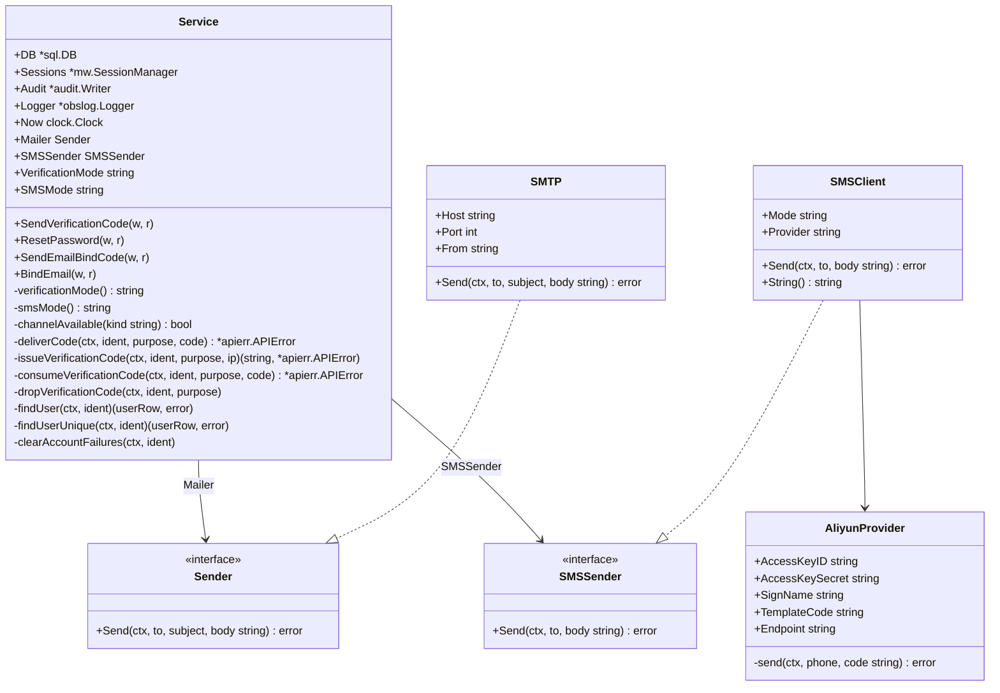
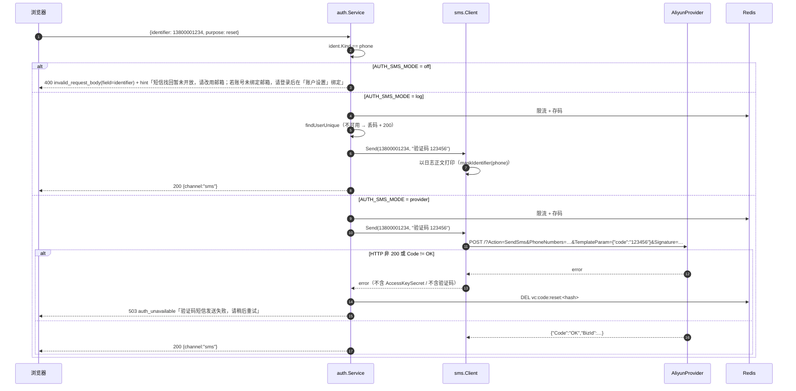
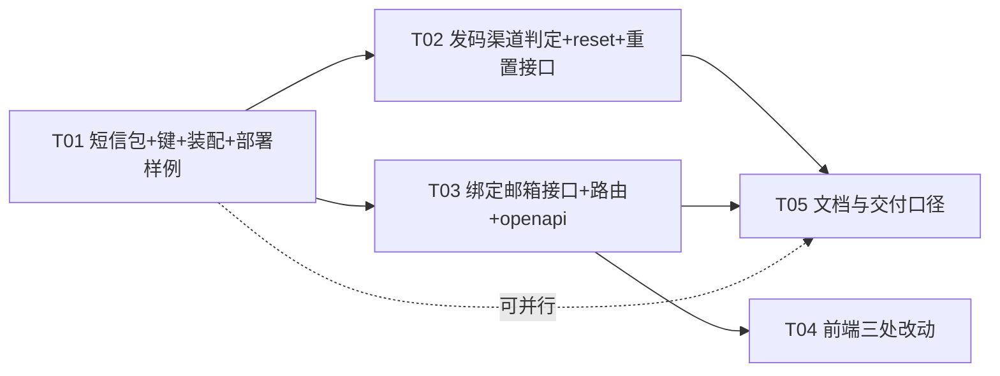

# 增量技术设计：密码自助找回（邮箱 / 短信）与登录邮箱绑定

| 项目 | 内容 |
| :--- | :--- |
| 上游 PRD | `docs/tasks/INC-password-recovery-prd.md`（245 行，已定稿） |
| 主理人裁定 | ① 自助重置成功后 `password_is_initial=0`；② `purpose=reset` 每日发码配额 **10 次/地址**；③ 超管代重置（P1-1）**本轮不做**，遗留缺口按 §10 写清 |
| 范围 | 增量。只描述本次变更，不含实现代码 |
| 事实基线 | 全部结论来自逐文件实测：`internal/control/auth/{verifycode,login,password,profile,register,normalize,guard,handler}.go`、`internal/control/mw/{session,csrf}.go`、`internal/control/server.go`、`internal/notify/mail/smtp.go`、`internal/redisx/keys.go`、`cmd/controld/main.go`、`web/src/{pages,api,lib}`、`api/openapi.yaml` |

---

## 0. 方案结论速查（工程师只看这一节也能确认口径）

| # | 结论 | 一句话理由 |
| :--- | :--- | :--- |
| A1 | 匿名发重置码**复用** `POST /api/v1/auth/verification-code`，`purpose` 扩为 `login\|register\|reset\|bind` | 发码接口的「零区分 200」和 IP 小时配额都是**按路径共享**的，新开路径等于把单 IP 每小时发信上限从 10 提到 20，直接放宽既有基线 |
| A2 | 重置提交**一次请求**（验码 + 新密码），不做「验码换 ticket」两步 | 少一个 ticket 命名空间；配合固定顺序「字段 → 密码规则 → 验码 → 写库」，弱密码不会烧掉码 |
| A3 | 绑定邮箱是**两个新接口** `POST /auth/email/code` + `POST /auth/email`，**不塞进** `PATCH /auth/profile` | profile 里 `nickname` 是必填的未验证字段，混进「已验码的登录标识写入」会让一次请求同时有未验证与已验证两种语义，失败时（昵称已存、邮箱 409）无法定义整体结果 |
| A4 | 新增 `internal/notify/sms` 包，`AUTH_SMS_MODE=off\|log\|provider`（默认 `off`），`provider` 缺凭据**拒绝启动** | 短信按条计费且尚未签供应商，与邮件通道的开通时间不可能同步，必须独立开关 |
| A5 | 供应商驱动只手写 **阿里云 Dysmsapi RPC 签名**（stdlib：`crypto/hmac`+`sort`+`net/http`），不引入 SDK | 新 SDK 会带进一整套传递依赖与凭据处理路径；签名函数是纯函数，可用固定输入做黄金测试 |
| A6 | **不加列、不加迁移**：不加 `email_verified_at` | 写入前已消费 `purpose=bind` 的验证码，`t_user.email` 非空即等于「已验证」；再加一列会出现「有 email 但 verified_at 为空」的第三种状态，需要额外的读侧分支与回填 |
| A7 | 手机号查账号**继续用 `phone` 明文列**，不改成 `phone_hmac` | `phone_hmac` 自 0011 建列以来**没有任何 Go 代码写入**（见 C1），改成 hmac 查询会让现存手机号账号 100% 查不到 —— 这是本轮最容易「照着任务说明改」改出的生产事故 |
| A8 | 重置成功额外做三件事：`password_is_initial=0`、`RevokeAll(uid)`、**清 K28 账号失败计数** | 前两条是 PRD；第三条避免「忘记密码 → 试错 5 次被锁 15 分钟 → 重置成功却登不进去」的闭环陷阱（不改 IP 维度预算，见 §5.6） |
| A9 | `AUTH_VERIFICATION_MODE=off` 的部署里，重置与绑定**一律 400 拒绝**（fail closed） | 没有验证码就没有身份证明；此时放行等于「知道邮箱即可重置任何人」 |

---

## 1. 目标与非目标

### 1.1 目标（与 PRD §1.2 一致）

1. 任意账号凭**自己掌握的一个渠道**（邮箱或手机号）重设密码并立刻登录，全程不接触 DBA/管理员。
2. 绑定邮箱上线后，系统内不再存在「有密码但没有任何可验证找回渠道」的账号类型；超管兜底从「改库」降为「改环境变量重启」。
3. 不扩大账号枚举面、不放宽既有四维限流、不让旧会话在改密后存活。

### 1.2 非目标（本轮明确不做）

- 超管代重置（P1-1）、更换已绑定邮箱（P1-2）、重置成功通知信（P1-3）、短信通道实网开通（P1-4，仅做协议与驱动）。
- 手机号自助注册、重置链接 / token-in-URL、按用户名找回、密保问题 / TOTP / 备用码。
- 密码历史、复杂度策略升级、「新密码 ≠ 旧密码」校验（P2-3）。
- 不新增错误码；不改登录 / 注册 / 改密三条既有接口语义（唯一变化是 `verification-code` 的 `purpose` 枚举扩项）。

---

## 2. 冲突与修正（任务说明 / PRD vs 代码实测）

> 这一节是本设计的「施工红线」。每条都是实测结论，不是推测。

### C1 手机号唯一性在 `phone_hmac`，但 `phone_hmac` **没有写入方** —— 不可按 hmac 查账号

> **本节结论已被后续增量关闭（2026-11-04）**：`INC-phone-hmac-design.md` 已补上 `phone_hmac` 的写入方（`insertUserRow` / 运营建号 / bootstrap / `seedctl` / 夹具）、存量回填命令 `cmd/backfill-phone-hmac`，并把 `fund/trial.go` 的等值判重切到 hmac。登录与找回**仍然按明文 `phone` 查**（这是 A6/A7 的刻意选择，不是欠账）。本节保留作历史记录。

任务说明要求「按手机号查账号必须用 hmac，不能查 `phone`」。实测：

- `internal/platform/migrate/sql/mysql/0011_user_phone_hmac.sql` 建了 `phone_hmac char(64)` + `uk_user_phone_hmac`，并 `DROP` 了 `uk_user_phone`。
- `grep phone_hmac` 在 `*.go` 里只有 `register.go` 的两处**注释**；`insertUserRow` 的列清单里**没有** `phone_hmac`（14 列：`user_no, username, email, phone, password_hash, password_algo, password_updated_at, nickname, role, status, agreement_version, agreed_at, created_at, updated_at`）。
- 结论：现存每一行的 `phone_hmac` 都是 `NULL`，`uk_user_phone_hmac` 恒不冲突；`login.go:findUser` 按 `phone` 明文列查询，是当前**唯一**能查通的写法。

**本设计的选择**：`findUser` 与新增的找回/绑定路径**继续按 `phone` 明文列查询**，不做 hmac 切换。若照任务说明改，结果是：所有手机号账号（含已有手机号登录用户）**立即全部查不到**，登录与找回同时失效 —— 这会把「忘记密码」升级成「所有人都进不来」。

**代价与补偿**（必须在评审里被看见）：

- `phone` 无唯一键，理论上允许两行同号；`QueryRow` 会静默取第一行。对找回而言这会「重置错账号」。
- 补偿：新增 `findUserUnique()`（`LIMIT 2`，命中 2 行视为**不可用账号**），**只用于**发码/重置/绑定三个新路径；登录路径保持原样（不在本次语义变更范围）。见 §3.2 与 §5.4。
- 遗留：写成 §10-R5，建议下一增量单独做「`phone_hmac` 写入 + 存量回填 + 全链路切 hmac」，本轮不碰。

### C2 `verification-code` 的「手机号一律拒绝」是硬编码，不是按渠道判定

`verifycode.go:140` 是 `if ident.Kind != "email" { 400 }`，注释写的是「SMS 已实现但刻意不开、按条计费」。本设计把它换成 `channelAvailable(kind)` 判定（`AUTH_SMS_MODE` 进 `Service`），**错误码与 hint 文案对 `off` 模式保持不变**，因此前端与既有测试的既有断言不破。

### C3 `internal/notify/mail` 的通道机制不能照搬到短信

`mail.ChannelsFromEnv` 支持「无前缀默认通道 + 任意 `SMTP_<NAME>_*` 命名通道 + `AUTH_SMTP_CHANNEL` 选择」。那套机制存在的前提是：**一个协议、多个中继**。短信是「多个协议、每家一套完全不同的凭据」，命名通道只会造出 `SMS_ALIYUN_ALIYUN_ACCESS_KEY_ID` 这种废话。本设计改成：`AUTH_SMS_MODE` 选**驱动**，凭据用各家自己的前缀（`ALIYUN_SMS_*`），新增一家供应商 = 新增一个文件 + 一个 `case`。

### C4 `auth.Sender` 只有三参（`to, subject, body`），短信没有 subject

不为了「同形态」硬造一个空 subject：那会让调用点写出 `Send(ctx, phone, "", text)`，评审者无法判断 code 到底进了哪个参数。本设计在 `auth` 包内**再声明一个消费侧接口**：

```go
// auth 包（消费侧声明，与既有 Sender 完全同一个模式）
type SMSSender interface{ Send(ctx context.Context, to, body string) error }
```

`internal/notify/sms.Client` 结构化满足它，`control.Deps` 直接注入具体类型，无需适配器 —— 与 `mail.SMTP` 满足 `auth.Sender` 的方式一致。

### C5 `docs/redis-keys.md` 里**整族**验证码键都没登记

PRD §8.5 说「补 `reset`/`bind` 命名空间」，实测该文档的键清单只有 K1–K30，`vc:code / vc:cool / vc:quota / vc:ipq` 一个都没有。所以文档任务不是「补两个用途」，而是**新增一节「验证码键族（K-VC）」**，把现有 4 个键与本次新增的 1 个一起写清。

### C6 `web/src/api/types.ts` 是 `openapi-typescript` 生成的，但 `verification-code` 压根不在 `api/openapi.yaml` 里

实测 `api/openapi.yaml` 的 `paths` 有 register/login/me/profile/logout/password/cancel，**没有** `verification-code`；前端登录页是自己写内联类型调用的。这是既有契约漂移。本设计：新增的 3 个接口**全部**写进 `api/openapi.yaml` 并 `npm run gen:api` 重新生成 `types.ts`；`verification-code` 的回填列为 P2（不阻塞，因为本次对它的改动只有服务端枚举与文案）。

### C7 PRD §8.2 写的路径 `web/src/lib/api/*` 不存在

实际目录是 `web/src/api/*`（`client.ts`、`console.ts`、`types.ts`…），`errorHint/errorMessage` 从 `@/api/client` 导。设计按**真实目录**写。

### C8 PRD P0-5③「页脚文案按 `AUTH_SMS_MODE` 改写」在前端拿不到真相

SPA 读不到服务端环境变量，`GET /auth/capabilities` 是 P2-1。两个可选：
(a) 保持静态文案「短信验证码未开放」；(b) 引入构建期 `VITE_AUTH_SMS_ENABLED`。

本设计选 **(b)** 并如实标注它的代价：这是服务端 `AUTH_SMS_MODE` 的**部署期镜像**，两者必须一起翻；翻错的表现是「页脚说支持短信、实际 400」。选它的原因是 PRD 明确要求「按实际开放情况改写」，而 (a) 在短信开通后必然变成错误文案。P2-1 落地后删掉这个变量。

---

## 3. 接口契约

所有路径前缀 `/api/v1`。错误信封沿用 `{error:{code,type,message,hint,request_id,...}}`（见 `docs/error-codes.md`），前端用 `errorMessage(err)` / `errorHint(err)` 取值，**不新增错误码**。

### 3.1 `POST /api/v1/auth/verification-code`（改）

**鉴权**：无会话（`s.public`），无 CSRF（结构上不进 CSRF 链）。

请求：

```json
{ "identifier": "a@b.com | 13800001234", "purpose": "login | register | reset" }
```

`bind` **不作为**该接口的合法 `purpose`：绑定发码必须已登录，走 §3.3。传 `bind` 在此接口返回 `400 invalid_request_body`（field=`purpose`）。

响应 200（`email` 与 `sms` 两种渠道**同一形状**）：

```json
{ "channel": "email", "expires_in": 600, "resend_after": 60 }
```

| 情况 | 状态 | code | hint |
| :--- | :--- | :--- | :--- |
| `purpose` 非法（含 `bind`） | 400 | `invalid_request_body` | `purpose 只能是 login、register 或 reset` |
| `identifier` 无法归一化 / 是用户名 | 400 | `invalid_request_body` | 用户名：`用户名仅用于运营账号，请使用邮箱或手机号`（不变） |
| `AUTH_VERIFICATION_MODE=off` | 400 | `invalid_request_body` | `本部署未启用验证码…`（不变） |
| 手机号 + `AUTH_SMS_MODE=off` | 400 | `invalid_request_body`（field=`identifier`） | `短信找回暂未开放，请改用邮箱；若账号未绑定邮箱，请登录后在「账户设置」绑定` |
| `purpose=register` 且邮箱已注册 | 409 | `account_exists` | `该邮箱已注册，请直接登录`（不变） |
| 同地址 60s 内重发 | 429 | `rpm_limit_exceeded` | 不变 |
| 同地址日配额用尽（reset=10、其余=20） | 429 | `rpm_limit_exceeded` | 不变 |
| 同 IP 每小时 >10 | 429 | `rpm_limit_exceeded` | 不变 |
| 投递通道未配置（smtp 无 mailer / provider 无 sender） | 503 | `auth_unavailable` | 不变 |
| 投递失败（SMTP / 短信 RPC 报错） | 503 | `auth_unavailable` | 邮件：`验证码邮件发送失败，请稍后重试`；短信：`验证码短信发送失败，请稍后重试` |
| **`purpose=reset` + 账号不存在 / 已软删 / `status<>NORMAL` / 手机号歧义** | **200** | — | 响应体与正常发送**逐字节相同**，**不发送任何消息**，已存的码被丢弃 |

`purpose=reset` 的判定顺序（固定）：

```
decode → purpose 校验 → NormalizeIdentifier → RequireEmailOrPhone
  → AUTH_VERIFICATION_MODE=off? 400
  → channelAvailable(ident.Kind)? 否 → 400 + 渠道 hint
  → （仅 register）查已注册 → 409
  → issueVerificationCode（IP/冷却/日配额 + 存码，照旧，探测也要付费）
  → （仅 reset）findUserUnique：不存在/软删/status≠NORMAL/歧义 → dropVerificationCode + 200 裸返回
  → deliverCode：失败 → 逐渠道 hint + 503
  → 200 {channel, expires_in, resend_after}
```

两个刻意的顺序决定：

- **限流在账号查询之前**：否则「查询耗时差」会变成存在性信号，且探测可以绕开限流预算。代价是「输入错误邮箱也会消耗一次 60s 冷却」—— 与今天 `login` 的行为一致。
- **码先存再丢**：`dropVerificationCode` 保证「探测产生的码」不会在某天账号被创建后变成可用的重置凭据。

### 3.2 `POST /api/v1/auth/password/reset`（新）

**鉴权**：无会话（`s.public`）。**已登录用户调用同样生效**，且其当前会话一并失效（D6）。CSRF：结构上豁免（`public()` 路由，不进 CSRF 链）；安全性论证见 §5.8。

请求：

```json
{ "identifier": "a@b.com", "code": "123456", "new_password": "..." }
```

成功：`204`，**不设任何 cookie**（不签发会话，不自动登录）。

| 情况 | 状态 | code | hint |
| :--- | :--- | :--- | :--- |
| JSON 坏 / 空 body | 400 | `invalid_request_body` | 不变 |
| `identifier` 无法归一化 | 400 | `invalid_request_body`（field=`identifier`） | — |
| `identifier` 是用户名 | 400 | `invalid_request_body`（field=`identifier`） | `用户名不能用于找回密码，请使用邮箱或手机号` |
| `new_password` 不合规（8..72 字节 / 纯空白） | 400 | `invalid_request_body`（field=`new_password`） | 与注册/改密同一套文案 |
| `code` 为空 | 400 | `invalid_request_body`（field=`code`） | — |
| `AUTH_VERIFICATION_MODE=off` | 400 | `invalid_request_body` | `本部署未启用验证码，无法自助重置，请联系管理员` |
| 码错 / 过期 / 从未申请 / 尝试超限 / 账号不可用 | 401 | `invalid_credentials` | `验证码不正确或已过期` + `请确认 6 位数字是否输完整；已过期就重新获取`（复用 `verificationInvalid()`） |
| Redis 不可用 / 吊销失败 | 503 | `auth_unavailable` | — |

**校验顺序（PRD P0-2②，硬要求）**：

```
decode → normalize → RequireEmailOrPhone → verificationMode!=off
  → validatePassword(new_password)          ← 早于验码：弱密码不烧码
  → code 非空
  → consumeVerificationCode(purpose=reset)  ← 一次一用，5 次错误销毁
  → findUserUnique(identifier)              ← 验码之后才查库
  → bcrypt(cost 12)
  → 事务：UPDATE t_user + INSERT 审计
  → RevokeAll(uid)  ← 失败 → 503（密码已改，不能谎报 204）
  → ClearCookie + ClearCSRFCookie + clearAccountFailures(ident)
  → 204
```

`findUserUnique` 在验码之后的原因：验码是零成本、零区分的一步，先做它可以让「账号存在性」不再影响前 6 步的任何可观测行为。若验码通过但账号查不到 / `status<>NORMAL`（理论不可达，因为发码阶段已丢弃），仍返回同一个 `invalid_credentials` —— 不引入 404/409。

**`password_is_initial = 0`**（主理人裁定 1）：用户自己设的密码，横幅「仍在使用初始密码」是事实错误。`1` 只保留给「引导创建」与「DBA 直改库」。

### 3.3 `POST /api/v1/auth/email/code`（新，已登录）

**鉴权**：`s.authed(mw.PermAccountWrite, ...)` → 会话 + CSRF（`X-CSRF-Token` 必须等于 `csrf` cookie）。与 `PATCH /auth/profile` 同一权限点：这是「改自己的资料」，不是运营侧的 `user.write`。

请求：`{ "email": "me@example.com" }`
成功：`200 { "channel": "email", "expires_in": 600, "resend_after": 60 }`

| 情况 | 状态 | code | hint |
| :--- | :--- | :--- | :--- |
| 邮箱格式非法 | 400 | `invalid_request_body`（field=`email`） | — |
| **当前账号 `email` 非空** | 400 | `invalid_request_body`（field=`email`） | `当前账号已绑定登录邮箱；更换邮箱请提交工单` |
| 邮箱已被其他账号占用 | 409 | `account_exists` | `该邮箱已被使用`（**不发送**） |
| `AUTH_VERIFICATION_MODE=off` | 400 | `invalid_request_body` | `本部署未启用验证码，无法验证邮箱` |
| 60s 冷却 / 地址日配额 / **账号日配额** / IP 小时 | 429 | `rpm_limit_exceeded` | 按命中维度给 hint |
| 投递失败 | 503 | `auth_unavailable` | `验证码邮件发送失败，请稍后重试` |

- 用途 `purpose=bind`，与 `login/register/reset` 键空间隔离。
- 邮件正文必须是**绑定专用**文案（「你正在为云枢账号绑定登录邮箱」+ 6 位码 + 「非本人操作请忽略」），不能复用登录码正文：同一封泛化文案既可以当登录码也可以当绑定码时，钓鱼与误操作都无迹可寻。
- 409 的存在性披露：`POST /auth/verification-code{purpose:register}` 今天就已匿名 409 披露「某邮箱已注册」，绑定侧沿用同一口径（且调用者已登录），不构成新增泄漏面。

### 3.4 `POST /api/v1/auth/email`（新，已登录）

**鉴权**：同 §3.3（会话 + CSRF + `account.write`）。

请求：`{ "email": "me@example.com", "code": "123456" }`
成功：`200 { "user": { ...AuthUser，含新的 email } }`

| 情况 | 状态 | code | hint |
| :--- | :--- | :--- | :--- |
| 字段非法 / 当前邮箱非空 | 400 | `invalid_request_body` | 同 §3.3 |
| 码错 / 过期 / 未申请 / 超限 | 401 | `invalid_credentials` | `验证码不正确或已过期` |
| 唯一键冲突（`uk_user_email`，1062）或并发下已被绑定 | 409 | `account_exists` | `该邮箱已被使用` |
| DB 错误 | 500 | `internal_error` | — |

写入语义：

```sql
UPDATE t_user SET email = ?, updated_at = ?
 WHERE id = ? AND deleted_at IS NULL AND (email IS NULL OR email = '')
```

`RowsAffected = 0` → 409（并发下已被绑定或被占用），**不允许**「覆盖已有邮箱」。写入与审计同事务。**不吊销会话**（PRD P0-3⑤）：绑定不改变 `role`/`status`/`password_hash`，当前会话绑的是 uid，`Session.Load` 每次都重读 `t_user`，所以下一次 `/auth/me` 自然带出新邮箱。

审计行：`module=USER`、`action=UPDATE`、`target_type=t_user`、`target_id=<uid>`、`operator_id=<uid>`、`operator_role=<row.role>`、`result=OK`、`after_json={"email_changed":true,"email":"<maskIdentifier 结果>"}`。**不含明文邮箱**（`a***@x.com` 已足够定位）。

### 3.5 路由与权限挂载点（`internal/control/server.go:Register`）

```go
// 公开：无会话、无 CSRF（结构上不进 authed 链）
mux.Handle("POST /api/v1/auth/password/reset", s.public(s.auth.ResetPassword))

// 已登录：会话 + CSRF + account.write
mux.Handle("POST /api/v1/auth/email/code", s.authed(mw.PermAccountWrite, s.auth.SendEmailBindCode))
mux.Handle("POST /api/v1/auth/email",      s.authed(mw.PermAccountWrite, s.auth.BindEmail))
```

`docs/control-api.md` 的 CSRF 豁免表要**显式加一行** `POST /api/v1/auth/password/reset`（并列理由）；虽然 `public()` 已经让它结构豁免，豁免表是给评审者看的口径，缺一行就等于「没人知道它为什么可以不校验」。

### 3.6 控制器与依赖（结构）



---

## 4. 数据与键空间

### 4.1 数据库：不加列、不加迁移（核实结论）

| 需求 | 结论 |
| :--- | :--- |
| `email` 写入 | `t_user.email`（varchar，`uk_user_email` 唯一，NULL 可重复）已存在 |
| 「未验证邮箱」状态 | **不需要**：写入前必须消费 `purpose=bind` 的码，所以「`email` 非空」恒等于「已验证」。**明确不加 `email_verified_at`**：加了就会产生「有 email 但未验证」的中间态，需要读侧到处判空，且存量行要回填，收益为 0 |
| 重置后的字段 | `password_hash`、`password_updated_at`、`password_is_initial=0`、`updated_at` 均已存在 |
| 审计 | `t_admin_audit_log` 的 `action` 词表沿用 `UPDATE`，不新增动作值 |
| 软删语义 | 软删行的 `email` 已被改写为 `#del#{id}#{unix_ms}`，原邮箱因此可被重新绑定；找回按「无有效账号」处理 |

迁移版本号维持现状（实测最大 `0028`）。**本轮无迁移**，所以 `go-live-checklist` 的「迁移已到最新」项不变。

### 4.2 Redis 键（沿用既有键族，不新增族）

| 键 | 构造函数 | 本次变化 |
| :--- | :--- | :--- |
| `vc:code:<purpose>:<sha256(id)[:32]>` | `VerifyCodeKey` | 新增 `purpose ∈ {reset, bind}`（purpose 进 key ⇒ 跨用途重放必失败） |
| `vc:cool:<purpose>:<hash>` | `VerifyCodeCooldownKey` | 同上 |
| `vc:quota:<purpose>:<hash>` | `VerifyCodeQuotaKey` | 同上；`reset` 日配额 **10**（裁定 2）、`bind` 地址日配额 10 |
| `vc:ipq:<sha256(ip)>:<YYYYMMDDHH>` | `VerifyCodeIPQuotaKey` | **不变，且故意不按 purpose 拆分**：单 IP 每小时发信总上限维持 10，新增两个用途不放大它 |
| `vc:quota:<purpose>:uid:<uid>` | **新增** `VerifyCodeUIDQuotaKey(purpose, uid)` | 绑定发码的账号维度日配额（5/天）。存在理由是「一个已登录账号不能变成向任意邮箱投递的免费发信器」；键仍在 `vc:quota:` 命名空间内，不属于新键族 |

`vc:code:<purpose>:<hash>:n`（尝试计数）沿用 `consumeVerificationCode` 里已有的 `codeKey + ":n"` 约定。

### 4.3 配置变量

| 变量 | 默认 | 取值 | 说明 |
| :--- | :--- | :--- | :--- |
| `AUTH_SMS_MODE` | `off` | `off` / `log` / `provider` | 与 `AUTH_VERIFICATION_MODE` **分开**。`provider` 缺凭据 → controld **拒绝启动**（与 `smtp` 无通道即拒启一致） |
| `ALIYUN_SMS_ACCESS_KEY_ID` | 空 | — | `provider` 时必填 |
| `ALIYUN_SMS_ACCESS_KEY_SECRET` | 空 | — | 同上；**日志/错误里永不出现** |
| `ALIYUN_SMS_SIGN_NAME` | 空 | 已报备的签名 | 必填，必须与报备一致，否则供应商侧报 `isv.SIGN_NAME_ILLEGAL` |
| `ALIYUN_SMS_TEMPLATE_CODE` | 空 | `SMS_xxxxxx` | 必填，模板变量固定为 `${code}`（报备时就要按此申请） |
| `ALIYUN_SMS_ENDPOINT` | `https://dysmsapi.aliyuncs.com` | — | 允许指向测试桩 |
| `VITE_AUTH_SMS_ENABLED` | `false` | `false` / `true` | **仅**前端页脚文案；服务端 `AUTH_SMS_MODE` 的部署期镜像，两者必须同时翻（见 C8） |

`AUTH_SMS_MODE` 与 `AUTH_VERIFICATION_MODE` 的组合矩阵（`docs/deploy` 里要写清）：

| 邮件模式 / 短信模式 | 行为 |
| :--- | :--- |
| `off` / 任意 | 所有发码 400；重置与绑定 400（A9 fail closed） |
| `log` 或 `smtp` / `off` | 邮箱全通；手机号 400 + 「短信找回暂未开放…」+ 绑定邮箱建议 |
| `log` 或 `smtp` / `log` | 短信码打到日志（仅开发/CI，启动 WARN） |
| `log` 或 `smtp` / `provider` | 短信实网发送；启动 INFO 打印 `sms provider=aliyun sign=... template=...`（无凭据） |

---

## 5. 时序图

### 5.1 匿名自助重置（邮箱渠道，正常路径）

```mermaid
sequenceDiagram
    autonumber
    participant U as 浏览器
    participant R as control(router)
    participant A as auth.Service
    participant RDS as Redis
    participant DB as MySQL
    participant M as SMTP

    U->>R: POST /auth/verification-code {identifier: a@b.com, purpose: reset}
    R->>A: SendVerificationCode
    A->>A: NormalizeIdentifier / RequireEmailOrPhone
    A->>A: smsMode/emailMode 判定渠道可用
    A->>RDS: INCR vc:ipq:<ip>:<hour>（>10 → 429）
    A->>RDS: SETNX vc:cool:reset:<hash>（失败 → 429）
    A->>RDS: INCR vc:quota:reset:<hash>（>10 → 429）
    A->>RDS: SET vc:code:reset:<hash> = sha256(code)，TTL 600s
    A->>DB: findUserUnique(a@b.com)（deleted_at IS NULL，LIMIT 2）
    alt 不存在 / 软删 / status<>NORMAL / 手机号歧义
        A->>RDS: DEL vc:code:reset:<hash>（+ :n）
        A-->>U: 200 {channel, expires_in, resend_after}（不发信）
    else 可用账号
        A->>M: Send(a@b.com, 云枢验证码, 6 位码)
        alt 发送失败
            A->>RDS: DEL vc:code:reset:<hash>
            A-->>U: 503 auth_unavailable
        else
            A-->>U: 200 {channel:"email", expires_in:600, resend_after:60}
        end
    end

    U->>R: POST /auth/password/reset {identifier, code, new_password}
    R->>A: ResetPassword（public，无 CSRF）
    A->>A: 字段校验 → validatePassword（400 且不碰码）
    A->>RDS: GET vc:code:reset:<hash>；ConstantTimeCompare
    alt 码不匹配
        A->>RDS: INCR vc:code:reset:<hash>:n（≥5 → DEL 码）
        A-->>U: 401 invalid_credentials
    else 码正确
        A->>RDS: DEL vc:code:reset:<hash>（一次一用）
        A->>DB: findUserUnique(identifier)
        A->>A: bcrypt.GenerateFromPassword(cost 12)
        A->>DB: BEGIN; UPDATE t_user SET password_hash, password_updated_at, password_is_initial=0; INSERT 审计; COMMIT
        A->>RDS: RevokeAll(uid)（K30 → 逐 DEL K20）
        alt 吊销失败
            A-->>U: 503 auth_unavailable（密码已改，不谎报 204）
        else
            A->>RDS: DEL auth:fail:acct:<hash(identifier)>
            A-->>U: 204（不设 cookie）
        end
    end
```

### 5.2 手机号渠道与 `AUTH_SMS_MODE` 降级



### 5.3 绑定登录邮箱（已登录）

```mermaid
sequenceDiagram
    autonumber
    participant U as 账户设置页
    participant R as control(router)
    participant A as auth.Service
    participant DB as MySQL
    participant RDS as Redis
    participant M as SMTP

    U->>R: POST /auth/email/code {email}（带 X-CSRF-Token）
    R->>R: Session 中间件 → CSRF → Require(account.write)
    R->>A: SendEmailBindCode
    A->>DB: SELECT COALESCE(email,'') FROM t_user WHERE id=sess.UID
    alt 当前 email 非空
        A-->>U: 400 「当前账号已绑定登录邮箱；更换邮箱请提交工单」
    else
        A->>DB: SELECT 1 FROM t_user WHERE email=? AND deleted_at IS NULL
        A-->>U: 409 account_exists（若已占用，不发信）
        A->>RDS: INCR vc:ipq / SETNX vc:cool:bind / INCR vc:quota:bind / INCR vc:quota:bind:uid
        A->>RDS: SET vc:code:bind:<hash(email)>
        A->>M: Send(email, 绑定邮箱验证码, 专用正文)
        A-->>U: 200 {channel:"email"}
    end

    U->>R: POST /auth/email {email, code}
    R->>A: BindEmail（会话 + CSRF + account.write）
    A->>RDS: consumeVerificationCode(bind, email, code)
    A->>DB: BEGIN; UPDATE t_user SET email=? WHERE id=? AND deleted_at IS NULL AND (email IS NULL OR email=''); INSERT 审计(email_changed, masked); COMMIT
    alt 1062 或 RowsAffected=0
        A-->>U: 409 account_exists「该邮箱已被使用」
    else
        A-->>U: 200 {user{email}}（不吊销会话）
    end
```

---

## 6. 短信通道抽象（`internal/notify/sms`）

### 6.1 文件与职责

| 文件 | 职责 |
| :--- | :--- |
| `internal/notify/sms/sms.go` | 模式解析（`Mode`/`ParseMode`）、`Client`（实现 `Send`）、`FromEnv()`、`ErrNotAvailable`/`ErrNotConfigured`、`String()`（不含密钥） |
| `internal/notify/sms/aliyun.go` | `AliyunProvider`：RPC 签名纯函数（`percentEncode`、`canonicalQuery`、`sign`）+ `SendSms` HTTP 调用（`net/http`，10s 超时） |
| `internal/notify/sms/sms_test.go` | 模式矩阵、缺凭据拒启、log 模式不触网、签名黄金测试、provider 错误映射 |

### 6.2 模式与启动校验

```go
const (
    ModeOff      = "off"      // 默认：手机号渠道不可用，发码接口 400 + hint
    ModeLog      = "log"      // 开发/CI：码打到 controld 日志正文
    ModeProvider = "provider" // 实网发送，缺凭据拒绝启动
)
```

`FromEnv()` 的行为（`cmd/controld/main.go` 调用，与 `mail.ChannelsFromEnv` 同样「启动期报错，不拖到首次发送」）：

- 空值 → `off`。
- 非法值 → `error`（`AUTH_SMS_MODE must be off, log or provider, got …`）→ 进程 `os.Exit(1)`。
- `off` / `log` → 返回可用 `*Client`，**不读任何凭据**。
- `provider` → 校验 5 个必填项，任一为空 → `error` 列出缺失变量名（**不打印任何值**）→ 进程 `os.Exit(1)`。
- `log` 模式在 `main.go` 打 WARN：`AUTH_SMS_MODE=log: 验证码会打印到本日志，不会真实下发 —— 生产环境请设为 provider`（与既有 `AUTH_VERIFICATION_MODE=log` 的 WARN 同一形态）。

### 6.3 发送接口与失败处理

```go
// Send 发一条纯文本短信。off 模式返回 ErrNotAvailable（不代表成功）。
func (c *Client) Send(ctx context.Context, to, body string) error
```

- `off`：返回 `ErrNotAvailable`。**不会**走到这个分支（发码接口在更早的地方已 400），但保留它作为「有人漏判模式」时的最后一道闸。
- `log`：以日志正文（不是结构化字段）打印 `sms_code_log_mode to=<maskIdentifier> body=<含码正文>`，返回 `nil`。
- `provider`：调用供应商；错误信息只包含供应商的 `Code`/`Message` 与 HTTP 状态，**绝不含** `AccessKeySecret`、完整手机号、验证码。

失败处理与邮件路径**逐条对齐**（复用一个 `deliverCode` helper）：

1. 先 `dropVerificationCode`（已存但未送达的码对用户不可用，还会把他卡在 60s 冷却后）；
2. 记 ERROR 日志（不含码、不含完整号码）；
3. 返回 `503 auth_unavailable` + 渠道专属 hint。

### 6.4 阿里云签名（必须可单测）

```
StringToSign   = "GET" + "&" + percentEncode("/") + "&" + percentEncode(CanonicalizedQueryString)
Signature      = base64( HMAC-SHA1( AccessKeySecret + "&", StringToSign ) )
CanonicalizedQueryString = 公共参数 + 业务参数，按 key 字典序，k=v 用 "&" 连接
公共参数：AccessKeyId, Action=SendSms, Format=JSON, RegionId=cn-hangzhou,
         SignatureMethod=HMAC-SHA1, SignatureNonce=<随机>, SignatureVersion=1.0,
         Timestamp=<UTC ISO8601 秒级>, Version=2017-05-25
业务参数：PhoneNumbers=<E.164 去 +>, SignName, TemplateCode, TemplateParam={"code":"123456"}
```

`percentEncode` 规则（易错，必须写进注释与测试）：字母/数字/`-`/`_`/`.`/`~` 不编码；空格 → `%20`；`*` → `%2A`；其余按 UTF-8 字节 `%XX` 大写。

**单测口径**（这是「签名可被覆盖」的落地方式）：

1. 固定输入（固定 nonce / timestamp / 参数集）→ 断言 `canonicalQuery` 的**逐字字符串**（排序、`%2A`、`%20` 全部体现）；
2. 断言 `Signature == base64(hmacSHA1(secret+"&", "GET&%2F&"+pct(cqs)))`，其中测试**自己**用 `crypto/hmac`+`base64` 重算，**不复用**实现里的 `percentEncode`/排序 —— 这样排序或编码的回归才会被抓到；
3. `SendSms` 用 `httptest.Server` 桩：断言请求里 `Signature` 参数存在、`PhoneNumbers` 正确、`TemplateParam` 是 JSON 字符串；桩返回 `{"Code":"isv.BUSINESS_LIMIT_CONTROL"}` → `Send` 返回错误且错误串**不含**密钥与验证码。

---

## 7. 安全与限流

### 7.1 发码限流矩阵（三层 + 账号层，全部沿用既有实现）

| purpose | 地址冷却 | 地址日配额 | 账号日配额 | IP 小时 | 账号可用性检查 |
| :--- | :--- | :--- | :--- | :--- | :--- |
| `login` | 60s | 20 | — | 10（**跨用途共享**） | 不做（现状不动） |
| `register` | 60s | 20 | — | 同上 | 已注册 → 409 |
| `reset` | 60s | **10**（裁定 2） | — | 同上 | 不可用 → **静默 200 + 丢码** |
| `bind` | 60s | 10 | **5**（新增，防发信器） | 同上 | 已占用 → 409 |

`vc:ipq` 不按 purpose 拆分的后果要写进评审记录：**新增两个用途后，单 IP 每小时发信总上限仍是 10**，不是 40。这是本次刻意保持的安全不变式。

### 7.2 验码

- 沿用 `consumeVerificationCode`：`subtle.ConstantTimeCompare` 比对 SHA-256 摘要；错误 `INCR :n`，达到 `verificationMaxAttempts=5` 即 `DEL` 码与计数；成功即 `DEL`（一次一用）。
- 所有失败（错 / 过期 / 未申请 / 超限）统一 `invalid_credentials` + 「验证码不正确或已过期」，**只有**超限时附加 hint「验证码错误次数过多，请重新获取」（既有行为，泄露面仅限「这个地址确实有一个码」，而这只对码的所有者有意义）。

### 7.3 零区分（枚举面）

| 阶段 | 口径 | 测试怎么钉 |
| :--- | :--- | :--- |
| 发码 | 存在 / 不存在 / 软删 / 冻结 / 手机号歧义 → 同一 200、同一 body 字节 | 两组请求分别记录 `httptest` 的 `body`，断言 `bytes.Equal`，并断言 `mailer.sends` 只 +1 |
| 验码 | 五类失败同一 401 + 同一 message/hint | 表驱动，逐项断言 `code/message/hint` 全等 |
| 成功 | 只有真正收到码的人能到 204 | 无码调用必须 401 |

不发「你未注册」的信（PRD §5.1 明确不做）：向未注册地址发信等于让任何人借我们的发信域名向任意邮箱投递，送达率与域名信誉的代价远高于收益。

### 7.4 会话与 CSRF

- 重置成功 → `RevokeAll(uid)`（K30 → 逐 DEL K20，Lua 原子）→ `ClearCookie` + `ClearCSRFCookie`。吊销失败 → 503（密码已改但旧会话仍在，不能 204）。
- 重置**不签发**任何会话（D1：重置常发生在公共设备上；「必须再登一次」是唯一能当场证明新密码正确的环节）。
- 已登录用户访问 `/reset-password` 是允许的；重置成功后他的当前会话也一起失效，前端必须跳 `/login`（用户故事「已登录但忘了旧密码」）。

### 7.5 审计与日志红线

| 事件 | 审计行 | 禁止出现 |
| :--- | :--- | :--- |
| 重置成功 | `module=USER, action=UPDATE, target_type=t_user, target_id=<uid>, operator_id=<uid>, operator_role=<row.role>, result=OK, after={password_updated_at, sessions_revoked:"all", via:"reset:email\|reset:sms"}`（与 DB 更新**同事务**） | 新密码、hash、验证码、完整邮箱/手机号 |
| 绑定邮箱成功 | `module=USER, action=UPDATE, target_type=t_user, target_id=<uid>, operator_id=<uid>, after={email_changed:true, email:"a***@x.com"}`（同事务） | 明文邮箱 |
| 重置被拒（验码失败） | 用 `s.warn`，**不写审计**：审计表是「有权者的操作留痕」，匿名失败写入会被刷成噪声 | 验证码、identifier 明文 |

日志：`log` 模式是唯一允许让码出现在日志里的地方（且那条日志以**正文**形式打印，不进结构化字段）；`provider`/`smtp` 模式下日志里只有 `maskIdentifier` 结果。手机号一律 `138****1234`。

### 7.6 不改冻结语义

`status<>NORMAL` 的账号：发码阶段静默不发、码被丢弃，因此重置永远走不到写库。理由：冻结本身就是一种访问收回，自助找回不能成为绕过它的手段。

### 7.7 不信任客户端

`/password/reset` 与 `/verification-code` 是匿名接口：**禁止**从 body/cookie/header 读取 uid、role、status；目标账号一律由 `identifier` 解析。`/auth/email*` 只作用于会话所属 uid，**不接受** `user_id` 参数。

### 7.8 重置接口为什么可以不做 CSRF 校验

`POST /auth/password/reset` 是无会话接口（`public()`，结构上不进 CSRF 链）。跨站伪造它能达成什么：

- 伪造**受害者**的重置？需要受害者的 6 位码 —— 攻击者拿不到。
- 用受害者浏览器重置**攻击者自己**的账号？只需攻击者自己的码，结果只是攻击者自己的密码变了，无横向影响。

因此 CSRF 在此**不增加任何安全性**；加一个「有会话就校验」的分支反而会让「已登录用户在公共设备上重置」出现 403 这种无法解释的死路。这条要写进 `docs/control-api.md` 的豁免表。

---

## 8. 前端改动

### 8.1 新增 `/reset-password`（`web/src/pages/site/ResetPasswordPage.tsx` + `.test.tsx`）

三态（同一个页面内）：

| 态 | 内容 | 关键约束 |
| :--- | :--- | :--- |
| `identify` | 单输入框「邮箱或手机号」+「发送验证码」 | `autoComplete="username"`；前端只用 `account.includes('@')` 决定是否本地拦截短信（**与服务端 hint 同文案**），不猜账号是否存在 |
| `verify` | 6 位码 + 新密码 + 确认密码 +「重置密码」+「重新获取（60s）」 | `autoComplete="one-time-code"` / `new-password` / `new-password`；倒计时取响应里的 `resend_after`（不写死 60）；文案固定「如果该邮箱/手机号已注册，验证码已发送」——**只用用户自己的输入值**，不显示服务端返回的任何掩码地址 |
| `done` | `role="status"` 提示「密码已重置，请用新密码登录」 | `navigate('/login?identifier=<encodeURIComponent(account)>', {replace:true})` |

- 客户端前置校验只做「6 位数字」「两次密码一致」「≥8 位」，与服务端 `validatePassword` 一致；**不**在前端判「密码是否弱」以外的策略。
- 错误统一 `errorMessage(err)` + `errorHint(err)` 展示（现有组件形态）。
- 375px 宽无横向滚动：复用现有 `Input`/`Button` + `space-y-*`，不引入新布局。
- 页面必须能在**已登录**状态渲染（用户故事「已登录但忘了旧密码」），所以路由挂在 site 布局、不加 `RequireAuth`。

### 8.2 路由与常量

- `web/src/router.tsx`：site 段加 `{ path: 'reset-password', element: <ResetPasswordPage /> }`（放在 `login` 之后）。
- `web/src/lib/constants.ts`：`ROUTES.resetPassword = '/reset-password'`；`ROUTE_TITLES[ROUTES.resetPassword] = '找回密码'`。

### 8.3 登录页（`LoginPage.tsx` + `LoginPage.test.tsx`）

删除：`resetOpen` 状态、`resetDocsRef`、`handleReset`、整块占位面板（含「发送重置链接（暂未开放）」按钮与「密码重置功能暂未开放…」文案）。

改为：

- 「忘记密码」由 `<button onClick={() => setResetOpen(...)}>` 变成 `<Link to={ROUTES.resetPassword}>`（保持贴在密码框下、右对齐的版式）。
- 初始化 `identifier`：`useState(searchParams.get('identifier') ?? '')`（承接重置页跳转回来的预填）。
- 页脚文案：`import.meta.env.VITE_AUTH_SMS_ENABLED === 'true' ? '支持邮箱、手机号或用户名登录。' : '支持邮箱、手机号或用户名登录；短信验证码未开放。'`（C8）。
- 单测：删掉对「暂未开放」面板的断言，新增「点忘记密码 → 跳到 `/reset-password`」「带 `?identifier=` 时输入框预填」两条。既有 `第 101 行`「短信验证码暂未开放，请使用邮箱。」的断言属于**手机号发码拦截**分支，保留（该分支服务端行为不变）。

### 8.4 账户页（`AccountPage.tsx` + `AccountPage.test.tsx`）

新增「登录邮箱」卡片（三态）：

| 态 | 内容 |
| :--- | :--- |
| 已绑定 | 脱敏展示（`a***@x.com`，前端本地掩码，不新增接口）+ 一行「更换登录邮箱请联系客服提交工单」 |
| 未绑定·输入 | 输入框 + 「发送验证码」（`POST /auth/email/code`） |
| 未绑定·验码 | 6 位码 + 「确认绑定」（`POST /auth/email`）→ 成功后 `useAuthStore.setState({user: data.user})` 并回到「已绑定」态 |

- 现有那句「登录邮箱与账号角色不可自助修改；需要变更请提交工单」必须改：改为「登录邮箱在未绑定时可自助绑定；已绑定的更换需提交工单」。
- 注销卡片读 `user?.email`，绑定成功后 store 已更新，因此注销确认框的占位文案自动跟着变（无需改动）。
- 错误沿用 `errorMessage` / `errorHint`；409 走 `account_exists` 的既有文案，不新增前端文案表。

### 8.5 API 层

新增 `web/src/api/auth.ts`（唯一新增文件，避免把四处请求散在页面里）：

```ts
sendResetCode(identifier)            // POST /api/v1/auth/verification-code {identifier, purpose:'reset'}
resetPassword({identifier, code, new_password})  // POST /api/v1/auth/password/reset  → void
sendBindEmailCode(email)             // POST /api/v1/auth/email/code → {channel, expires_in, resend_after}
bindEmail({email, code})             // POST /api/v1/auth/email → {user}
```

请求/响应类型取自生成的 `components['schemas'][...]`；`api.post` 已自动带 `X-CSRF-Token`（`web/src/api/csrf.ts`），四个函数里**不要**手工加 header。

`web/src/api/types.ts`：由 `api/openapi.yaml` 的 3 个新 path 重新 `npm run gen:api` 生成（**不手改**）。这也是 T03 必须先落 `openapi.yaml` 的原因。

### 8.6 前端守卫

`npm run check:copy` 禁 `#hex`（除 `tokens.css`）、禁「云枢API」拼接、禁 `localStorage/sessionStorage`（测试文件豁免 storage 项）。新页面只用 token 类名与 `@/components`，不碰这三条。

---

## 9. 文档改动

| 文件 | 改什么 |
| :--- | :--- |
| `docs/control-api.md` | ① 「验证码（邮箱）」一节改标题为「验证码」，`purpose` 枚举 `login\|register\|reset`，补 `reset` 的「静默 200」语义表与 `channel:"sms"`；② 新增 `POST /auth/password/reset`、`POST /auth/email/code`、`POST /auth/email` 三小节（请求/响应/错误码/hint/CSRF 要求）；③ CSRF 豁免表加 `POST /api/v1/auth/password/reset` + 理由（§7.8）；④ 「初始口令提醒」一节点明：自助重置成功置 0，`1` 只来自引导与 DBA 直改 |
| `docs/ops-runbook.md` §9.1 | 「首登后」加一步：**绑定登录邮箱**（`/console/account` 的「登录邮箱」卡片），这是超管唯一的自救入口 |
| `docs/ops-runbook.md` §9.2 | 改密之外增第一条自救建议：**已登录 → 绑定/使用登录邮箱 → `/reset-password` 自助重置** |
| `docs/ops-runbook.md` §9.3 | **重写**。首选 **A 方案**：把 `ADMIN_BOOTSTRAP_USERNAME` 换成未占用的新用户名 → 重启 controld → 用新超管登录 → 给旧账号绑定邮箱或按其邮箱重置。DBA 直改库降为**最后手段**，并明确：直改库必须 `password_is_initial=1`（口令是别人给的，横幅文案才正确），且必须手工清 K20/K30 与补审计（保留现有四步） |
| `docs/go-live-checklist.md` | 新增一项（接在现有第 27 项「内置超管初始口令已修改」之后）：「内置超管已绑定登录邮箱」——`SELECT COUNT(*) FROM t_user WHERE role='SUPER_ADMIN' AND status='NORMAL' AND deleted_at IS NULL AND email IS NOT NULL;` 结果必须等于超管总数；未绑定即视为未完成上线（否则「唯一超管忘记密码」仍会落回改库） |
| `docs/error-codes.md` | 无新增码（确认）；只在 hint 口径处补三条文案：短信未开放、`invalid_credentials` 在重置场景的 message/hint、绑定邮箱 409 |
| `docs/redis-keys.md` | **新增一节「验证码键族（K-VC）」**（C5）：`vc:code / vc:cool / vc:quota / vc:ipq / vc:quota:<purpose>:uid:<uid>`，写清 `purpose ∈ {login,register,reset,bind}`、TTL（码 600s、冷却 60s、日配额 24h、IP 2h）、以及「`vc:ipq` 故意跨用途共享」 |
| `.env.example` | 加 `AUTH_SMS_MODE=off` 注释段（默认 off；provider 需 `ALIYUN_SMS_*`）+ `VITE_AUTH_SMS_ENABLED=false` 说明 |
| `deploy/.env.stack.example` | 同上，并在 SMTP 段之后新增「短信通道」段（5 个 `ALIYUN_SMS_*` 留空 + 注释「provider 模式留空即拒绝启动」） |
| `deploy/docker-compose.stack.yml` | `x-app-env` 白名单加 `AUTH_SMS_MODE` 与 5 个 `ALIYUN_SMS_*`（`docker compose --env-file` 只做插值，不注入容器；加漏了容器里永远是 off，且没有任何报错）+ web 服务的 `VITE_AUTH_SMS_ENABLED` 构建参数 |

---

## 10. 任务列表（5 个任务，按实现顺序）

> 增量项目没有「项目基础设施」阶段（脚手架、构建配置早已存在），所以 T01 承担等价角色：**其他三个任务都要 import 的包 + 键 + 装配点 + 部署样例**。所有任务粒度按模块而非单文件。

### T01 基础层：短信通道包 + 键空间 + 启动装配（P0，无依赖）

| 项 | 内容 |
| :--- | :--- |
| 文件 | `internal/notify/sms/sms.go`（新）、`internal/notify/sms/aliyun.go`（新）、`internal/notify/sms/sms_test.go`（新）、`internal/redisx/keys.go`（+`VerifyCodeUIDQuotaKey`）、`internal/control/auth/handler.go`（+`SMSSender`/`SMSMode` 字段与 `smsMode()`）、`internal/control/server.go`（`Deps.SMS/SMSMode` + 注入 `authSvc`）、`cmd/controld/main.go`（`AUTH_SMS_MODE` 解析 + 拒启动 + 启动日志）、`deploy/.env.stack.example`、`deploy/docker-compose.stack.yml`、`.env.example` |
| 验收 | ① `go test ./internal/notify/sms/ -run TestSignature` 通过：固定 nonce/timestamp，断言 `canonicalQuery` 逐字 + `Signature` 由测试内独立 HMAC 重算相等；② `TestFromEnv`：`provider` 缺 `ALIYUN_SMS_ACCESS_KEY_SECRET` → 返回 error 且 error 串含变量名、不含值；空值 → `off`；`log` → 不发网络请求（`httptest` 计数器为 0）；③ `AUTH_SMS_MODE=bogus ./controld` 退出码非 0（脚本断言）；④ `go build ./...` 通过 |

### T02 认证域：发码渠道判定 + `purpose=reset` + 重置接口（P0，依赖 T01）

| 项 | 内容 |
| :--- | :--- |
| 文件 | `internal/control/auth/verifycode.go`（purpose 常量加 `reset`；`channelAvailable`；`deliverCode` 抽出；`reset` 的 `findUserUnique` + 丢码 + 静默 200；`reset` 日配额 10）、`internal/control/auth/account.go`（新：`findUserUnique`，`LIMIT 2`，歧义→`ErrAmbiguousAccount`）、`internal/control/auth/reset.go`（新：`ResetPassword`）、`internal/control/auth/verifycode_test.go`（矩阵用）、`internal/control/auth/reset_test.go`（新） |
| 依赖 | T01（`SMSSender`/`SMSMode` 字段与键构造函数） |
| 验收（测试断言什么） | ① `TestPurposeMatrix`：4×4（login/register/reset × 提供的码用途）只有同用途成功，跨用途全部 `invalid_credentials`；② `TestResetSendCodeIndistinguishable`：存在/不存在/软删/`status=DISABLED`/手机号双行 五组，响应 `body` 字节相等且除「存在」组外 `mailer.sends` 不增；③ `TestResetWeakPasswordDoesNotBurnCode`：先用弱密码 `"123"` 拿 400 `invalid_request_body(new_password)`，再用同一码正确重置得 204（码仍有效）；④ `TestResetRevokesAllSessions`：登录两台设备 → 重置 → 两台 `/auth/me` 均 401；⑤ `TestResetAuditRow`：`after_json` 含 `sessions_revoked=all` 与 `via=reset:email`，且不含明文密码/码；⑥ `TestResetDisabledModeFailsClosed`：`VerificationMode=off` 时 400；⑦ `TestResetClearsAccountFailures`：先失败 5 次登录（K28=5）→ 重置成功 → K28 不存在；⑧ `TestResetQuotaTen`：第 11 次 `purpose=reset` 拿 429，而 `purpose=login` 仍可发（两个计数互不干扰） |

### T03 绑定邮箱接口 + 路由挂载 + 对外契约（P0，依赖 T01；与 T02 并行）

| 项 | 内容 |
| :--- | :--- |
| 文件 | `internal/control/auth/bind_email.go`（新：`SendEmailBindCode` + `BindEmail`）、`internal/control/auth/bind_email_test.go`（新）、`internal/control/server.go`（三条路由挂载）、`api/openapi.yaml`（3 个 path + `VerificationCodeRequest.purpose` 加 `reset` + `channel` enum 加 `sms`） |
| 依赖 | T01；**不依赖** T02（各自在不同文件，都可独立编译） |
| 验收 | ① `TestBindCodeRejectsExistingEmail`：账号已有邮箱 → 400 且 `mailer.sends` 不变；② `TestBindCodeConflict`：邮箱属于他人 → 409 `account_exists` 且不发信；③ `TestBindEmailHappyPath`：验码 → 200，`user.email` 为新值，`SELECT email FROM t_user` 已写入，审计行 `after_json` 只有 `email_changed` + 掩码；④ `TestBindEmailDuplicate`：并发/已占用 → 409 而非 500（构造 1062）；⑤ `TestBindDoesNotRevokeSession`：绑定后原 sid 仍可用；⑥ `TestBindQuotaPerUID`：同一账号第 6 次 `bind` 发码 429，换账号不受影响；⑦ `TestBindRequiresCSRF`：缺 `X-CSRF-Token` → 403；⑧ `cd web && npm run gen:api` 后 `git diff --stat src/api/types.ts` 只增不改既有类型 |

### T04 前端：找回页 + 登录页占位清理 + 账户页绑定卡片（P0，依赖 T03 的契约；可按本文契约与 T02/T03 并行开发）

| 项 | 内容 |
| :--- | :--- |
| 文件 | `web/src/pages/site/ResetPasswordPage.tsx`（新）、`web/src/pages/site/ResetPasswordPage.test.tsx`（新）、`web/src/pages/site/LoginPage.tsx`、`web/src/pages/site/LoginPage.test.tsx`、`web/src/pages/console/AccountPage.tsx`、`web/src/pages/console/AccountPage.test.tsx`、`web/src/api/auth.ts`（新）、`web/src/router.tsx`、`web/src/lib/constants.ts` |
| 依赖 | T03（`api/openapi.yaml` 落地后才能 `gen:api`；页面逻辑不依赖后端实现完成） |
| 验收 | ① `npm run test`：`ResetPasswordPage.test.tsx` 断言三态流转、`resend_after` 倒计时按钮置灰、成功跳 `/login?identifier=…` 且 `role="status"` 文案正确、失败展示 `hint`；② `LoginPage.test.tsx` 里 `grep '暂未开放'` 只剩「手机号发码拦截」那一处，且「忘记密码」渲染为 `role=link` 指向 `/reset-password`；③ `AccountPage.test.tsx` 断言未绑定态发码 + 验码后邮箱以掩码展示且 store 已更新；④ `npm run typecheck && npm run check:copy && npm run build` 全绿；⑤ 375px 手测无横向滚动（Playwright e2e 或截图留档） |

### T05 文档与交付口径（P0，可与 T02/T03/T04 并行起草，随 T02/T03 定稿）

| 项 | 内容 |
| :--- | :--- |
| 文件 | `docs/control-api.md`、`docs/ops-runbook.md`、`docs/go-live-checklist.md`、`docs/error-codes.md`、`docs/redis-keys.md` |
| 依赖 | T02/T03（口径以最终实现为准，可先按本设计写） |
| 验收 | ① `docs/control-api.md` 里 3 个新接口的路径/错误码与 `api/openapi.yaml`、`internal/control/server.go` 三处**逐字一致**（人工对照 + 评审 checklist）；② `docs/ops-runbook.md` §9.3 里 `password_is_initial=1` 出现在 DBA 直改 SQL 中，且「A 方案」出现在「最后手段」之前；③ `docs/go-live-checklist.md` 新项 SQL 可在测试库上跑通；④ `docs/redis-keys.md` 能按 `purpose` 查到 `bind`/`reset` 的键名；⑤ `grep -r "短信验证码暂未开放，请使用邮箱" ` 的每一处都与实现文案一致 |

### 10.1 任务依赖图



- **可并行**：T02 与 T03（不同文件，无共享改动点，只有 T01 的公共依赖）；T04 的页面骨架可与 T02/T03 同时写（契约已在本文件钉死）；T05 可全程并行起草。
- **串行瓶颈**：T01 → (T02 ∥ T03) → T04 收尾（`gen:api` 需 T03 的 yaml）。

---

## 11. 共享约定（工程师必须遵守）

1. **不新增错误码**。可用集合：`invalid_request_body`、`invalid_credentials`、`account_exists`、`resource_state_conflict`、`rpm_limit_exceeded`、`auth_unavailable`、`internal_error`、`session_expired`、`permission_denied`。
2. **零区分优先于提示友好**：任何在 `/verification-code{purpose:reset}` 与 `/password/reset` 上区分「账号是否存在」的分支都是评审拒绝项（409/404/不同 hint 都算）。
3. **顺序不可调换**：`字段 → 密码规则 → 验码 → 写库`。任何在验码之前写库、或在密码规则之前验码的实现都算缺陷（前者让弱密码占位成功，后者烧码）。
4. **审计与 DB 同事务**（`s.Audit.Insert(ctx, tx, …)`），日志走 `s.warn/errorLog`；审计 `after_json` 禁止出现密码、hash、验证码、明文邮箱/手机号。
5. **验证码只在 `log` 模式的日志正文里出现**；`smtp`/`provider` 模式下任何 `fmt.Sprintf` 里带 `code` 都是缺陷。
6. **Redis 键只经 `internal/redisx` 构造**，业务代码不许拼字符串；`purpose` 必须进 key。
7. **`phone_hmac` 本轮不碰**（C1）；手机号查询走 `phone` 明文列，且新路径必须用 `findUserUnique`（歧义即不可用）。
8. **`password_is_initial`**：只有「引导创建」与「DBA 直改库」置 1；所有用户可自助完成的改密/重置路径置 0。
9. **前端不显示服务端返回的任何账号标识**（含掩码）：重置页文案只用用户输入值。
10. **不加迁移**；若实现过程中发现非加不可，先停下来回评审 —— 本轮所有需求都有现成列。

---

## 12. 风险与遗留

| ID | 风险 | 影响 | 处置 / 兜底 |
| :--- | :--- | :--- | :--- |
| R1 | **短信计费与模板报备未完成**：`provider` 模式在没有签约/报备时不可用（签名与模板都要事前报备，模板变量名一旦与代码里的 `{"code":…}` 不一致就整条失败） | 手机号用户的找回在开通前只能用邮箱 | `off` 是默认且是唯一实网状态；`provider` 只做到「协议与驱动就绪」。上线前必须用真实号码跑通一条，并把「签名/模板 ID/模板变量」写进 `.env.stack.example` 注释；失败时统一 503 + hint，`off` 时 400 + 明确下一步（绑定邮箱） |
| R2 | **绑定邮箱成为账号接管主通道**：邮箱一旦被接管（邮箱服务商侧），攻击者可自助重置密码并在审计里留下「合法」痕迹 | 账号彻底失守 | 本轮缓解：绑定必须验码；**已绑定不可自助更换**（P1-2 才做，且需要旧邮箱通知 + 冷静期）；重置成功给该邮箱发通知（P1-3，本轮不做 → 记入本节）；审计留 `via` 与 `email_changed`。残余风险：邮箱被接管本身无解，属行业基线，靠邮件服务商的二次验证 |
| R3 | **验证码跨用途重放**（具体攻击链）：若 `bind` 与 `reset` 共用一个键，攻击者可给自己的账号绑目标邮箱 → 拿到该地址的 `bind` 码 → 绑定成功后账号已有该邮箱 → 用未消费的同一个码去 `reset` | 直通式账号接管 | `purpose` 进 key（`vc:code:<purpose>:<hash>`）+ T2 的 4×4 矩阵测试逐格断言失败。这条链是本轮**最该写测试**的地方 |
| R4 | **`/password/reset` 成为新的账号枚举面** | 存量用户名/邮箱清单可被批量确认 | 发码静默 200（字节级相同）+ 验码统一 401；「收不到信」的残余泄露**接受**（要消除它就得向未注册地址发信，代价远大于收益 — PRD §5.1）；评审红线见 §11-2 |
| R5 | **手机号明文列无唯一键**（`phone_hmac` 无写入方，C1） | 理论上存在两行同号：登录取第一行，重置可能「重置错账号」或让第二个账号无法重置 | 本轮：新路径用 `findUserUnique`（`LIMIT 2`，歧义→按「不可用账号」静默处理）。**已由 `INC-phone-hmac-design.md` 关闭（2026-11-04）**：写入方补齐 + 存量回填 + `fund/trial.go` 切 hmac。`findUserUnique` 的 `LIMIT 2` 作为回填期兜底保留，回填清零且 `verify` 0 差异后才可删（P1） |
| R6 | **已登录用户重置后的会话语义**：重置会吊销当前会话，若前端不跳登录，用户会看到「已重置成功」但界面仍是登录态，下一个请求才 401 | 观感像「重置把账号弄坏了」 | 重置页 `done` 态必须 `navigate('/login?identifier=…')` 并清本地登录态（`useAuthStore` 复位为 anonymous）；T04 测试断言跳转发生 |
| R7 | **`AUTH_VERIFICATION_MODE=off` 的部署里放行重置 = 任何人可重置任何账号** | 灾难性越权 | fail closed：重置与绑定在 `off` 模式下一律 400（A9），T02 有断言。`docs/deploy` 里同时提示：`off` 模式下没有任何找回路径，只能靠 A 方案 |
| R8 | **PII 与密码进日志**：短信驱动把 `TemplateParam`（含码）或 `PhoneNumbers` 打进错误串 | 日志即凭据 | 错误信息只带供应商 `Code`/`Message` 与 HTTP 状态；号码一律 `maskIdentifier`；`internal/notify/sms` 的 `String()`/`GoString()` 与 `mail.SMTP` 同样处理（`%v`/`%#v` 都不出密钥） |
| R9 | **`VITE_AUTH_SMS_ENABLED` 与服务端 `AUTH_SMS_MODE` 漂移**（C8） | 页脚文案说谎（说支持短信但实际 400），或反过来埋没了已开通的渠道 | 两个变量在同一段 `.env.example` 里相邻注释「必须同时翻」；P2-1 的 `/auth/capabilities` 上线后删除该前端变量 |
| R10 | 短信通道开通后**单账号单日条数**（PRD P1-4）本轮只做了发码侧的 `bind` 账号配额与 IP 配额 | 一个账号仍可通过多个地址触发多条短信（受 IP 10/h 与地址 60s 约束） | 记为 P1-4 的一部分：`provider` 模式再加 `vc:quota:sms:<uid>:<day>` 的账号日条数上限；当前上限由 IP 维度（10/h）间接约束 |

### 12.1 遗留缺口（P1-1 本轮不做，必须写进运维手册）

「渠道全丢且无法登录绑定邮箱」的账号（例如：唯一超管，`email`/`phone` 均 NULL，且口令已忘）本轮**没有**任何 Web 侧自救路径。标准处置顺序：

1. **A 方案（首选）**：把 `ADMIN_BOOTSTRAP_USERNAME` 改成一个未占用的新用户名 → 重启 controld（引导幂等，会建出第二个 `SUPER_ADMIN`）→ 用 `ADMIN_BOOTSTRAP_PASSWORD` 登录 → 新超管给自己绑定登录邮箱 → 之后按需给旧账号重置（旧账号仍需旧口令才能改密，因此实际做法是：由新超管在运营后台**新建**一个带邮箱的超管账号，并把旧账号 `status=DISABLED`，走人员变更流程）。
2. **DBA 直改库（最后手段）**：仅当 A 方案也不可用（如 `uk_user_username` 被软删行幽灵占用且不能改环境变量）。四步不变，且**必须** `password_is_initial=1`：DBA 写的是别人给的口令，语义上就是「初始口令」，置 0 会让横幅永不出现。
3. **P1-1（超管代重置）** 若下一轮纳入：`POST /api/admin/users/{id}/password/reset`，仅 `SUPER_ADMIN`，一次性临时口令只在响应里返回一次、不落日志/不落审计、置 `password_is_initial=1`、吊销该 uid 全部会话 —— 届时上面第 2 步可以整段删除。

---

## 13. 交付复核清单（评审用，逐条打勾）

- [ ] 三条新路由在 `server.go` 里的权限点分别是「public / `account.write`+CSRF / `account.write`+CSRF」，且注释说明了理由
- [ ] `verification-code` 的 `purpose` 枚举与 hint 文案在 `verifycode.go`、`docs/control-api.md`、`api/openapi.yaml` 三处一致
- [ ] `reset` 的「静默 200」在**不发送**的同时丢弃了已存的码，且限流预算已被消耗
- [ ] 重置的校验顺序与 §3.2 完全一致（弱密码不烧码的测试通过）
- [ ] `password_is_initial=0`、`RevokeAll`、`clearAccountFailures` 三件事都在重置成功路径上
- [ ] 审计 `after_json` 无密码/无码/无明文邮箱；`via` 字段存在
- [ ] `AUTH_SMS_MODE` 非法值/缺凭据都会让 controld 拒绝启动，且错误串不含任何凭据值
- [ ] 短信签名有固定输入的黄金测试，且测试**不复用**实现的排序/编码函数
- [ ] compose 的 `x-app-env` 与 `.env.stack.example` 都加了 `AUTH_SMS_MODE` 与 5 个 `ALIYUN_SMS_*`
- [ ] `web/src/api/types.ts` 是 `npm run gen:api` 生成的，没有手改
- [ ] 登录页 `grep '暂未开放'` 只剩手机号发码拦截一处
- [ ] `docs/ops-runbook.md` §9.3 的 A 方案排在 DBA 之前，且 DBA SQL 含 `password_is_initial = 1`
- [ ] `docs/go-live-checklist.md` 新增「已绑定登录邮箱」项且 SQL 可跑通
- [ ] 全程无新增迁移、无新增错误码
