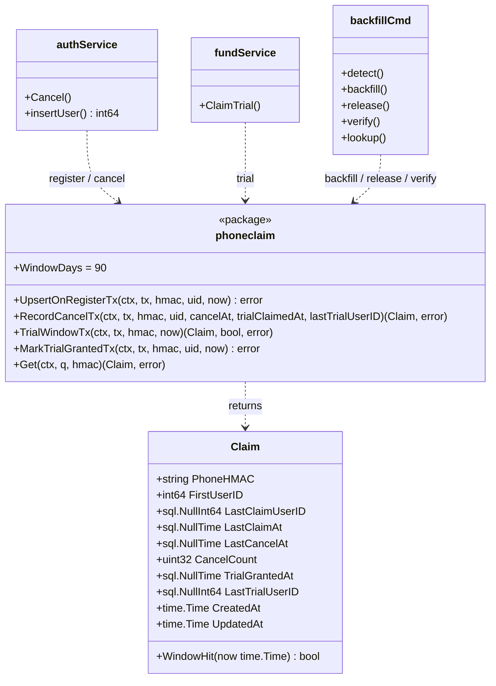
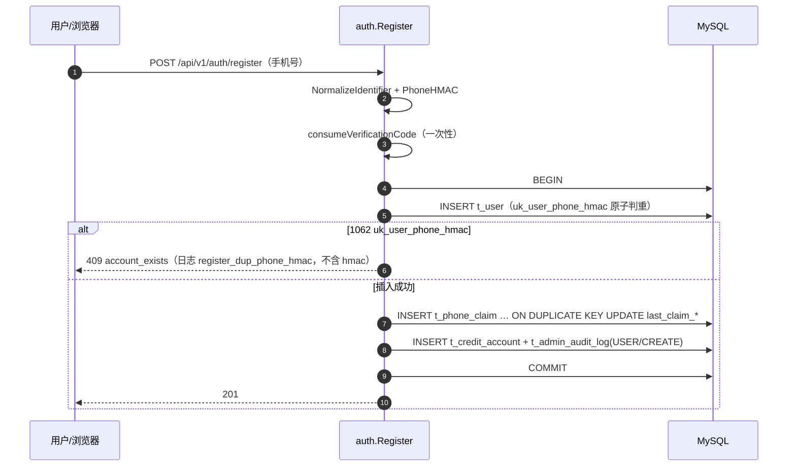
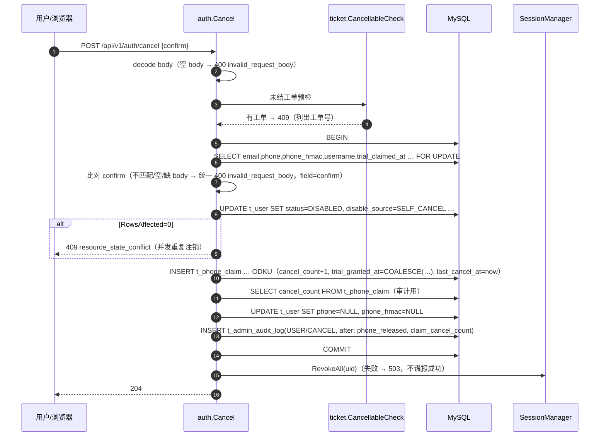
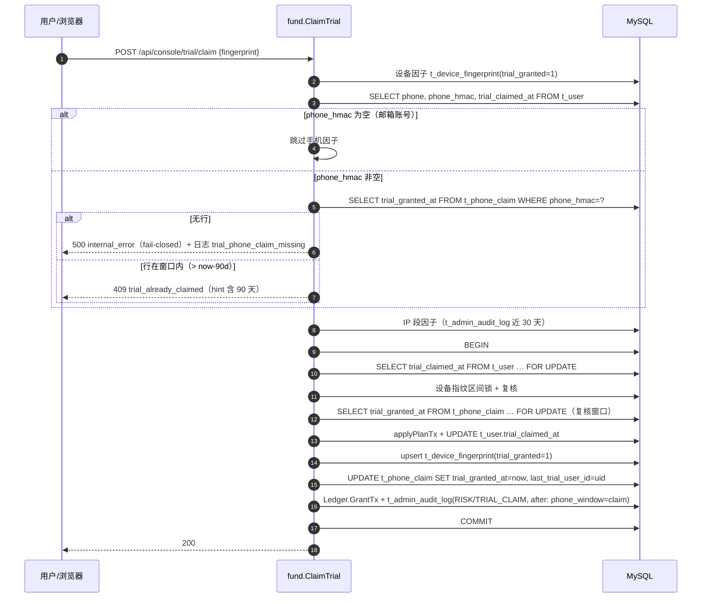
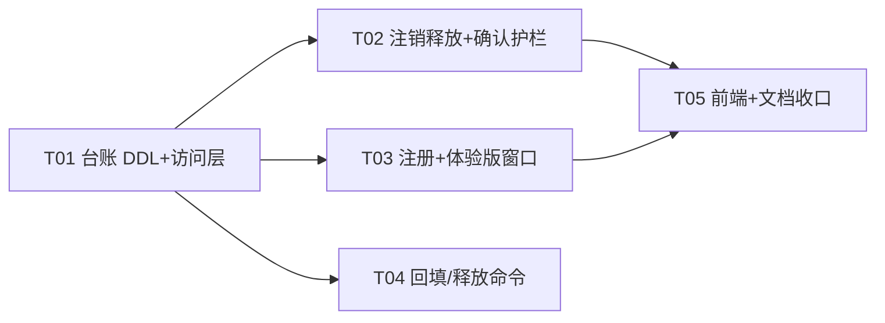

# 增量设计：手机号注销释放 + 体验版 90 天窗口（`t_phone_claim` 台账）

> 上游：`docs/tasks/INC-phone-claim-prd.md`（16 条 AC、D1–D9）。
> 本文只定**结构与口径**，不写实现代码；DDL / SQL 是"必须长成这样"，不是示意。
> 前置事实核对基于当前仓：`auth/cancel.go`（`cancelPhonePII` 空函数）、`auth/register.go`（`insertUserRow` 唯一插入漏斗）、`fund/trial.go`（手机因子 JOIN `t_device_fingerprint`）、迁移 0028 为止。

## 0. 一句话结论

新增**号码台账表** `t_phone_claim`（一号码一行、无状态机），注册/注销/体验版三条路径各自在同一事务里按 **`t_user` → `t_phone_claim`** 的固定锁序读写它；注销时把号码写进台账后**同时清空 `t_user.phone` 与 `t_user.phone_hmac`**（唯一性仍由 `uk_user_phone_hmac` 承担，零新增错误码）；体验版手机因子从"跨账号等值判重"换成"台账窗口判定"（`trial_granted_at > now-90d` → 拒），台账缺失一律 **fail-closed**。

---

## 1. 目标 / 非目标

### 目标（对应 PRD §3）
1. 注销后同号**立即可重新注册**（U1/U3），旧行不再参与登录与找回（B6 的耦合一并解决）。
2. 同号 **90 天内至多领一次体验版**，跨账号、不受注销影响（U2）。
3. 文档口径反转：`schema.md`「注销 = 占号」改写为「注销 = 放号（台账承接记忆）」（U6/§12）。

### 非目标（本轮明确不做，理由见 §12）
- 邮箱对称缺口（`uk_user_email` 注销后仍占号）；7 天冷静期与撤销；PII 全量清空 Job；发票/账本/退款；claim 清理 Job；运营后台台账页（P1-1）；`idx_phone_claim_cancel`（P2）。

---

## 2. 设计问题逐条回答（Q1–Q10）

| # | 问题 | 结论 |
| :-- | :--- | :--- |
| Q1 | DDL 与列取舍 | 建表 DDL 见 §3。**只留 9 列**：`phone_hmac`(PK)、`first_user_id`、`last_claim_user_id`、`last_claim_at`、`last_cancel_at`、`cancel_count`、`trial_granted_at`、`last_trial_user_id`、`created_at`、`updated_at`（10 列）。**砍掉 PRD 的 `first_seen_at`**（与 `created_at` 同义，重复列 = 两份真相）；**不加** `state` / `release_seq` / `last_cancel_user_id`（后者与审计 `USER/CANCEL.target_id` 重复）。主键 `phone_hmac` **足够**：唯一性权威在 `t_user.uk_user_phone_hmac`，claim 只被等值寻址。不设清理 Job 的依据见 §3.3。 |
| Q2 | 写入点 | 统一收敛到新包 `internal/platform/phoneclaim`（唯一一份 SQL）。注册：`insertUserRow` 内 `t_user` INSERT 之后 ODKU（`first_*` 不回写）。运营建号/内置超管走同一 `InsertUserRowTx` → 自动覆盖，超管无手机号 → 不写。`cmd/seedctl` 自己写 `t_user`（本地/验收夹具），**必须补同一条 ODKU**，否则本地号码账号会撞上 Q4 的 fail-closed。 |
| Q3 | 注销 | `cancelPhonePII` 真实现：**先 `SELECT … FOR UPDATE` 取 `phone/phone_hmac/trial_claimed_at`，再 guarded `UPDATE`（原 409 判定不变），再 claim ODKU（`cancel_count+1`、`trial_granted_at=COALESCE(既有, 行上 trial_claimed_at)`），最后 `UPDATE t_user SET phone=NULL, phone_hmac=NULL`**。`disable_source` 判定：注销路径**不需要判**（本事务刚写 `SELF_CANCEL`）；存量命令按 `status='DISABLED' AND disable_source='SELF_CANCEL'` 读，现值集合 = `SELF_CANCEL / OPS_MANUAL / RISK_AUTO / NULL`（历史行可能为 NULL → **不释放**）。`FROZEN_OVERDRAFT` 是 **status** 不是 source，不在释放集合内。 |
| Q4 | 体验版 | 手机因子 = 查 `t_phone_claim.trial_granted_at`，拒条件 `> now-90d`（**左开**：恰 90 天放行）。三态：**有行且在窗口 → 409**；**有行且为 NULL/超窗 → 放行**；**无行但 `phone_hmac` 非空 → 500 fail-closed**（结论见 §6.3）。发放写回：事务内 `UPDATE t_phone_claim … WHERE phone_hmac=?`（期望 1 行），与 `t_user.trial_claimed_at` 同事务；顺序 = `claim` 先、`t_user` 后（两行锁均已持有，顺序不影响死锁，但 claim 先写让"0 行"能立刻回滚）。 |
| Q5 | 回填/释放命令 | **新命令** `cmd/backfill-phone-claim`，子命令 **`detect` / `backfill` / `release` / `verify` / `lookup`**——把"回填"和"释放"拆成两个**互不包含**的动词（PRD 的 `apply` 一名两义正是顺序错误的来源）。dry-run 默认、`--commit` 才写、幂等、退出码 0/1/2/3（§7）。 |
| Q6 | 确认框 | 服务端在注销事务内按"**登录标识**"比对：`email` 非空 → 比归一小写邮箱；否则 `phone` 非空 → 比手机号**后 4 位**；否则比 `username`。**三种失败（没传 body / 空值 / 值不匹配）统一 400 `invalid_request_body` + `field=confirm`**（`mw.InvalidField("confirm")`，不新增错误码、不区分"没传"与"传错"）。前端标签与占位符按同一 mode 渲染。既有 `TestCancel*` 的 `runCancel` helper 必须加 body（§8）。 |
| Q7 | 并发 | 三路径统一 `t_user` → (`t_device_fingerprint`) → `t_phone_claim`，claim 永远是最后一环 → 无环。ODKU 撞唯一键时取"重复 PK 记录的排他锁"，与 cancel 的 UPDATE **串行在同一行上而不是互等**（矩阵见 §7）。 |
| Q8 | 迁移与回滚 | `0029` down = `DROP TABLE`；**释放不可逆**，生产回滚语义 = **只做前滚**（§9）。 |
| Q9 | 测试映射 | §10 把 16 条 AC 逐条落到文件与断言。 |
| Q10 | 风险 | §11：运营商回收号码的误伤面与申诉口径、hmac 合规论证、明文置空后客服核身路径。 |

**与主理人裁定的对齐**：① 邮箱本轮不做（P1 登记）；② 窗口锚 `claim.trial_granted_at`、跨账号、不按注销时间；③ 确认框本轮修且**服务端**有护栏、不新增错误码。三条均无技术性反证，按裁定执行。

### 2.1 裁定落地记录（2026-xx，主理人签字）

| 项 | 裁定 | 本设计如何落地 |
| :--- | :--- | :--- |
| 邮箱对称缺口 | 本轮不做 | P1 登记，客服话术 C5（§11 R6） |
| D3 窗口锚点 | `trial_granted_at`、跨账号 | §5.3 / §6.3 |
| 确认框缺陷 | 本轮修（服务端护栏） | §8（三级匹配 + 必填 body） |
| A5 `FROZEN_OVERDRAFT` | **放号**（语义上号码不是抵押物），但记为"当前不可达" | `mw/session.go:263-270` 的 `switch sess.Status` 对 `FROZEN_OVERDRAFT` 返回 `account_frozen_due_to_overdraft`，**拿不到会话就调不到 `/auth/cancel`**。因此 `cancelPhonePII` **不加任何状态判断、不查余额**；`release` 命令的 SQL 条件里 `status='DISABLED'` 已天然排除 `FROZEN_OVERDRAFT`。口径写进 runbook（§11 R5） |
| 命令拆分 | `backfill` / `release` 两个动词 | §7 |
| `first_seen_at` | 砍 | §3.3 |
| seedctl | 补台账写入 | §5.4 |
| 破坏性契约 | `confirm` 必填，旧客户端 400 | §8.1：三种失败统一 `400 invalid_request_body` + `field=confirm`（`mw.InvalidField("confirm")`，`codes.go` 零改动）；`errata.md` 登记 E-43（§13 T02/T05） |
| `confirm_ambiguous` | **撤销该码**（反证成立） | §8.2.1：不可达（比对对象 = 会话自己那一行，三档互斥）；`deviations.md` 加一行"登记不实现"留痕 |
| 既有断言 | `TestCancelKeepsPhoneAndHMAC` 等**改写**为新语义，不得删除 | §10「额外必测」+ §8.4 |

---

## 3. Q1：DDL

### 3.1 `0029_phone_claim.sql`

```sql
-- 0029 t_phone_claim：手机号台账（一号码一行，无状态机）。
--
-- 为什么需要它：0011 把唯一性挪到 t_user.phone_hmac 之后，「注销 = 占号」，
-- 用户被自己的号码永久锁死（同号永远 409）；而「同号 90 天内不得再领体验版」
-- 从未实现（fund/trial.go 只做跨账号等值判重，无时间窗）。本轮注销即释放号段，
-- 释放后 t_user 行上不再有号码，唯一的记忆只能落在号码维度的台账上。
--
-- 为什么没有 state 列：占用状态的唯一权威是「是否存在一行 t_user.phone_hmac = H」；
-- 台账只记事实（首登、最近注销、注销次数、最近发放）。
-- UNIQUE(phone_hmac, state) 会让同一号码第二次 releasing 撞 1062，绕开它的手段
-- （release_seq / RELEASED 存 NULL）都是隐式约定，且 state 会与 t_user 漂移。
--
-- 排序规则必须与 t_user.phone_hmac 完全一致（utf8mb4_0900_as_cs）：回填/校验/客服
-- 查询都要 JOIN ON u.phone_hmac = c.phone_hmac，两边 charset 不同会退化
-- 成隐式转换 + 无法用索引。
--
-- 不设清理 Job：一行一号码（上界 = 出现过手机号的号码数），hmac 是伪名化标识
-- 不含明文，且它是「该号码是否领过体验版」的唯一记忆——清掉它等于把 90 天窗口
-- 一起废止。清理的前提只能是窗口改由别处承载。
--
-- 回滚见 0029_phone_claim.down.sql：只 DROP 表；已释放的号码不可回滚（见设计 §9）。

CREATE TABLE t_phone_claim (
  phone_hmac         char(64)        NOT NULL COMMENT 'HMAC-SHA256(手机号, PHONE_HMAC_KEY) hex；一号码一行，台账主键',
  first_user_id      bigint unsigned NOT NULL COMMENT '首次认领该号码的账号 id；不随注销/重注册变化',
  last_claim_user_id bigint unsigned DEFAULT NULL COMMENT '最近一次注册占用该号码的账号 id',
  last_claim_at      datetime(3)     DEFAULT NULL COMMENT '最近一次被注册占用的时点',
  last_cancel_at     datetime(3)     DEFAULT NULL COMMENT '最近一次因注销释放的时点；存量释放取原 cancel_apply_at',
  cancel_count       int unsigned    NOT NULL DEFAULT 0 COMMENT '该号码被注销释放的累计次数',
  trial_granted_at   datetime(3)     DEFAULT NULL COMMENT '该号码最近一次发放体验版的时点；90 天窗口的唯一锚点',
  last_trial_user_id bigint unsigned DEFAULT NULL COMMENT '最近一次领到体验版的账号 id',
  created_at         datetime(3)     NOT NULL COMMENT '台账建立时点（= 号码首次被认领时间）',
  updated_at         datetime(3)     NOT NULL,
  PRIMARY KEY (phone_hmac)
) ENGINE=InnoDB DEFAULT CHARSET=utf8mb4 COLLATE=utf8mb4_0900_as_cs;
```

`0029_phone_claim.down.sql`：

```sql
-- 回滚只 DROP 表。台账里的 trial_granted_at 是 90 天窗口的唯一记忆，
-- 表一掉窗口就没有数据源（代码侧 fail-closed 会直接 500，不会静默放行）；
-- 而 t_user.phone / phone_hmac 一旦被释放，明文已不可恢复（hmac 可由明文重算，
-- 明文不能由 hmac 还原）。所以生产回滚口径是「前滚修复」，不是本脚本。
DROP TABLE t_phone_claim;
```

### 3.2 迁移相关连带文件（不做就一定红）

| 文件 | 改什么 | 为什么 |
| :--- | :--- | :--- |
| `internal/platform/migrate/guard_test.go` | `wantTables` 增加 `"t_phone_claim"`（新分组注释 `// 0029 号码台账（1）`），顶部注释 `60 张` → `61 张` | `TestCreatedTableSetMatchesDeliveredGroups` 逐表钉死建表集合，漏改必红 |
| `internal/platform/migrate/checksums.golden` | `bash scripts/gen-migration-checksums.sh` 重生成 | `TestEmbeddedMigrationsMatchGoldenChecksums` 逐字节比对 |
| `docs/schema.md` | 迁移表加 0029 行；业务表清单加 `t_phone_claim` 行（关键唯一键列写 `PRIMARY KEY(phone_hmac)`） | 读者按 schema.md 建表 |

### 3.3 列取舍表（必需 vs YAGNI）

| 列 | 判定 | 理由 |
| :--- | :--- | :--- |
| `phone_hmac` | **必需（PK）** | 唯一寻址键；与 `t_user.phone_hmac` 同宽同排序规则 |
| `trial_granted_at` | **必需** | 90 天窗口唯一锚点（D3/D4） |
| `last_trial_user_id` | **必需** | 运营口径「谁领的」；也让 `verify` 能自证发放写回成功 |
| `cancel_count` | **必需** | 复用次数（U4/U5）；重复注销的递增断言靠它 |
| `last_cancel_at` | **必需** | U4「什么时候注销的」；存量释放取原 `cancel_apply_at` 而不是 now |
| `last_claim_user_id` / `last_claim_at` | **保留（低价值但自洽）** | 释放后 `t_user` 已无法反查"上一个占用者"，台账自洽比多一次 JOIN 审计表便宜 |
| `first_user_id` | **保留** | 台账溯源起点；PRD P0-1 明列，成本 8B/号码 |
| `created_at` / `updated_at` | **必需** | 全库惯例（`datetime(3)` UTC），且 `created_at` 直接替代 `first_seen_at` |
| `first_seen_at` | **砍（YAGNI）** | 与 `created_at` 同义；两列迟早漂移 |
| `state` / `release_seq` | **砍（PRD 已否）** | 见 §3.1 注释 |
| `last_cancel_user_id` | **砍（YAGNI）** | 与 `t_admin_audit_log` 的 `USER/CANCEL.target_id` 重复；台账只做摘要 |
| `idx_phone_claim_cancel` | **砍（PRD P2）** | 无消费者的索引 |

**不设清理 Job 的完整依据**（写进 runbook）：① 行数上界 = 出现过手机号的号码数，不随注销/注册增长；② hmac 不可逆、不含明文，与 F-12④「删可识别性、保留可判定性」一致；③ 它是窗口的唯一数据源，清理即废窗；④ 若将来要清理，前提是窗口改由别处承载——那时本表可以整表 DROP，是个明确的未来决策点，不是"顺手跑的 Job"。

---

## 4. 结构：台账访问层（唯一一份 SQL）

新增包 `internal/platform/phoneclaim`（放在 platform 下，理由与 `phonehmac` 相同：`auth` / `fund` / `cmd` 三处调用方需要**逐字节相同**的 SQL 与常量；散写必然漂移）。



约定：

- 包里**不 import** `auth` / `fund`（避免环）。`auth` 已有的 `PhoneHMAC` 继续在 auth 侧算，包只吃 `phone_hmac` 字符串。
- `WindowHit(now)` = `TrialGrantedAt.Valid && TrialGrantedAt.After(now.AddDate(0,0,-WindowDays))`——**边界只有一处**，SQL 与 Go 判定不许各写一份。
- `fund` 里的 `const trialPhoneWindowDays = phoneclaim.WindowDays`（别名，不是第二个字面量；与 `BcryptCost = bcryptCost` 同一手法）。

---

## 5. 三点写入位置的 SQL（确切形态）

### 5.1 注册：`auth.insertUserRow`（漏斗内，`t_user` INSERT 成功之后）

```sql
INSERT INTO t_phone_claim
  (phone_hmac, first_user_id, last_claim_user_id, last_claim_at, cancel_count, created_at, updated_at)
VALUES (?, ?, ?, ?, 0, ?, ?)
ON DUPLICATE KEY UPDATE
  last_claim_user_id = VALUES(last_claim_user_id),
  last_claim_at      = VALUES(last_claim_at),
  updated_at         = VALUES(updated_at)
```

- 覆盖 3 条建号路径：公开注册、`ops.CreateOperatorUser`（同一 `InsertUserRowTx`）、`bootstrap`（无手机号 → 不写）。
- `first_user_id / created_at / cancel_count / trial_granted_at` 在 ODKU 分支里**不出现** = 首次优先，反复注册只推进 `last_*`。
- 失败 → 整个注册事务回滚（不允许"账号建好、台账缺失"）。
- `VALUES()` 在本仓既有 upsert（`t_device_fingerprint`）已是同一写法：**全仓一种风格**，不混用 MySQL 8.0.20+ 的 `AS new` 行别名（两者并存才是要命的）。

### 5.2 注销：`auth.Cancel` + `cancelPhonePII`

事务内顺序（锁序即顺序）：

```sql
-- ① 锁行并取号码三列（这是锁序第一环，也顺带给确认框提供期望值）
SELECT COALESCE(email,''), COALESCE(phone,''), COALESCE(phone_hmac,''),
       COALESCE(username,''), trial_claimed_at
  FROM t_user WHERE id = ? AND deleted_at IS NULL FOR UPDATE

-- ② 【确认框护栏】在 Go 里比对 confirm（口径见 §8）；不匹配 → rollback + 400

-- ③ 现有 guarded UPDATE（语义、409 判定、审计 before/after 全部不变）
UPDATE t_user
   SET status='DISABLED', disable_source='SELF_CANCEL', disable_reason='用户主动注销',
       disabled_at=?, disabled_by=NULL, cancel_apply_at=?, updated_at=?
 WHERE id=? AND deleted_at IS NULL AND status<>'DISABLED'
-- RowsAffected=0 → 409 resource_state_conflict（并发重复注销）

-- ④ claim 自愈 + 计数（锁序第二环）
INSERT INTO t_phone_claim
  (phone_hmac, first_user_id, last_claim_user_id, last_claim_at, last_cancel_at,
   cancel_count, trial_granted_at, last_trial_user_id, created_at, updated_at)
VALUES (?, ?, ?, ?, ?, 1, ?, ?, ?, ?)
ON DUPLICATE KEY UPDATE
  last_cancel_at   = VALUES(last_cancel_at),
  cancel_count     = cancel_count + 1,
  trial_granted_at = COALESCE(trial_granted_at, VALUES(trial_granted_at)),
  updated_at       = VALUES(updated_at)

-- ⑤ 释放（本事务最后一条 t_user 写）
UPDATE t_user SET phone = NULL, phone_hmac = NULL, updated_at = ?
 WHERE id = ? AND phone_hmac = ?
-- 期望 RowsAffected == 1；否则整事务回滚（errPhoneReleaseFailed）
```

要点：

0. **释放语句必须校验 `RowsAffected == 1`，否则回滚**（实现比本节初稿更严，按实现更新）：`WHERE … AND phone_hmac = ?` 只保证"不误覆盖别人"；要求恰好 1 行才保证"确实覆盖到了"。0 行意味着行在锁释放后被改过（理论不可达，但与"释放成功却什么都没改"不能长得一样），此时回滚比 commit 一个静默无操作安全。同理，体验版的 `MarkTrialGrantedTx` 也要求 `RowsAffected == 1`（§5.3）。

1. **`trial_granted_at = COALESCE(既有, 行上 trial_claimed_at)`**（PRD P0-3 原文）：台账已有窗口就保留（更早的发放时间不能被后来者覆盖）；台账为空才用行上的历史（D5-7 的"自愈"）。
2. `last_trial_user_id` 在 INSERT 分支 = `trial_claimed_at IS NULL ? NULL : uid`（自愈时把"谁领的"一起补上）；ODKU 分支**不写**它（不许把已有值冲成 NULL）。
3. **三态**（`cancelPhonePII` 的全部行为）：

   | `phone` | `phone_hmac` | 行为 |
   | :--- | :--- | :--- |
   | 空 | 空 | 邮箱/用户名账号：什么都不做，`phone_released=false`（AC-10） |
   | 有值 | 有值 | ④ + ⑤ 全做，`phone_released=true` |
   | 有值 | **空** | **两列都不动**，`phone_released=false`，WARN `cancel_phone_release_skipped reason=phone_without_hmac uid=` |

   第三态不释放明文的原因：`phone_hmac` 的唯一重算输入就是明文 `phone`（`backfill-phone-hmac` §10.3 靠它修复）。此时把明文置 NULL 会让这个号码的窗口记忆**永久不可重建**，反而制造白送。`uk_user_phone_hmac` 本来也没被占（NULL 不参与唯一），"能不能重注册"不受影响。运营侧处置：按 runbook §10.3 补 hmac 后，用 `backfill-phone-claim release --uid=<id>` 补释放。
4. 审计：仍是一条 `USER/CANCEL`，`after` 增 `phone_released: bool`、`claim_cancel_count: N`；**不写 hmac、不写明文**。`claim_cancel_count` 取自 ④ 之后同一事务内的 `SELECT cancel_count FROM t_phone_claim WHERE phone_hmac=?`（行已锁，无额外代价）。审计失败 → 回滚（保持现状）。
5. 顶部那段"CANCELLATION KEEPS phone AND phone_hmac"注释必须整段反转重写（它现在是**反的**，是下一轮最容易被误读的地方）；`cancelPhonePII` 的"未来实现只许加 `phone=NULL`"段落删除。

### 5.3 体验版：`fund/trial.go`

**预检（事务外，快路径）**：

```sql
SELECT trial_granted_at FROM t_phone_claim WHERE phone_hmac = ?
```

- `sql.ErrNoRows` → **fail-closed 500**，`s.logError(ctx, "trial_phone_claim_missing uid="+uid)`（引导 on-call 跑回填）。
- `NULL` 或 `<= now-90d` → 放行；`> now-90d` → `trialRefusal()`（复用 `trial_already_claimed`，不点名因子）。

**事务内（`t_user` 行锁之后、设备指纹锁之后，仍是锁序最后一环）**：

```sql
SELECT trial_granted_at FROM t_phone_claim WHERE phone_hmac = ? FOR UPDATE   -- 命中 → 回滚 errTrialPhoneWindow
-- 发放成功后：
UPDATE t_phone_claim
   SET trial_granted_at = ?, last_trial_user_id = ?, updated_at = ?
 WHERE phone_hmac = ?
-- RowsAffected <> 1 → 回滚（台账行在事务内消失 = 漂移，不许吞）
```

其余保持现状：设备因子、IP 段因子、账号 `trial_claimed_at` 因子**一个都不动**（AC-14 要证明两个因子独立），`fp` 锁与 upsert 不变，`AntiAbuseChecks` 字符串不变。`apierr.CodeTrialAlreadyClaimed.Hint` 按 C4 加一句"手机号注销后 90 天内同样不可再次领取"（`apierr/codes_test.go` 的期望文案同步改）。

### 5.4 `cmd/seedctl`（本地/验收夹具）

自己的 `INSERT INTO t_user` 之后补一条 5.1 的 ODKU。不补的后果不是"生产少了台账"，而是**本地/验收环境所有号码账号领体验版直接 500**（fail-closed 生效），把开发卡在一个与生产不同的故障上。

---

## 6. Q7：并发与死锁

### 6.1 锁序矩阵（唯一权威）

| 路径 | ① | ② | ③ | ④ |
| :--- | :--- | :--- | :--- | :--- |
| 注册 | `t_user` INSERT（`uk_user_phone_hmac` 记录锁） | `t_phone_claim` ODKU | — | commit |
| 注销 | `t_user` SELECT FOR UPDATE（行锁） | `t_user` UPDATE（同行） | `t_phone_claim` ODKU | `t_user` UPDATE（同行） |
| 体验版 | `t_user` SELECT FOR UPDATE | `t_device_fingerprint` 区间锁 + upsert | `t_phone_claim` SELECT FOR UPDATE → UPDATE | `t_user` / 账本写 |
| 存量释放命令 | `t_user` SELECT FOR UPDATE | `t_phone_claim` ODKU | `t_user` UPDATE（同行） | commit（逐行事务） |

**claim 永远是最后一环，且没有任何路径"先锁 claim 再锁 t_user"** → 无环。违反即为缺陷。

### 6.2 ODKU 在唯一键冲突时的行为

- 行存在：对重复 PK 记录加排他锁并原地 UPDATE；并发 ODKU 在同一 hmac 上**排队**，不互等。
- 行不存在：取 PK 间隙的插入意向锁，直到 commit；两个并发插入同一新 hmac 会一个成功、另一个退化为 UPDATE（同事务内不会 1062）。
- **会不会与 cancel 的 UPDATE 互等？** 不会，给出可证伪的推理：同一号码上"注销 A"与"注册 B"同时发生时，B 的 `INSERT t_user` 先被 A 未提交的 `uk_user_phone_hmac` 记录锁挡住（`t_user` 层），A 提交后 B 才进入 claim 层，而此时 A 的 claim 行已存在 → B 只做 ODKU-update。**冲突被前移到锁序第一环解决**，claim 层永远只发生"同一行上的先后"。
- 残留风险：`innodb_lock_wait_timeout` 超时 → 5xx。不加分布式锁、不加重试（D6）；客户端重试即可，日志里能靠 `cancel_update_failed` / `fund_trial_claim_failed` 定位。

### 6.3 Q4 的 fail-closed 结论（明确表态）

**无 claim 行但账号有 `phone_hmac` → 不发（500 internal_error）。**

- 先例一致：现有代码对"`phone` 有值但 `phone_hmac` 空"就是 500 拒绝，注释写着"用一个未知的判重键付钱，正是滥用者想要的"。
- 该状态在**所有写路径覆盖后不可达**：注册/运营建号/seedctl/cancel 都会建台账行；只有"手工改库"或"回填未跑"能造出来。
- 反向代价不对称：fail-open 的失败模式是**静默白送一次体验积分**（无人发现），fail-closed 的失败模式是**试用领取接口 500 + 一条明确日志 + runbook 一步恢复**。
- 配套：`trial_phone_claim_missing` 是独立日志 token（P1-3），runbook 写明"看到它就说明回填没跑"。

---

## 7. Q5：`cmd/backfill-phone-claim` 规格

### 7.1 为什么是"两个动词"而不是一个 `apply`

PRD P0-5 写 `apply`，本轮改为 `backfill` + `release` 两个**互不隐含**的子命令：顺序硬约束是"先回填、后释放"（反了就白送一次体验版），而一个 `apply` 名同时描述两件事时，"跑了一半"和"跑错了顺序"在报告里长得一模一样。两个动词让 gate 可机检（§7.3）。

### 7.2 子命令

| 子命令 | 读写 | 做什么 |
| :--- | :--- | :--- |
| `detect [--json] [--show=20]` | 只读 | 统计：待回填行数、释放候选行数、异常（`PHONE_WITHOUT_HMAC`、`HMAC_NOT_64`、**过度释放**：`OPS_MANUAL/RISK_AUTO` 行 hmac 为 NULL） |
| `backfill [--commit] [--batch=500] [--sleep=50ms] [--max-rows=0] [--from-id=0]` | 写 claim | ①`INSERT … SELECT … ON DUPLICATE KEY UPDATE phone_hmac=phone_hmac`（纯补缺失行，`first_user_id=id`、`created_at=created_at`、`last_claim_*=id/created_at`、`trial_granted_at=trial_claimed_at`、`last_trial_user_id=(trial_claimed_at IS NULL? NULL: id)`、`cancel_count=(status='DISABLED' AND disable_source='SELF_CANCEL' ? 0 : 0)`）②`UPDATE claim JOIN t_user SET trial_granted_at=COALESCE(...) WHERE trial_granted_at IS NULL AND u.trial_claimed_at IS NOT NULL`（补半途行）。**不碰 `t_user` 一个字节。** |
| `release [--commit] [--batch=…] [--sleep=…] [--uid=]` | 写 `t_user` + claim | 仅 `status='DISABLED' AND disable_source='SELF_CANCEL' AND deleted_at IS NULL AND phone_hmac IS NOT NULL`；逐行事务：锁行 → claim ODKU（`cancel_count+1`、`last_cancel_at=COALESCE(cancel_apply_at, disabled_at, now)`、`trial_granted_at=COALESCE(既有, trial_claimed_at)`）→ `UPDATE t_user SET phone=NULL, phone_hmac=NULL`。 |
| `verify [--json]` | 只读 | 四条断言全 0：①每个活号码行都有台账行；②每个 `SELF_CANCEL` 行 `phone_hmac IS NULL`；③没有过度释放（`OPS_MANUAL`/`RISK_AUTO`/`status='FROZEN_OVERDRAFT'` 行 hmac 仍非空）；④台账行 hmac 均为 64 位小写 hex。 |
| `lookup --phone=138… [--json]` | 只读 | 客服查询（U4/U5）：算 hmac → 打台账行 + 当前持有者（`t_user` 按 `phone_hmac` 取 0/1 行）+ 掩码手机号。**不是新页面，是 runbook 的一条命令。** |

### 7.3 gate（顺序错误的机器护栏）

- `release` 启动时先跑 `detect`：**待回填行数 > 0 → 拒绝执行，退出码 3**，文案"先跑 backfill --commit（顺序反了会给老注销号白送一次体验版）"。
- `backfill` 不检查释放状态（回填天然可先跑）。
- 两者都 dry-run 默认；`--dry-run` 与 `--commit` 同给 → 退出码 1。

### 7.4 退出码（runbook 直接引用，属接口）

| 码 | 含义 |
| :--- | :--- |
| 0 | 干净 / dry-run 完成 |
| 1 | 运行时错误（缺 `DB_DSN`、`PHONE_HMAC_KEY` 缺失或 < 32 字节、参数互斥） |
| 2 | `detect`/`verify` 发现阻塞项（异常行 / 差异 / 过度释放） |
| 3 | 阶段顺序违规（未回填就跑 release）、或 apply 撞冲突 |

### 7.5 输出与幂等

- 所有手机号走 `phonehmac.Mask`；台账行只打 `hmac 前 6 位`（`shortHash`），**永不打印完整 hmac 或明文**。
- 报告格式与 `backfill-phone-hmac` 同构（`scanned / pending / changed / skipped / batches / elapsed` + 逐条异常），`--json` 供工单系统解析。
- 幂等：`backfill` 第二次 `changed=0`（ODKU 无操作、heal 已补）；`release` 第二次 `changed=0`（行的 `phone_hmac` 已 NULL，SELECT 条件不再命中）。
- 单行失败：记 `uid` 继续，末尾汇总 `failed=N`（非零即退出码 1）。
- 不写审计行：数据迁移的留痕是"报告 + `schema_migrations` + runbook 变更单"，与 `backfill-phone-hmac` 同一范式；逐行写 `t_admin_audit_log` 会把一次迁移变成几万行噪声。（`PHONE_RELEASE` 这个 action 保留给 §5.2 第三态的人工补释放。）

### 7.6 Makefile

```make
#   make backfill-phone-claim                      # detect（只读）
#   make backfill-phone-claim ARGS="backfill"      # dry-run
#   make backfill-phone-claim ARGS="backfill --commit"
#   make backfill-phone-claim ARGS="release --commit"
#   make backfill-phone-claim ARGS="verify"
backfill-phone-claim:
	@$(LOAD_ENV) $(GO) run ./cmd/backfill-phone-claim $(ARGS)
```

---

## 8. Q6：注销确认框修复（服务端护栏）

### 8.1 契约（主理人裁定：**不新增错误码**，三种失败统一 400 `invalid_request_body` + `field=confirm`）

`POST /api/v1/auth/cancel` 新增请求体：

```json
{ "confirm": "<登录标识的确认值>" }
```

- **三种失败一律同一个响应**：①没传 body（旧客户端）②传了但 `confirm` 为空 ③`confirm` 与期望值不匹配 —— 全部 `400 invalid_request_body`，`message="请求体参数有误：confirm"`，只换 `hint`。**不区分"没传"与"传错"**：区分就等于给探测者一个二值反馈去猜值。
- **不需要任何新代码**：`mw.InvalidField("confirm")` 现成就是 `apierr.CodeInvalidRequestBody` + `Newf(code, "confirm")`（`internal/control/mw/errs.go:62-64`，`codes.go:325-329` 的 message 模板是"请求体参数有误：%s"）。这正是"统一 + field=confirm"的实现，零改动。
- `decodeJSON` 对空 body 返回的是 `field=body`；cancel 必须把它**收敛**成 `mw.InvalidField("confirm")`（一处小映射，见 §8.2.2），否则旧客户端会看到 `field=body`、新客户端看到 `field=confirm`，两种反馈又能拼出信息。
- `hint` 按账号形态给（三选一）：有邮箱「请输入完整登录邮箱以确认注销」/ 仅手机号「请输入手机号后四位以确认注销」/ 仅用户名「请输入登录用户名以确认注销」。
- **绝不静默通过**（这正是本轮要堵的口子）；"兼容旧客户端 = 缺 body 时降级为旧行为"是给护栏开后门，明确不做。
- 该契约变更是**对外行为变更**，在 `docs/tasks/errata.md` 记一条（E-43）：自本轮起要求 `{"confirm":"…"}`，缺失/空/不匹配均 400；影响面 = 任何未同版升级的调用方。

### 8.2 期望值口径（三档，服务端判定，前端只负责提示一致）

| 账号形态 | mode | 期望值 | 归一化 |
| :--- | :--- | :--- | :--- |
| `email` 非空（含手机号注册后绑定邮箱） | `email` | 完整邮箱 | `strings.ToLower(strings.TrimSpace(x))`，与登录归一一致 |
| `email` 空、`phone` 非空 | `phone_suffix` | 手机号**后 4 位** | 取出 `confirm` 中所有数字，要求恰好 4 位；与 `phone` 后 4 位比较 |
| 都空、`username` 非空（运营/超管） | `username` | 用户名 | 小写 + trim（同登录归一） |

三档必须在同一处实现（`auth` 包内一个纯函数 + 表驱动测试），**前端不重写判定**，只按 mode 渲染 label/placeholder 并做"非空 + 长度"的本地预检。

**权威值 vs 提示值的分工（已按实现校正：**两者都取自同一行**）**：

| 用途 | 数据来源 | 为什么 |
| :--- | :--- | :--- |
| 比对（安全判定） | 事务内 `SELECT … FOR UPDATE` 读到的 `t_user` 行（`lockCancelIdentity`） | 权威：用户可能刚绑邮箱，会话快照是旧的，只有行是准的 |
| `hint` 文案（仅展示） | **同一个** `lockCancelIdentity` 返回的 `cancelIdentity.primaryMode()` | 锁反正是要取的，读一次就够；用同一行导出的 hint 与比对对象**天然一致**，不会出现"提示要邮箱、判定要手机号"的自相矛盾 |

实现顺序（与代码一致）：`BEGIN` → `lockCancelIdentity`（`SELECT … FOR UPDATE`，取 email/phone/username/status + 号码三列）→ **解析 body**（失败即 `confirmRefusal(hintMode)`）→ `status='DISABLED'` 判 409 → `checkCancelConfirm` → 后续写。

两处顺序上的细化，都是**为了避免给出误导性反馈**，写进设计而不是留在代码注释里：

1. **`status='DISABLED'` 的 409 排在 confirm 校验之前**：号码已释放的账号可能一个标识都不剩（`email` 为空、`phone` 为 NULL），此时任何 `confirm` 都注定不匹配；若先判 confirm，第二次注销会得到"字段有误"而不是"已注销"——后者才是真实原因。
2. **body 解析排在取锁之后**：这样"没传 body"也能拿到正确的 `hint`（按账号形态），三种失败的差异只剩 hint，与 G1 一致。代价是畸形请求也短暂持有行锁——可接受（同事务内、无写、随即回滚）。

> 为什么补上 `username` 一档：运营/超管账号的 `email` 也是空，当前同样"空过即通过"——这是同一个缺陷的第二个实例，顺手修掉比留一个"只有运营能一键注销"的口子便宜。

### 8.2.1 关于 `confirm_ambiguous`（409）：**已裁定不落码**（主理人 2026-xx）

原裁定"命中多义 → 409 `confirm_ambiguous`"经技术反证后**撤销**：

1. **比对是"与自己那一行比"，不是"查是谁"**。uid 来自会话（`mw.SessionFrom`），**期望值与 hint 都来自同一个 `SELECT … FROM t_user WHERE id = ? FOR UPDATE` 的行**（见 §8.2）。三档互斥、单一候选值 → **不存在"命中多条"的输入**，`confirm_ambiguous` 没有生产者。
2. **多义只可能发生在"按 confirm 反查账号"这种实现里**，那等于让确认框变成账号探测接口（输入任意串 → 不同反馈 → 可枚举），是安全倒退。
3. 若为它落码：`apierr/codes.go` 全量清单 + `codes_test.go` 计数 + `docs/error-codes.md` 三处都要加，而**没有任何路径能产出它** —— 这正是 `account_frozen` 的翻版（`docs/tasks/delivery/deviations.md` D-31：「无合法生产者，客户端收不到该码」）。
4. **留痕（裁定要求的第二项）**：在 `docs/tasks/delivery/deviations.md` 加一行「`confirm_ambiguous` 登记不实现（无合法生产者：confirm 与当前账号自身标识比对，三档互斥单一候选）」，并在 `docs/error-codes.md` 的总数说明里**不增码**（保持 76）。下一个人翻 deviations 就不会再提同一个建议。

**当前唯一正确的 confirm 口径（替换一切旧表述）**：`confirm` 缺失 / 为空 / 与期望值不匹配 —— **三种情况统一 `400 invalid_request_body`，`message = "请求体参数有误：confirm"`，三者除 `hint`（按账号形态三档）外逐字节相同**。不存在 409，也不存在第二个错误码。

真要用 409 语义表达的唯一场景是「同一手机号存在两行活数据」——那是 `findUserUnique` 的 `ErrAmbiguousAccount`（找回密码路径），与本接口无关，且 0011 + `backfill-phone-hmac verify` 之后已不可能。

### 8.2.2 实现骨架（**已按实现校正**：hint 与判定同源，均来自锁住的那一行）

实际实现（`internal/control/auth/cancel.go`）与本骨架的对应关系：

```
// 唯一的 mode 推导：loginKindFor(email, phone, username) → "email" | "phone_suffix" | "username" | "none"
//   · cancelIdentity.primaryMode() 复用它（服务端判定）
//   · userView.login_kind 也复用它（下发给前端渲染 label）
//   一份逻辑两处消费，前端不重算。

// 判定（纯函数，表驱动）：
func checkCancelConfirm(id cancelIdentity, confirm, hintMode string) *apierr.APIError
//   typed 为空 → refusal；三档各自归一化比较；不匹配 → refusal
func confirmRefusal(hintMode string) *apierr.APIError   // mw.InvalidField("confirm").WithHint(...)
func confirmHintForMode(mode string) string              // 三条 hint + none 兜底

// handler 顺序（与代码一致）：
// BEGIN → lockCancelIdentity(FOR UPDATE) → hintMode = ident.primaryMode()
//       → decodeJSON 失败即 confirmRefusal(hintMode)   ← 空 body 也在这里被收敛成 confirm
//       → status=DISABLED 判 409（早于 confirm，理由见 §8.2）
//       → checkCancelConfirm 失败即同一个 refusal → 后续写
```

要求：`checkCancelConfirm` 的表驱动用例覆盖 `email` 大小写、`phone_suffix` 带空格/横线/`+86` 前缀、`username` 大小写、`typed` 为空、`typed` 为纯空白共 ≥8 条；`typed` 的原始值**不进日志**（只记 `confirm_ok=false uid=`）。

> **G1（必过项，交付时逐条核）**：不传 body / `{"confirm":""}` / `{"confirm":"错值"}` 三种输入，断言 HTTP 码 + `error.code` + `error.message` **完全一致**（`invalid_request_body` / "请求体参数有误：confirm"），仅 `hint` 按 mode 不同；并断言 **`message` 不以「：body」结尾**（即 `decodeJSON` 的 `field=body` 已被收敛成 `confirm`）。不过此条视为未交付——它是"统一 400"不退化回"两种字段 / 三种码"的唯一机器护栏。
>
> **断言方式（避免假绿，且别踩我第一版写错的那条）**：`apierr` 的响应体里**没有独立的 `field` 字段**（`internal/apierr/error.go:277-291` 的 `errorObject` 只有 `type/code/message/retry_after_seconds/hint/request_id…`），所谓 `field=confirm` 只体现为 **`message` 文本**（`Newf(CodeInvalidRequestBody, "confirm")` → "请求体参数有误：confirm"）。因此断言方式是：
> 1. 三者**序列化响应体里的 `error.message` 字符串 `==` "请求体参数有误：confirm"**；
> 2. 三者 `error.code == "invalid_request_body"`、HTTP 400；
> 3. 三者 `hint` **按 mode 分档**（不按错误类型分档），且**不含** `"：body"` 这个子串。
>
> ⚠️ **不要**写成"响应体不含 `body` 子串"——`code` 本身就是 `invalid_request_body`，那条断言恒假。正确写法是"`message` 不以 `：body` 结尾"。

### 8.3 前端改动点（`web/src/pages/console/AccountPage.tsx`）

1. `handleCancel` 的比对从 `typed !== (user?.email ?? '')` 改为 mode 判定 + 分档比对；**mode 不由前端推导**，改为读服务端下发的 `login_kind`（`/api/v1/auth/me` 与登录/注册/绑定邮箱返回的 `user` 都带，加法字段，`email`/`phone_suffix`/`username`/`none`）。这是实现阶段相对本设计的改进：**判定口径只有服务端一份**，前端不再重算，避免"前端算 email、后端算手机号后 4 位"这类双份逻辑漂移。
2. 输入框 `label` 与 `placeholder` 必须由 `login_kind` 派生（当前 placeholder 是 `user?.email ?? ''` → 手机号账号是空串，直接诱导空过）。
3. 注销区块文案加 C2 三条后果（停用；**号码立即释放、可被他人重新注册**；**90 天内该号不能再领体验版、剩余赠送积分不退**）。
4. 提交时把 `confirm` 放进 body。

### 8.4 对既有测试的影响

`auth/cancel_test.go` 的 `runCancel(svc, sess, cookie)` 现在无 body → 全部用例会先撞 400。**必须**把 helper 改成接受 `confirm`（默认按夹具账号的邮箱），并新增 5 条：邮箱账号错值 400 / 手机号账号后 4 位正确 204 / 手机号账号空值 400 / **完全不传 body → 400 `invalid_request_body`** / 用户名账号（运营）正确 204。

**语义反转（改写，不得删除）**：`TestCancelKeepsPhoneAndHMAC`、`TestCancelPhonePIIIsANoOpToday` 与 `fund/trial_test.go:TestTrialSurvivesCancel` 三条断言的是**上一轮的语义**（"注销保留 phone/hmac"）。它们必须**原地改写**为新一轮语义——注销后 `phone` 与 `phone_hmac` 均为 NULL、`claim[X].cancel_count=1`、同号可再注册——**不能删掉重写标题**：这三条用例本身就是"本轮语义变更"的证据链，删了等于把变更的可追溯性一起删了。建议保留原测试函数名并在注释里写明「T11 语义已于 INC-phone-claim 反转：原断言 phone/hmac 不变 → 现断言释放」。

---

## 9. Q8：迁移与回滚

| 阶段 | 动作 | 失败怎么办 |
| :--- | :--- | :--- |
| 1 | `make migrate`（0029 建表） | 表已存在则迁移器报错 → 无副作用，重跑即可 |
| 2 | `backfill-phone-claim detect` → `backfill --commit` | 未完成不进入 3（gate） |
| 3 | `backfill-phone-claim release --commit`（低峰、单实例） | 单行失败继续并计数；重跑幂等 |
| 4 | 发布代码（register/cancel/trial） | 见下 |

**顺序不可换**：先发代码后回填，会有一段"号已释放、台账无 `trial_granted_at`"的窗口 → 老注销号白送一次体验版（D5-6）。反过来（先回填再发代码）只是台账多几行，无副作用。

**回滚语义**：

- `0029` down 只有 `DROP TABLE`，**仅限本地/CI**。生产 down = 把 90 天窗口的唯一数据源删掉 → 所有号码账号领体验版立刻 500（fail-closed，响但不静默），且释放过的号码无法回填（明文已丢）。
- 生产回滚 = **前滚修复**（改代码 + 新迁移），不回退 0029、不恢复 `t_user.phone`。
- 已释放号码被他人注册后，"恢复原账号号码"在产品上**不存在**这条路径：只能走客服人工（新号主注销/释放后原用户重注册）。这一句要写进 runbook §10.4。

---

## 10. Q9：验收映射（PRD 16 条 → 断言）

| AC | 断言（可执行） | 落点 |
| :--- | :--- | :--- |
| AC-1 注销即释放 | 注销后 `t_user` 行 `phone IS NULL AND phone_hmac IS NULL`；`claim[X]` 的 `last_cancel_at=now`、`trial_granted_at=3 天前`、`cancel_count=1`；中途无中间态（同事务） | `auth/cancel_test.go`（替换 `TestCancelKeepsPhoneAndHMAC`） |
| AC-2 同号可重注册 | 紧接 AC-1 用 X 注册 → 201，新 uid ≠ 旧 uid | `auth/cancel_test.go` / `auth/register_phone_test.go` |
| AC-3 窗口生效 | B 领体验版 → 409 `trial_already_claimed`，hint 含「90 天」；B 的 `trial_claimed_at` 仍 NULL；`t_device_fingerprint` 无 `trial_granted=1` 新行；无账本行 | `fund/trial_test.go`（替换 `TestTrialSurvivesCancel`） |
| AC-4 窗口到期放行 | 把 `claim.trial_granted_at` 改成 91 天前 → 200，且 `trial_granted_at=now`、`last_trial_user_id=B` | `fund/trial_test.go` |
| AC-5 边界 | 恰为 `now-90d` → **200**（左开）；`now-90d+1ms` → 409 | `fund/trial_test.go`（两条，夹具直接写 `trial_granted_at`） |
| AC-6 从未领过 | `trial_granted_at IS NULL` 的号码：注销→重注册→**立即 200** | `fund/trial_test.go` |
| AC-7 唯一性未削弱 | X 被 B 占用后 C 注册 X → 409 `account_exists`；日志 `register_dup_phone_hmac` 且**行内不含 hmac** | `auth/register_phone_test.go`（已有，补日志断言） |
| AC-8 并发注册 | 两连接同时注册同一号码 → 恰一 201 一 409，无 5xx；`COUNT(*)=1` | `auth/register_phone_test.go` |
| AC-9 锁序 | 同账号并发「注销 + 领体验版」→ 无 5xx、无 `Error 1213`；日志无 ERROR | `auth/cancel_test.go` + `fund/trial_test.go`（跨包各一条，用 goroutine 对打） |
| AC-10 邮箱零影响 | 邮箱账号注册/注销/再注册全程 → `SELECT COUNT(*) FROM t_phone_claim WHERE first_user_id IN (…)` = 0 | `auth/cancel_test.go` |
| AC-11 存量释放 | 造 `DISABLED+SELF_CANCEL`（hmac=H、`trial_claimed_at` 有值）→ `release --commit` → 两列 NULL、`claim[H].trial_granted_at` 有值、同号可注册 | `cmd/backfill-phone-claim/main_test.go` |
| AC-12 释放边界 | `OPS_MANUAL` / `RISK_AUTO` / `status='FROZEN_OVERDRAFT'` 三类行跑同一命令 → `phone_hmac` **不变**；且 `verify` 对"被手工过度释放"的行报 2 | 同上 + `phoneclaim` 包测试 |
| AC-13 幂等 | 连跑两次：第二次 `changed=0`（backfill 与 release 各一条） | `cmd/backfill-phone-claim/main_test.go` |
| AC-14 设备因子独立 | 同 `fp_hash`、换新号码注册 → 领体验版仍被拒（`trial_granted=1` 命中设备因子） | `fund/trial_test.go`（已有 `TestTrial*` 序列扩一条） |
| AC-15 审计 | `USER/CANCEL` 的 `after` 含 `phone_released=true` 与 `claim_cancel_count`；**`t_admin_audit_log` 无新增 action 值** | `auth/cancel_test.go` |
| AC-16 找回不被撞 | 注销→注册成功→新账号「找回密码」正常；A 行不参与 `findUserUnique` 的两行歧义 | `auth/reset_test.go` 或 `cancel_test.go`（`findUserUnique` 直调断言） |

**额外必测**（PRD 未列但缺了就白写）：① 重复注销 → 409 且 `cancel_count` **不增**；`register→cancel→register→cancel` → `cancel_count=2`（团队关注点）；② `phone` 有值 `hmac` 空时注销 → 两列**都不动** + WARN token；③ 台账缺失时领体验版 → 500 + `trial_phone_claim_missing`；④ `0029` 的 `up`/`down` 各跑一次（`migrate_test` 覆盖）；⑤ **confirm 三种失败响应逐字节相同**（只差 `hint`）：不传 body / `{"confirm":""}` / `{"confirm":"错值"}` —— 断言 `code`、`message`、HTTP 码三者一致，`message` 为"请求体参数有误：confirm"，`hint` 按 mode 命中 §8.1 三条之一（这条是防"统一口径"被写成三种码的回归护栏）。

---

## 11. 时序图（三条路径）







---

## 12. 风险与登记

| # | 风险 | 处置 |
| :--- | :--- | :--- |
| R1 | **号码被运营商回收后新机主被 90 天窗口误伤**（PRD 已接受） | 误伤面：仅"上一任在 90 天内领过体验版"的号码；窗口锚发放时间而非注销时间已把误伤面压到最小（陈旧号码自然过期）。申诉口径：客服核身（uid/订单号）后经 `t_balance_adjust` 人工发放一次等值积分并留审计，原因写"号码回收误伤"；`claim` 报表可统计频度，超过阈值再谈是否缩短窗口 |
| R2 | claim 行含 hmac 的合规性 | hmac = 带密钥伪名化标识：不可逆、无密钥不可枚举、不含明文；与 `t_user.phone_hmac`（0011 已裁定）同一论证。**论证的前提是 `PHONE_HMAC_KEY` 与 DB 分离保管**（密钥泄漏则手机号可穷举反查，等价泄漏明文）——所以 §3.3 的"不清理"结论必须与"密钥保管要求"绑在一起写进 schema.md |
| R3 | `phone` 明文置空后客服无法按号码查账号 | 三条替代：① `backfill-phone-claim lookup --phone=<客服从通话中拿到的号码>`（掩码输出 + uid + 台账）；② `t_verify_record`（身份证 hmac）仍在；③ 订单号/`user_no`。runbook §10.3/§10.4 写清顺序 |
| R4 | 存量释放批量不可逆 | gate（未回填不许 release）+ dry-run 默认 + 低峰单实例 + 报告入变更单 + `verify` 四条断言 |
| R5 | `FROZEN_OVERDRAFT` 账号的自助注销 | **裁定：放号（语义上号码不是抵押物），但记为"当前不可达"。** 证据：`mw/session.go:263-270` 的 `switch sess.Status` 对 `FROZEN_OVERDRAFT` 直接返回 `account_frozen_due_to_overdraft`——**拿不到会话就调不到 `POST /api/v1/auth/cancel`**。因此：`cancelPhonePII` **不加任何状态判断、不查余额**；`release` 命令 SQL 的 `status='DISABLED'` 已天然排除冻结行。runbook 写明"当前冻结账号无法自助注销（会话层拦截），本条为前瞻口径" |
| R6 | 邮箱账号对称缺口 | 本轮不做；登记 P1（claim 泛化成通用 identifier 才可行，工作量翻倍）；客服话术按 C5 明说"手机号能重注册、邮箱目前不能" |
| R7 | 台账缺失 → 体验版 500 | fail-closed 的可观测性由 `trial_phone_claim_missing` + runbook 承担；发布顺序（§9）保证不可达 |

**本轮不做（防膨胀，均为既有缺口）**：7 天冷静期与撤销（D1 已写明"上冷静期必须先改释放时点"）、PII 全量清空 Job、Key/日志硬删、发票账本退款、邮箱对称缺口、claim 清理 Job、运营后台台账页（P1-1，先用 `lookup` 顶上）、`idx_phone_claim_cancel`。

---

## 13. 任务分解（5 个，按依赖排序）

### T01 号码台账基础设施（DDL + 访问层 + 迁移守卫）— P0
- **源文件**：
  - `internal/platform/migrate/sql/mysql/0029_phone_claim.sql`（新）
  - `internal/platform/migrate/sql/mysql/0029_phone_claim.down.sql`（新）
  - `internal/platform/migrate/guard_test.go`（`wantTables` + 注释 60→61）
  - `internal/platform/migrate/checksums.golden`（`bash scripts/gen-migration-checksums.sh`）
  - `internal/platform/phoneclaim/claim.go`（新：`Claim` / `WindowDays=90` / 4 个 Tx 函数 / `WindowHit`）
  - `internal/platform/phoneclaim/claim_test.go`（新）
- **依赖**：无
- **验收**：`go test ./internal/platform/migrate/` 绿；`0029` up/down 可跑；包测试覆盖 first-wins（ODKU 不回写 `first_user_id/created_at/trial_granted_at`）、`WindowHit` 第 90 天/第 91 天边界、`RecordCancelTx` 的 `COALESCE` 语义。

### T02 注销路径：释放 + 确认护栏（P0-3 / P0-6 服务端 / D8-C3）— P0
- **源文件**：`internal/control/auth/cancel.go`、`internal/control/auth/cancel_test.go`、`api/openapi.yaml`、`web/src/api/types.ts`（`npm run gen:api` 重生成）、`docs/control-api.md`、`docs/tasks/errata.md`（E-43 对外行为变更登记）、`docs/tasks/delivery/deviations.md`（`confirm_ambiguous` 登记不实现，§8.2.1）
- **依赖**：T01
- **验收**：AC-1 / AC-2 / AC-10 / AC-15 / AC-16；额外①②⑤（§10）；**G1 必过项**（§8.2.2：三种失败响应逐字节相同、`message` 不以「：body」结尾，team-lead 交付时逐条核）；确认框用例 5 条（邮箱错值 400、手机后 4 位 204、空值 400、**不传 body → 400 且与上两条响应同形**、用户名账号 204）+ `checkCancelConfirm` ≥8 条表驱动；`cancel.go` 顶部注释整段反转；`phone_hmac` 为空时两列都不动；`TestCancelKeepsPhoneAndHMAC` / `TestCancelPhonePIIIsANoOpToday` **原地改写为释放语义（保留函数名 + 注释说明语义反转）**；`cancelPhonePII` 内**不得出现**任何 `status`/余额判断（A5 裁定）；`apierr/codes.go` **零改动**（不许出现 `confirm_ambiguous`）。

### T03 注册与体验版：台账写入 + 90 天窗口（P0-2 / P0-4 / P1-2）— P0
- **源文件**：`internal/control/auth/register.go`、`internal/control/fund/trial.go`、`internal/control/fund/main_test.go`（`setUserPhone` 补台账 + 新增 `setUserPhoneWithoutClaim`）、`internal/control/fund/trial_test.go`、`internal/apierr/codes.go`、`internal/apierr/codes_test.go`、`cmd/seedctl/main.go`
- **依赖**：T01
- **验收**：AC-3/4/5/6/7/8/9/14；额外③（台账缺失 → 500 + token）；`trialPhoneWindowDays = phoneclaim.WindowDays`（无第二个字面量）；hint 含"90 天"。

### T04 存量回填 + 释放命令（P0-5）— P0
- **源文件**：`internal/platform/phoneclaim/ops.go`（detect/backfill/release/verify/lookup 实现，便于无进程退出地测试）、`internal/platform/phoneclaim/ops_test.go`、`cmd/backfill-phone-claim/main.go`、`cmd/backfill-phone-claim/main_test.go`、`Makefile`
- **依赖**：T01
- **验收**：AC-11/12/13；gate（未回填跑 release → 退出码 3）；dry-run 默认；掩码输出；单行失败继续；`--json` 可解析。

### T05 前端与文档收口（P0-6 前端 / P0-7 / P1-4 / P1-5）— P0
- **源文件**：`web/src/pages/console/AccountPage.tsx`、`web/src/pages/console/AccountPage.test.tsx`、`docs/schema.md`、`docs/ops-runbook.md`、`docs/tasks/errata.md`、`docs/_API 中转站 · 需求文档 V1.2.md`、`docs/test-matrix.md`、`docs/tasks/INC-phone-hmac-design.md`
- **依赖**：T02（契约）、T03
- **验收**：C2 三条后果可见；确认框 label/placeholder 与 mode 一致（手机号账号不再空过）；`schema.md`「注销 = 占号」整句改写 + `t_phone_claim` 两处登记；runbook §10.2 增 `backfill-phone-claim` 四步（含顺序禁令）+ §10.4 降级为兜底 + `lookup` 话术 + 「冻结账号当前无法自助注销」前瞻口径；`errata` E-41 关闭 + **E-43 新增（cancel 契约变更）**；PRD F-12/§10.3 按 §12 回写；`INC-phone-hmac-design` 的 §8.3/§15-R8/A8 标注废止。



---

## 14. 共享约定（给研发）

1. **锁序**：`t_user` → `t_device_fingerprint` → `t_phone_claim`。claim 永远是最后一环，任何"先锁 claim"的写法都是缺陷。
2. **窗口只有一处判定**：`phoneclaim.Claim.WindowHit(now)`；SQL 侧只做 `SELECT`，比较阈值由 Go 传入（`now.AddDate(0,0,-WindowDays)`），**不用 MySQL `NOW()`**（应用时钟可注入，测试才能造第 90 天边界）。
3. **时间**：全部 `datetime(3)` UTC；`now` 一律来自 `s.now()`，与既有代码一致。
4. **不新增错误码**：409 用 `account_exists` / `trial_already_claimed` / `resource_state_conflict`；400 统一用 `invalid_request_body`（`mw.InvalidField(field)`）。**confirm 的唯一口径**：缺失/为空/不匹配三种情况都走 `mw.InvalidField("confirm")`，`message = "请求体参数有误：confirm"`，三者除 `hint` 外逐字节相同；`apierr` 响应体没有结构化 `field` 字段（`internal/apierr/error.go:277-291`），字段信息只存在于 `message` 文本。`codes.go` 本轮**只改 `trial_already_claimed.Hint` 一行**，不增码。
5. **日志 token（WARN，不带号码/不带 hmac）**：`phone_claim_released uid=`、`cancel_phone_release_skipped reason=phone_without_hmac uid=`、`trial_phone_window_hit`、`trial_phone_claim_missing uid=`。**不新增指标家族**（避免 §5.3 冻结清单与"无数据源假 0"）。
6. **审计**：不新增 action 值，只扩 `USER/CANCEL` 的 `after`（`phone_released`、`claim_cancel_count`）与 `RISK/TRIAL_CLAIM` 的 `after`（`phone_window:"claim"`）。
7. **upsert 风格**：全仓统一 `ON DUPLICATE KEY UPDATE … = VALUES(…)`，不混用 `AS new` 行别名。
8. **所有对外输出**（命令、日志、审计）只用 `phonehmac.Mask` 或 hmac 前 6 位。

---

## 15. 明确 UNCLEAR / 我做的假设

| # | 不明确处 | 我的假设（如需改，改动点在此） |
| :--- | :--- | :--- |
| A1 | 注销接口**新增必填 body** 是破坏性契约变更（任何漏发 body 的旧客户端会 400） | **已裁定：必填，400 不静默通过**（主理人 2026-xx）。唯一调用方是仓内 web（`AccountPage.tsx`），同版本发布；`openapi.yaml` + `types.ts` 同步重生成；对外行为变更登记 `errata.md` E-43。**不做**"缺 body 降级为旧行为"的兼容分支（= 给护栏开后门） |
| A2 | 手机号账号的确认值取"后 4 位"（PRD C3） | 采用 PRD 口径。它只是防误触的减速带，不是鉴权（用户已登录）；如产品要求更强，改成"完整手机号"只需换 `mode=phone` 的归一化实现 |
| A3 | 存量释放是否逐行写审计 | 假设不写（与 `backfill-phone-hmac` 同范式，报告 + 变更单留痕）；`PHONE_RELEASE` action 保留给人工兜底 |
| A4 | `cancel_count` 在存量释放时是否 +1 | **+1**（它确实是一次注销，只是没被实时计数）；重跑不会再加（`phone_hmac IS NULL` 不再命中） |
| A5 | `FROZEN_OVERDRAFT` 账号自助注销后是否释放号码 | **已裁定：放号（号码不是抵押物），但当前不可达**（`mw/session.go:263-270` 会话层已拦，见 §11 R5）。`cancelPhonePII` **不加任何状态判断、不查余额**；runbook 记为前瞻口径 |
| A8 | `confirm_ambiguous`（409）是否落码 | **已裁定：不落码**（主理人，反证见 §8.2.1）。三种 confirm 失败统一 `400 invalid_request_body`，`message = "请求体参数有误：confirm"`（`mw.InvalidField("confirm")` 现成实现，`codes.go` 零改动）；`deviations.md` 加一行"登记不实现"留痕，`error-codes.md` 总数维持 76 |
| A6 | P1-1（运营台展示台账）本轮是否做 | 不做，先用 `backfill-phone-claim lookup` 顶上；做的话要动 `ops` 读接口 + 运营前端，不属 P0 闭环 |
| A7 | 上冷静期后 `cancelPhonePII` 的时点 | 未变：**先改释放时点，再改其它**（D1）；`cancelPhonePII` 是唯一编辑点，届时把 ④⑤ 从"注销事务"搬到"冷静期届满任务" |

---

## 16. 交付复核清单（7 条，可机械执行）

engineer 交付后由主理人先跑 G1、再与本设计核对 R1–R6。每条给出**判据**与**判定命令**，避免"看起来对"。

| # | 检查项 | 判据 | 判定命令（仓内根目录） |
| :--- | :--- | :--- | :--- |
| **G1** | confirm 三种失败同形（必过） | `message == "请求体参数有误：confirm"`、`code == invalid_request_body`、HTTP 400、`hint` 按 mode 分档、`message` 不以「：body」结尾 | `go test ./internal/control/auth/ -run TestCancelConfirm -v`；且用例中**不得出现** `Contains(...body...)` 这种恒假断言 |
| **R1** | 锁序 | claim 永远是最后一环；无任何"先锁 claim 再锁 t_user"的语句序 | `grep -n "t_phone_claim" -A2 -B2 internal/control/auth/*.go internal/control/fund/trial.go` 逐处看前后语句；claim 之前必须已有 `t_user`（INSERT 或 FOR UPDATE） |
| **R2** | `COALESCE` 方向 + ODKU 分支 | `trial_granted_at = COALESCE(trial_granted_at, VALUES(trial_granted_at))`；ODKU 分支**不写** `last_trial_user_id` | `grep -n "trial_granted_at" internal/platform/phoneclaim/*.go`，逐条与本设计 §5.2 的 SQL 比对（方向写反 = 窗口失效） |
| **R3** | 窗口阈值来自 Go | 代码里**不出现** `INTERVAL 90 DAY` / `NOW()` / `CURDATE()`；阈值参数是 `now.AddDate(0,0,-WindowDays)` | `grep -rn "INTERVAL 90\|NOW()\|CURDATE()" internal/platform/phoneclaim internal/control/fund/trial.go` → **必须为空** |
| **R4** | 注销第三态 | `phone` 有值且 `phone_hmac` 为空时，`phone` 与 `phone_hmac` **都保持原值**，只出 WARN | `grep -n "phone_without_hmac" -B6 -A3 internal/control/auth/cancel.go`；测试里应有 1 条断言"两列均未变" |
| **R5** | `cancelPhonePII` 无业务判断 | 函数体内无 `status` / 余额 / `FROZEN` / `arrears` 字样 | `sed -n '/func cancelPhonePII/,/^}/p' internal/control/auth/cancel.go \| grep -ni "status\|balance\|arrears\|frozen"` → **必须为空** |
| **R6** | `codes.go` 零新增码 | **没有新增 `Code*` 常量、没有新增 `specs` 条目**；`trial_already_claimed` 的 `Hint` 改一行（注释可扩写，那是文档不是码） | 判据要写成"无新码"而不是"diff 只有 1 行"：`git diff internal/apierr/codes.go \| grep -E "^\+.*(Code[A-Z][A-Za-z]+ *= \|Code: )"` → **必须为空**；`grep -c "Code: Code" internal/apierr/codes.go` 与改动前一致；`grep -rn "confirm_ambiguous" internal/` 只许出现在注释 |

**另需肉眼确认的连带项**（不在 7 条内，但漏了会让 CI 红）：`guard_test.wantTables` +1 / `checksums.golden` 已重生成 / `types.ts` 是 `npm run gen:api` 生成的（`git diff` 里应有 openapi 对应改动）/ `errata.md` 有 E-43 且 E-41 已关闭 / `deviations.md` 有 `confirm_ambiguous` 登记行。
