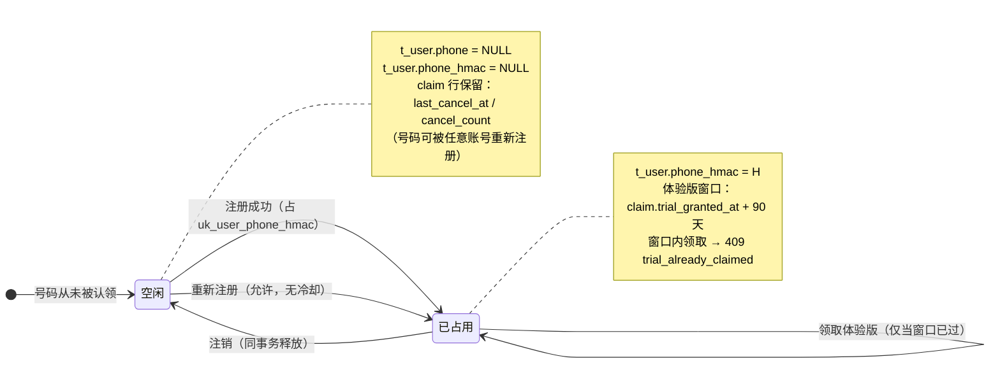

# 增量 PRD：手机号认领与释放（注销可重新注册 / 体验版 90 天窗口）

> 承接：`docs/tasks/INC-phone-hmac-prd.md`（方案 A 落地）、`docs/tasks/errata.md` E-41 / E-42。
> 本文件回答三件事：**注销后能再注册**、**同号 90 天不得再领体验版**、**PRD 措辞回写**。
> 不写代码、不写表结构（DDL 由设计/研发落），只定语义与验收。

## 1. 项目信息

| 项 | 值 |
| :--- | :--- |
| Language | 中文 |
| Programming Language | Go（controld / fund）+ MySQL 8 + Redis；前端 React + Tailwind（沿用仓内既有栈，不引入新框架） |
| Project Name | `inc-phone-claim` |
| 交付物 | `docs/tasks/INC-phone-claim-prd.md`（本文件）+ 回写文本（§12） |

**原始需求复述**：上一轮按方案 A 把「注销」实现为「账号 DISABLED 但继续占用手机号唯一键」，结果是用户被自己的号码锁死（同号永远 409），且 PRD F-12⑥ 的「同号 90 天内不得再领体验版」完全没有实现（`fund/trial.go` 只做跨账号等值判重，无时间窗）。本轮放开号段、把 90 天窗口真正做出来，并把 PRD / errata 的措辞改成与实现一致。

## 2. 现状基线（已核实，作为事实前提）

| # | 事实 | 影响 |
| :--- | :--- | :--- |
| B1 | `cancel.go` 只置 `status='DISABLED'`（`disable_source='SELF_CANCEL'`），无 7 天冷静期、无 PII 清空任务；`cancelPhonePII` 是**空函数**，`phone` 与 `phone_hmac` 都保留 | 唯一键继续占号 → 同号永久 409 |
| B2 | `t_user.uk_user_phone_hmac` 全表唯一，NULL 不参与；`phone` 明文列无唯一键 | 唯一性可以「释放」，只要把 `phone_hmac` 置 NULL |
| B3 | `trial.go` 手机因子 = `t_device_fingerprint JOIN t_user ON phone_hmac` 等值判重，跨账号、**无时间窗** | 90 天窗口不存在；且该 JOIN 在 hmac 置空后**静默失效** |
| B4 | `trialClaimLookbackDays=30` 是 **IP 段审计窗口**，不是体验版窗口 | 不要拿它当 90 天用 |
| B5 | 体验版**不是注册时自动发放**，是显式动作 `POST /api/console/trial/claim` | F-12⑥ 的「注册侧校验」在本项目应落在**领取侧** |
| B6 | 登录按**明文 `phone`** 取第一行（`findUser`，无 `LIMIT 2`、不筛 `status`）；找回密码用 `findUserUnique`（`LIMIT 2`，两行判歧义） | **只释放 hmac、保留明文 `phone` 会让同号出现两行活数据**：登录可能取到已注销行、找回密码永久歧义。这是本轮必须一并处理的耦合 |
| B7 | 软删/放号既有约定：`#del#{id}{unix_ms}` 墓碑；审计表 `t_admin_audit_log`；错误码不新增（可用 `account_exists` / `trial_already_claimed` / `resource_state_conflict`） | 复用，不自创 |

## 3. 目标（3 个，正交）

1. **用户不再被自己的号码锁死**：注销后同一手机号可立即重新注册，且旧账号的登录/找回路径不会被新账号撞上。
2. **套利链断开**：同一手机号在 90 天内至多领取一次体验版，**跨账号、不受注销影响**。
3. **文档与实现一致**：F-12⑥ / §10.3 的措辞可执行、可验收；E-41 关闭，`schema.md` 里「注销 = 占号」这句反向口径一并改掉。

**成功度量**：注销→重注册的客服工单归零；同号 90 天内二次领体验版成功率为 0；`docs/schema.md` 与代码对「注销对手机号做了什么」的描述零差异。

## 4. 用户故事

| # | 角色 | 故事 |
| :--- | :--- | :--- |
| U1 | 个人用户 | 我误注销了账号，希望**用同一个手机号重新注册**，把服务恢复起来，而不是被告知「该号码已注册」。 |
| U2 | 个人用户 | 我注销后重新注册，期望**不再拿到一次体验版**——规则要能说清楚，且不能只对我一个人随机生效。 |
| U3 | 个人用户（新机主） | 我买到的号码是别人用过的，期望**能注册**（不是 409 卡死），也知道为什么第一次领体验版可能被拒。 |
| U4 | 运营/客服 | 用户说「我用的是我自己的号，却说我已注册」，我要能**一次查清**：这个号被谁用过、什么时候注销、是否领过体验版。 |
| U5 | 运营 | 我要能区分「号码正常被占用」和「号码已释放但仍在 90 天体验窗口内」，两个口径对应两套话术。 |
| U6 | 研发/DBA | 上线后**存量的已注销账号**也要能被释放（不是只对新注销生效），且这个动作可回滚、可重跑、有报告。 |

## 5. 决策（逐条对应「要定清」的 9 个问题）

### D1 释放时机：**注销即释放**（同一事务），不等 7 天

- **结论**：`POST /api/v1/auth/cancel` 在一个事务里完成「`status=DISABLED` → 写 claim → `t_user.phone=NULL` 且 `phone_hmac=NULL`」。
- **理由**：① 冷静期本轮未实现，注销**立即生效且不可撤销**；释放若延后，就必须引入一个延迟任务（本轮明确不做 Job），而窗口期内号码仍占位、用户重注册仍 409，等于承诺了「可重新注册」却不兑现；② 释放必须在**注销成功的同一事务**里落库，任何「异步补一刀」都留下「注销成功但号段未释放」的中间态，且没有幂等补偿入口。
- **风险（必须写进 PRD，§10 不做清单与 D1 绑定）**：F-12 的 7 天冷静期一旦落地，「释放」必须**挪到冷静期届满**与 PII 清空同批执行——否则冷静期内撤销时，用户手机号明文与 hmac 都已消失（hmac 不可逆、claim 只有 hmac），**撤销后无法再用手机号登录，撤销形同虚设**。这是 D1 与 F-12 的唯一硬耦合，后续实现冷静期时**先改释放时点，再改其它**。
- **被否方案**：「注销后 7 天再释放」——需要延迟 Job + 幂等补偿 + 一个「冷静期中」的中间状态，本轮成本 ≫ 收益；且当前没有冷静期的撤销入口，延迟释放没有任何用户价值。

### D2 claim 表语义：**号码台账，一行一号码，没有状态列**

- **结论**：`t_phone_claim` 的 `PRIMARY KEY (phone_hmac)`，**一个号码永远一条记录**，只被 UPDATE，不因反复注销/注册而新增行。**不设 `state`（ACTIVE / RELEASED）**。
- **「同时只有一个 ACTIVE」怎么保证**：不靠 claim，靠 **`t_user.uk_user_phone_hmac`**。占用状态的唯一权威是「是否存在一行 `t_user.phone_hmac = H`」；claim 行只是台账（首次见到的账号、最近注销时间、注销次数、体验版窗口）。这样没有第二份真相源，也没有 MySQL 部分唯一索引的问题。
- **为什么拒绝 `UNIQUE(phone_hmac, state)`**：它对 `RELEASED` 也生效——同一号码第二次释放就会撞 1062。要绕开只能给 `state` 加 `release_seq`，或把 `RELEASED` 存成 NULL 利用「NULL 不参与唯一」——两者都是「为了让一个本不需要状态的东西有状态」而引入的隐式约定，且 `state` 与 `t_user.phone_hmac` 会漂移（漂移后无人知道哪个对）。
- **注册判重不查 claim**：查 claim 是 check-then-act（TOCTOU），claim 又没有能承担唯一性的键；而 `t_user` 的 uk 是**原子**的。判重继续由 `INSERT t_user` 的 1062 决定（B2 已具备）。
- **claim 行承担的唯一职责**：① 号码维度记住「最近一次体验版发放时间」；② 运营可查号码历史；③ 号码首登时间。

### D3 90 天窗口锚点：**最近一次体验版发放时间**（`trial_granted_at`），**跨账号**

- **结论**：拒绝条件 = `claim.trial_granted_at IS NOT NULL AND trial_granted_at > now - INTERVAL 90 DAY`。
- **为什么不锚「注销时间」**：① 号码被运营商回收、新机主从未领过体验版时，锚注销时间会**冤枉新人**（他不该为上一任的注销付 90 天代价）；② 锚发放时间才与 PRD 自己写的动因一致——「注册领 7,000 → 注销 → 再注册」这条链里，注销必发生在发放后 7 天内（体验版权益 7 天回落、赠送积分 90 天到期），锚发放时间**覆盖全链条**；③ 与 `bonus_valid_days = 90` 同值，语义可一句话说清：**一个赠送积分生命周期内，一个号码只能领一次**。
- **为什么不锚「最近一次认领（注册）时间」**：反例——第 0 天注册并领体验版，第 100 天才注销，第 101 天重注册；按认领时间算窗口已过 → 可领第二次，但套利链恰恰是这一条。锚发放时间是唯一能堵住它的。
- **跨账号**：是。claim 按号码存，与账号解绑——这是「同号换号重注册仍受限」的实现方式。
- **与 PRD 字面的差异（需签字，见 §11 Q2）**：F-12⑥ 原文「注销后 90 天内」，本 PRD 改为「90 天内至多领一次，按最近一次发放时间计」。差异只出现在「领过体验版后又用了很久才注销」的号码上（字面更严、本方案更合理）。

### D4 体验版权威数据：**`claim.trial_granted_at`**（只存最近一次）

- **结论**：`trial_granted_at` + `last_trial_user_id` 落在 claim 行；`t_user.trial_claimed_at` 保留，但降级为**账号维度历史**，不再作为跨账号判据。
- **为什么不在 `t_user` 上查历史**：注销后 `t_user` 行仍在（不删行，只 `DISABLED`），但本轮之后**它不再持有 `phone_hmac`**（已释放），按号码反查历史就断了；而且「最近一次」本来就不需要多行——多发记录已有 `t_admin_audit_log`（`RISK/TRIAL_CLAIM`）与账本兜底。
- **写入时机**：`fund/trial.go` 发放事务内 `INSERT ... ON DUPLICATE KEY UPDATE trial_granted_at=VALUES(trial_granted_at), last_trial_user_id=VALUES(last_trial_user_id), updated_at=VALUES(updated_at)`。**同一事务**，发放成功与窗口时间必须同生共死。

### D5 存量回填：**两部分 P0，先于发布执行**

1. **回填 claim**（`INSERT ... SELECT`＋幂等）：来源 = `t_user` 中 `phone_hmac` 非空、非 `#del#` 前缀、`deleted_at IS NULL` 的行；`trial_granted_at = t_user.trial_claimed_at`，`first_seen_at = created_at`，`first_user_id = id`。
2. **释放存量已注销账号**（这是漏了就等于没做的部分）：`status='DISABLED' AND disable_source='SELF_CANCEL'` 的行，**先把历史写进 claim**（含 `trial_granted_at` 取自行上 `trial_claimed_at`），再 `phone=NULL, phone_hmac=NULL`。否则「上线前注销的老用户」永远注册不上——产品承诺了却只对新用户生效。
3. **释放边界**：只放 `SELF_CANCEL`。`OPS_MANUAL` / `RISK_AUTO` / `FROZEN_OVERDRAFT` 的号码**不释放**（封禁账号保留占位），这是产品裁定，验收里要有一条反向断言。
4. **执行形态**：dry-run 默认、`--commit` 才写、`--batch/--sleep`、连跑第二次 `changed=0`、输出掩码手机号与汇总报告；单条失败记录 `uid` 继续，不中断。与 `backfill-phone-hmac` 同一操作范式（`docs/ops-runbook.md` §10.2）。
5. **异常行**：`phone` 有值但 `phone_hmac` 为空 → **跳过 + 计数**，指向 runbook §10.3 的 `PHONE_WITHOUT_HMAC` 处置；不现场造 hmac。
6. **与发布顺序**：迁移 0029 → 回填/释放（低峰，单实例）→ 再发布代码。反过来会有一个窗口：老注销号释放了但 claim 里没有 `trial_granted_at` → 白送一次体验版。
7. **不阻塞性**：即便回填没跑，**新注销**也会在 cancel 事务里把 `t_user.trial_claimed_at` 写进 claim（自愈），所以回填只影响「存量已注销账号能否重注册」与「台账完整性」。**但存量释放必须跑**，否则 U1 的承诺对老用户不成立。

### D6 并发：唯一性在 `t_user.uk` 层，**不新增并发机制**

- **结论**：两个请求同时注册同一号码 → 一个 201，另一个 `INSERT t_user` 命中 1062 → **409 `account_exists`**（复用 E-42 的既有映射，`register_dup_phone_hmac` WARN 日志，日志不含 hmac 值）。不新增错误码、不加分布式锁。
- **claim 写入位置**：同一事务、`t_user` INSERT **之后**。claim 写失败 → 整事务回滚（不许出现「注册成功但台账缺失」）。
- **锁序（硬约束，写进设计）**：**`t_user` → `t_phone_claim`**。 register / cancel / trial 三条路径统一按此顺序；`trial` 现有 `SELECT ... FOR UPDATE t_user` 保持不变，claim 行锁排在它之后。违反锁序即为缺陷（会与 cancel 死锁）。
- **概率说明**：验证码一次性 + 按标识签发，已经让双注册很难发生；1062 是兜底，不是主路径。

### D7 号码重复使用次数：**claim 不累积行，改为计数列**

- **结论**：因为一行一号码，反复注销/注册**只 UPDATE 同一行**，`cancel_count += 1`。行数上界 = 有手机号的唯一号码数，**不存在清理问题**。
- **保留期**：**不设清理，本轮不做清理 Job**。理由：① hmac 是伪名化标识，不含明文，与 F-12④「删可识别性、保留可判定性」一致；② claim 是「号码是否领过体验版」的唯一记忆，清掉它等于把 90 天窗口一起废掉；③ 一行一号码，没有膨胀。若将来要清理，前提是 **90 天窗口已废止或改由别处承载**。
- **索引**：只留 `PRIMARY KEY (phone_hmac)`；`last_cancel_at` 的统计索引留到真有统计查询时再加（避免建无消费者的索引）。

### D8 对外文案（4 处）

| # | 位置 | 变更 |
| :--- | :--- | :--- |
| C1 | 注册 409 `account_exists` | **保持现状**（「该账号已注册 / 直接登录，或通过找回密码重置」）。理由：本轮之后 409 只可能来自**一个正常占用的账号**；在此处提「可能你注销过」会把状态判断的活丢给用户，且等于告诉探测者「这个号曾经被注销」。客服话术补一句见 C5。 |
| C2 | 注销确认页（`web/src/pages/console/AccountPage.tsx`） | 新增三条必须可见的后果：① 账号停用、无法登录；② **该手机号将被立即释放，可被他人重新注册**；③ **90 天内该号码不能再领取体验版积分；剩余赠送积分不退**（F-12③） |
| C3 | **注销确认框（缺陷修复，P0）** | 当前要求输入「登录邮箱」确认；**手机号注册用户的 `email` 为空**，`typed !== (user?.email ?? '')` 恒成立 → 输入框为空即通过，确认框形同虚设。本轮注销后果变重（不可逆 + 立即释放），必须改为「输入登录标识确认」：有邮箱用邮箱，无邮箱用手机号后 4 位，并给出字段标签与实际比对对象一致。 |
| C4 | 体验版被拒 `trial_already_claimed` | `hint` 由「每个设备、手机号与网络仅可领取一次」改为「每个设备、手机号与网络仅可领取一次；**手机号注销后 90 天内同样不可再次领取**；如有异议请联系客服」。**不点名命中的因子**（点名＝教唆换哪个因子），`message` 不变。 |
| C5 | 客服话术（runbook） | 「号码已被一个正常账号占用，请直接登录或找回密码；若您近期注销过，该号码可能已被他人注册，需人工核验。**同一号码 90 天内不能重复领取体验版积分**。」 |

### D9 审计：**不新增 action**，扩展现有 3 条的 `after`

| 现有 action | 本轮扩展 |
| :--- | :--- |
| `USER/CANCEL` | `after` 增加 `phone_released: true`、`claim_cancel_count: N`（不写 hmac、不写明文） |
| `USER/CREATE` | 不变（台账 upsert 不单独留痕；注册已有一条审计） |
| `RISK/TRIAL_CLAIM` | `after` 增加 `phone_window: "claim"`（表示本次判定走号码台账），不写 `trial_granted_at` 之外的号源信息 |
| 运营手工释放 `PHONE_RELEASE` | **保留但降级为兜底**（cancel 事务失败后的补偿、误判纠正）；常规路径不再需要它，`ops-runbook` §10.4 标题与前言要改 |

## 6. 状态机

号码维度（唯一权威 = `t_user.phone_hmac` 是否存在），体验版窗口是**叠加在「已占用」上的第二维**，不是状态列：



| 状态 | `t_user.phone` | `t_user.phone_hmac` | `claim` 行 | 能否注册 | 能否领体验版 |
| :--- | :--- | :--- | :--- | :--- | :--- |
| 空闲（从未认领） | — | — | 无 | 能 | 能 |
| 已占用·无窗口 | 有值 | `H` | `trial_granted_at IS NULL` | 409 | 能 |
| 已占用·窗口内 | 有值 | `H` | `trial_granted_at > now-90d` | 409 | **409** |
| 空闲（注销后） | NULL | NULL | `last_cancel_at=now`, `cancel_count+1` | 能 | 按 `trial_granted_at` 判 |

## 7. 需求池

### P0（缺一项则需求不成立）

| # | 需求 | 说明 |
| :--- | :--- | :--- |
| P0-1 | 迁移 `0029` 建 `t_phone_claim`（+ down） | 一行一号码，`PRIMARY KEY (phone_hmac)`；列：`first_user_id`、`first_seen_at`、`last_claim_user_id`、`last_cancel_at`、`cancel_count`、`trial_granted_at`、`last_trial_user_id`、`updated_at`。排序规则与全库一致（`utf8mb4_0900_as_cs`）。**无 `state` 列** |
| P0-2 | 注册（含运营建号）同事务 upsert claim | 改在**唯一插入漏斗**（`insertUserRow`）内，覆盖公开注册 / 运营建号 / 内置超管；`first_seen_at` 保留首次（`VALUES()` 不回写） |
| P0-3 | 注销同事务：写 claim → 清 `phone` 与 `phone_hmac` | 顺序不可换（claim 要先读到 `trial_claimed_at`）；`trial_granted_at = COALESCE(claim 既有值, 行上 trial_claimed_at)`；`cancel_count+1`；`cancelPhonePII` 从空函数改为真实实现，`cancel.go` 顶部「注销保留 hmac」的注释**必须重写**（现在是反的） |
| P0-4 | 体验版 90 天窗口 | 手机因子从 `JOIN t_user.phone_hmac` 改为查 `claim`；判定与发放写回在同一事务；窗口常量 `trialPhoneWindowDays = 90` **硬编码**（不新增配置键：F-12 已定档，新增键要动 §3.7 的 45 键表与失效通道，成本不成比例；与既有 `trialClaimLookbackDays=30` 同风格） |
| P0-5 | 存量回填 + 存量释放命令 | 见 D5；`make backfill-phone-claim ARGS="apply\|apply --commit\|verify"`，dry-run 默认，幂等，报告，只放 `SELF_CANCEL` |
| P0-6 | 文案 C2 + C3 | 注销确认页后果三条 + 注销确认框改「登录标识」（手机号账号当前是空过） |
| P0-7 | 文档回写 | §12 的 F-12 cell、§10.3④/⑤/⑥、errata E-41 关闭；**`docs/schema.md` §「注销 = 占号，软删 = 放号」必须改写**（本轮把它反转了），否则下一位读者会照着旧口径实现 |

### P1（应当）

| # | 需求 |
| :--- | :--- |
| P1-1 | 运营用户详情展示「该号码：领取体验版时间 / 注销次数 / 最近注销时间」（只读，走 `admin.read`，不暴露 hmac） |
| P1-2 | `trial_already_claimed` 的 `hint` 按 C4 调整 |
| P1-3 | 两条运维日志 token（不新增指标家族，避免 §5.3 冻结清单与「无数据源假 0」的旧坑）：`phone_claim_released uid=`、`trial_phone_window_hit`（不带号码、不带 hmac） |
| P1-4 | `ops-runbook` §10.4 改标题与前言为「兜底」；§10.2 增 `backfill-phone-claim` 段；`test-matrix` 补 AC 组 |
| P1-5 | `INC-phone-hmac-design.md` §8.3 / §15-R8 / 决策表 A8 标注「方案 B 已落地，D1/D2 废止」 |

### P2（可选）

- 运营后台「号码台账」查询页（按掩码手机号 / user_no 反查）。
- `idx_phone_claim_cancel`（等真有按 `last_cancel_at` 的统计查询再加）。

## 8. 验收标准（可断言）

| # | 场景 | 断言 |
| :--- | :--- | :--- |
| AC-1 | 注销即释放 | 账号 A（号码 X，3 天前领过体验版）注销后：`t_user` A 行 `phone IS NULL AND phone_hmac IS NULL`；`claim[X].last_cancel_at` = 注销时刻、`trial_granted_at` = 3 天前、`cancel_count = 1`；无中间态（同事务） |
| AC-2 | 同号可重新注册 | 紧接 AC-1 用 X 注册 B → **201**，且 B 是**新 uid**（不复用 A 行） |
| AC-3 | 90 天窗口生效 | B 领体验版 → **409 `trial_already_claimed`**；`hint` 含「90 天」；B 的 `t_user.trial_claimed_at` 仍 NULL、无账本行、`t_device_fingerprint` 无 `trial_granted=1` 行 |
| AC-4 | 窗口到期放行 | 把 `claim[X].trial_granted_at` 改到 91 天前 → B 领取 → **200**，`claim.trial_granted_at = now`、`last_trial_user_id = B` |
| AC-5 | 边界 | `trial_granted_at` 恰为 `now - 90d` → **放行**（窗口为左开：`> now-90d` 才拒） |
| AC-6 | 从未领过的号码不受限 | A 从未领体验版（`trial_granted_at IS NULL`）→ 注销 → B 注册 → B **立即可以领到** 200（新机主场景 U3） |
| AC-7 | 唯一性未被削弱 | X 被 B 占用后，C 用 X 注册 → **409 `account_exists`**；日志 `register_dup_phone_hmac`（WARN），**日志行不含 hmac 值** |
| AC-8 | 并发 | 两连接同时注册同一号码 → 恰一个 201、另一个 409，无 5xx；`SELECT COUNT(*) FROM t_user WHERE phone_hmac=H` 恰 1 |
| AC-9 | 锁序 | 同一账号并发「注销 + 领体验版」→ 双方均无 5xx、无死锁；日志无 ERROR |
| AC-10 | 邮箱账号零影响 | 邮箱注册/注销/再注册全过程 → `t_phone_claim` 无新增行（该手机号因子对其不适用） |
| AC-11 | 存量释放 | 造 `DISABLED + SELF_CANCEL` 行（hmac=H，`trial_claimed_at` 有值）→ 跑 `apply --commit` → 该行两列 NULL，`claim[H]` 有 `trial_granted_at`、同号可注册 |
| AC-12 | 释放边界 | `OPS_MANUAL` / `RISK_AUTO` / `FROZEN_OVERDRAFT` 行跑同一命令后 `phone_hmac` **不变**（仍占号） |
| AC-13 | 幂等 | 命令连跑两次，第二次 `changed = 0` |
| AC-14 | 设备因子叠加 | 同 `fp_hash` 换新号注册 → 领体验版仍被拒（证明两个因子独立，不是 90 天窗口替代设备判重） |
| AC-15 | 审计 | `USER/CANCEL` 的 `after` 含 `phone_released=true` 与 `claim_cancel_count`；`t_admin_audit_log` 无新增 action 值 |
| AC-16 | 找回密码不被撞 | 注销后可立即注册成功，且**新账号**的「找回密码」流程正常（不被 A 行干扰）；A 行不参与 `findUserUnique` 的两行歧义 |

## 9. 影响面（研发按此派单，产品不再展开）

| 层 | 位置 | 变更 |
| :--- | :--- | :--- |
| 迁移 | `internal/platform/migrate/sql/mysql/0029_phone_claim.sql(+down)` | 建表；down 直接 DROP |
| 后端 | `auth/register.go`（`insertUserRow` 漏斗） | upsert claim |
| 后端 | `auth/cancel.go`（`cancelPhonePII` + 顶部注释） | 真实释放 + 注释反转 |
| 后端 | `fund/trial.go` | 手机因子改 claim；发放写回；`hint` 文案 |
| 后端 | `apierr/codes.go` | 仅 `trial_already_claimed.hint` 一行 |
| 命令 | `cmd/backfill-phone-claim`（+ `Makefile` 目标） | 回填 / 释放 / verify |
| 前端 | `pages/console/AccountPage.tsx`（+ test） | 后果三条、确认框改标识 |
| 文档 | PRD `:1625`、§10.3④⑤⑥；`errata.md` E-41；`schema.md` §「注销 = 占号」；`ops-runbook` §10.2/10.4；`INC-phone-hmac-design` §8.3/§15-R8；`error-codes.md`（hint）；`test-matrix.md` | 见 §12 |
| 监控 | 日志 token ×2（P1-3） | 不新增指标家族 |

## 10. 明确不做（防范围膨胀，且这些是**既有缺口**，不是本轮引入）

| 不做 | 为什么可以不做 |
| :--- | :--- |
| **7 天冷静期与撤销** | F-12① 从未实现（现状注销立即生效、立即 DISABLED）。本轮释放与它绑定：**上冷静期时必须先改释放时点**（D1），否则撤销不可用。已在 D1 写明收口方式 |
| **PII 全量清空 Job**（邮箱、姓名、设备指纹） | F-12④ 的既有缺口。本轮只做了 ④ 里的 `phone` 与 `phone_hmac` 两项，且**提前到注销时点**（隐私上更严不更松）。其余字段仍在库里 |
| **Key 删除 Job / 日志正文硬删 Job** | F-12④②③ 的既有缺口，与号段无关。现有账号停用后 Key 不可用已足够 |
| **发票 / 账本 / 退款处理** | F-12③⑤ 的既有缺口，涉及资金与税务，必须单独增量 |
| **邮箱账号的对称缺口** | `uk_user_email` 仍在注销后占号 → **邮箱注册的用户同样被自己锁死**，且邮箱是主标识、影响面比手机号更大。本轮只做手机号；登记为 P1（见 §11 Q1） |
| **claim 清理 Job** | 一行一号码、无累积（D7） |
| **运营后台 claim 管理页** | P2，先靠 runbook 的 SQL + 审计 |

## 11. 待确认问题（3 条）

1. **邮箱账号要不要一并放开？** 现状：注销后 `email` 仍占 `uk_user_email`，同邮箱无法重新注册——与手机号是同一个 bug，且邮箱用户占比更高。本轮若不做，客服会遇到「手机号能重注册、邮箱不能」的不一致。**建议**：本轮不做（claim 表按 `phone_hmac` 建，扩到邮箱要改成通用标识台账），登记 P1 并在客服话术中说明；若要求本轮一并解决，则 `t_phone_claim` 需改为通用 identifier claim，工作量翻倍。
2. **D3 的锚点要签字**：把 F-12⑥ 从「注销后 90 天」改成「90 天内至多领一次，按最近一次发放时间计」。这是本轮唯一偏离 PRD 字面的地方，需要需求方落笔（否则回写 PRD 就变成「按实现改需求」）。
3. **D8-C3（注销确认框对手机号账号空过）本轮修不修？** 建议修——本轮把注销变成「不可逆 + 立即释放号段」，一个一键即过的确认框风险不对称。若判定超范围，请明确降级为 P1 并由谁背这个风险。

## 12. PRD / errata 回写文本（可直接替换）

### 12.1 PRD `docs/_API 中转站 · 需求文档 V1.2.md:1625`（F-12 行）——**新单元格文本**

```
**7 天冷静期**；充值积分退 **90%**、低于 **1,000** 不受理、赠送不退；届满后 7 个工作日完成 PII 置空 / `phone_hmac` 迁出、Key 删除、正文硬删；账本不回改、发票记录不脱敏；**号码可重新注册**——释放与 PII 清空同批执行（本轮在注销提交时，冷静期落地后随届满），释放后同一手机号可注册；**同一手机号 90 天内不得再领体验版**（按号码判重、**跨账号**，窗口自该号码**最近一次体验版发放时间**起算，命中时按正常流程注册、仅**不发体验版**并提示原因）
```

> 只在 ⑤ 段做了三处改动：`phone_hmac 置空` → `phone_hmac 迁出`；新增「号码可重新注册」；⑥ 加锚点与跨账号。**7 天冷静期、退 90%、Key 删除、正文硬删一字未动**——它们是需求，不是本轮实现状态。

### 12.2 §10.3 ⑥ 整段替换

```
**⑥ 防套利。** 同一手机号 **90 天内至多领取一次体验版**——防「注册领 7,000 积分 → 注销 → 再注册」的套利链。判据是**号码**而非账号：注销**不**抹掉这条记忆（`t_phone_claim` 保留，`t_user.phone_hmac` 释放），因此同号换账号重注册仍受限。窗口自该号码**最近一次体验版发放时间**起算（与 `bonus_valid_days = 90` 同值：一个赠送积分生命周期内一次）。本项目的体验版是**显式领取动作**（`POST /api/console/trial/claim`），不是注册副作用，所以校验落在**领取侧**：命中时拒绝领取并提示原因，注册本身不受影响、也不发积分。
```

### 12.3 §10.3 ④ 第 1 条与 ⑤ 的合并修正（一行替换）

```
1. 用户表 PII **置空或不可逆哈希**：`phone` 置 NULL，`phone_hmac` **迁出到 `t_phone_claim` 后置 NULL**（判重与 90 天窗口由号码台账承载，不再依赖 `t_user` 行）；邮箱、姓名、设备指纹**直接置空**。**判重一律查号码台账，不查明文**；
```

### 12.4 `docs/tasks/errata.md` E-41 关闭说明（一句话）

```
**E-41 关闭（本轮）**：方案 B 已落地——迁移 `0029` 建 `t_phone_claim`，注销时同一事务把号码写进台账并释放 `t_user.phone` / `phone_hmac`（同号可重新注册），注册唯一性仍由 `uk_user_phone_hmac` 保证，体验版 90 天窗口按 `trial_granted_at` 跨账号判定；F-12⑥ 措辞已按 `INC-phone-claim-prd` 回写，原 D1「注销即占号」与 D2「90 天窗口不实现」两条裁定**同时废止**。
```

---

## 附：与既有文档的关系

- 本文件**取代** `INC-phone-hmac-prd.md` 中「注销即占号」「90 天窗口不实现」两条结论，其余（hmac 计算、回填、密钥保管）不变。
- `docs/schema.md` §「`t_user.phone` 与 `t_user.phone_hmac` 的语义」的「注销 = 占号，软删 = 放号」一句**必须改写为**「注销 = 放号（台账承接记忆），软删 = 放号」，否则本轮之后它就是错的。
