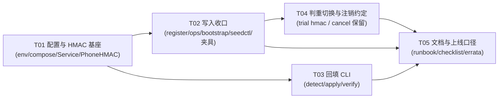
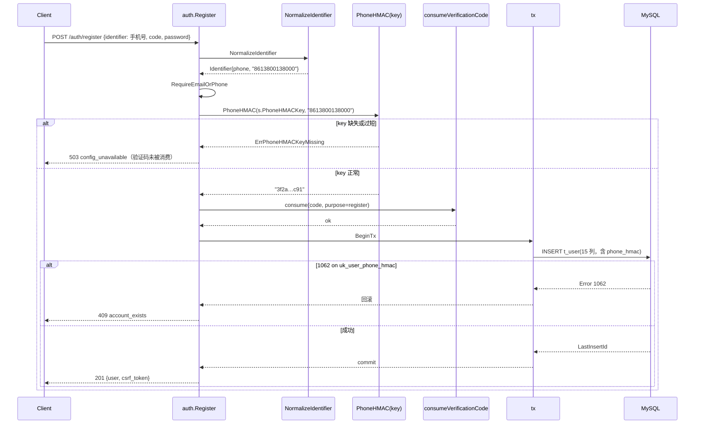
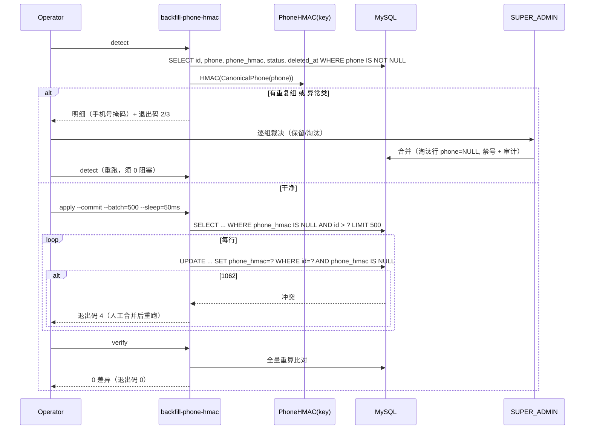

# 增量技术设计：`t_user.phone_hmac` 写入 / 回填 / 判重切换（手机号唯一性修复）

| 项目 | 内容 |
| :--- | :--- |
| 类型 | 技术债清理（增量）。**不含实现代码**，只给口径、数据流、任务分解与验收 |
| 入口 | 主理人 2026-11-04 任务说明（`t_user.phone_hmac` 空列 → 手机号唯一性实际失效） |
| 关联遗留 | `INC-password-recovery-design.md` §C1 / §10-R5、`INC-admin-bootstrap-design.md` §16-R4 |
| 事实基线 | 逐文件实测：`internal/platform/migrate/sql/mysql/0011_user_phone_hmac.sql`、`internal/control/auth/{register,cancel,login,account,normalize,handler}.go`、`internal/control/ops/{users,users_operator,service}.go`、`internal/control/fund/{trial,service}.go`、`internal/control/bootstrap/admin.go`、`cmd/{seedctl,migrate,controld}/main.go`、`internal/config/key.go`、`deploy/*`、`scripts/{stack.sh,e2e-backend.sh}`、`internal/acceptance/main_test.go`、`internal/control/fund/main_test.go` |
| 目标读者 | 主理人（拍板 D1/D2）、工程师（照 §12/§13 施工）、评审（照 §16 打勾） |

---

## 0. 方案结论速查（工程师只看这一节也能确认口径）

| # | 结论 | 一句话理由 |
| :--- | :--- | :--- |
| **A1** | **不加迁移**。`phone_hmac char(64)` + `uk_user_phone_hmac` 在 `0011` 已存在且形态正确，本轮只做「写入 + 回填 + 判重切换」 | 列与唯一键都在，缺的是数据和代码，不是 schema（§10） |
| **A2** | **密钥 `PHONE_HMAC_KEY` 独立于 `FP_HMAC_KEY`，不复用** | 轮换周期与泄漏影响面完全不同：设备指纹高熵不可枚举，手机号 11 位可离线枚举（§3.2） |
| **A3** | 缺 key：**进程照常启动**（邮箱账号的登录/注册/找回不受影响），但**所有写入手机号的路径 fail closed**（503 `config_unavailable` + 启动 ERROR/WARN） | 拒绝启动会把「手机号功能不可用」升级成「整站不可用」，这是升级即事故（§3.3） |
| **A4** | 回填形态：**独立命令 `cmd/backfill-phone-hmac`**（`detect` / `apply` / `verify`），**不是** `migrate` 子命令，**不是**启动懒回填 | MySQL 只有 `SHA2` 没有 HMAC，纯 SQL 迁移写不出来；启动懒回填在多副本下并发、失败语义不可控（§5.1） |
| **A5** | 回填**必须先 `detect` 再 `apply`**；`detect` 发现重复/异常时**不写、非零退出**，由人工裁决 | 唯一键已存在，带重复直接 `apply` 会在半个批次成功、半个批次 1062 的地方烂尾（§5.3） |
| **A6** | 判重口径：**登录与找回继续查明文 `phone`**；**只有 `fund/trial.go` 的等值判重切 `phone_hmac`**；注册/运营建号的重复由 1062 → `account_exists` 兜住 | 登录要回显手机号原文，且不能因缺 key/回填未完成让全部手机号用户登不进（与 `INC-password-recovery` A7 同一条红线） |
| **A7** | 注销（`POST /api/v1/auth/cancel`）语义不动，但**从本轮起 `phone_hmac` 永不因注销而清空**；未来 F-12 的 PII 置空任务只许 `phone=NULL`，不许动 `phone_hmac` | 这正是 `0011` 的设计目的（稳定判重键）；今天仓里还没有置空任务（§C1） |
| **A8** | ~~**注销后同一手机号不可再注册**（本轮默认 A，需产品确认 D1）；允许重新注册需要新表 `t_phone_claim`（方案 B，本轮不做）~~ **已废止（INC-phone-claim，0029 起：注销即释放，同号可重新注册）** | 「唯一键 + 保留 hmac + 允许重注册」三者不可兼得，MySQL 没有部分唯一索引（§C3/§8） |
| **A9** | 密钥轮换**本轮不做**，只在文档写清「停机 + 全量重算 + 已 PII 置空行不可重算」 | 在线轮换要加列做双写双查、三次发布，属于过度设计（§9） |
| **A10** | 明文与 hmac 漂移的发现手段 = `backfill-phone-hmac verify`（重算比对），进上线清单 + 可选日巡检 | SQL 做不了 HMAC，「看起来有值」不等于「值是对的」（§5.6/§15-R4） |
| **D1** | **产品待确认**：注销后是否允许同一手机号重新注册（默认「不允许」） | 影响 §8 的唯一键语义，必须由产品落笔 |
| **D2** | **产品待确认**：F-12⑥「同一手机号 90 天内不得再领体验版」的窗口是否本轮实现（默认「不实现」，记为 P1） | 当前 `trial.go` 根本没有窗口，切 hmac 不会顺带实现它（§C2） |

### 最容易做错的 3 点（评审重点盯这三处）

1. **把登录 / 找回也切成 `phone_hmac` 查询** —— 缺 key 或回填没跑完，所有手机号账号瞬间 100% 登不进、收不到码。红线：**读路径用明文，写路径用 hmac**（§7）。
2. **跳过 `detect` 直接 `apply` 回填** —— 唯一键报 1062、CLI 半途烂尾，留下一半行有 hmac 一半没有的不可解释状态；更糟的是有人为了让它跑通去 `DROP` 唯一键。
3. **只改 `register.go` 一处写入** —— 漏掉 `ops.CreateOperatorUser`、`bootstrap/admin.go`、`cmd/seedctl`、以及**测试夹具里直插/直改 `t_user.phone` 的地方**（`internal/control/fund/main_test.go:461`、`internal/acceptance/main_test.go:337`）。后果是「CI 绿、生产 1062」或反过来。附带一个顺序坑：hmac 必须在**消费验证码之前**算，否则缺 key 时用户白白烧掉一个码。

---

## 1. 目标与非目标

### 1.1 目标

1. **让 `uk_user_phone_hmac` 真正起作用**：一个手机号在任意时刻至多存在于一个 `phone_hmac` 上，注册与运营建号都无法再写入第二个。
2. **存量手机号可回填**：可检测、可 dry-run、可幂等重跑、可分批限速、失败可续跑，且**重复数据必须先由人裁决**。
3. **不制造新的事故面**：缺 key、回填未完成、历史重复数据这三种非理想状态下，登录与找回**不许**整体失效（宁可唯一性暂时不完整，也不能让人进不来）。
4. **为 F-12 留出正确的键**：注销/PII 置空后，判重仍有稳定键可用（`phone_hmac` 保留）。

### 1.2 非目标（本轮明确不做）

- ❌ 不实现 F-12 的注销后 PII 清空任务（jobsd 里今天没有这个任务，见 §C1）。
- ❌ 不实现「同一手机号 90 天内不得再领体验版」的窗口（D2，P1；需要 `t_phone_claim` 或 `trial_claimed_at` 窗口条件）。
- ❌ 不删 `findUserUnique`（`internal/control/auth/account.go:41`）—— 它是回填未完成期间唯一的歧义保护，回填清零后才可删（P1）。
- ❌ 不做密钥在线轮换（§9）。
- ❌ 不改登录/注册/找回的对外契约（不新增错误码、不改 `api/openapi.yaml` 结构、不重新生成 `web/src/api/types.ts`）。
- ❌ 不新增 `phone` 明文的唯一键（`phone` 保留可空、可重复；唯一性只归 hmac）。

---

## 2. 冲突与修正（任务说明 vs 代码实测）

> 这一节是本设计的「施工红线」。每条都是实测结论。**C1、C3 直接改写了任务说明的一个前提**。

### C1 `cancel.go` 并不置空 `phone`，仓里也没有 F-12 的 PII 清空任务

任务说明写「注销路径在 `internal/control/auth/cancel.go`（把 phone 置 NULL）」。实测：

- `cancel.go:75-80` 只有 `UPDATE t_user SET status='DISABLED', disable_source='SELF_CANCEL', disable_reason='用户主动注销', disabled_at=?, disabled_by=NULL, cancel_apply_at=?, updated_at=?`。**没有任何列被置空**。
- `grep -rn "phone = NULL\|SET phone"` 在 `internal/`、`cmd/` 里只命中 `internal/control/fund/main_test.go:461`（测试夹具）。
- `cmd/jobsd/main.go` 注册的任务是 `purge_log`、`purge_body_mode`、`daily_quota`、`expire_batch`、`close_expired_order`、`rollup`、`obs_sample` —— **没有账号 PII 清空**。`t_user.frozen_until`（注销冷静期截止，`0001:28`）全仓无写入方。

**结论修正**：今天「注销后 `phone` 为 NULL → `trial.go` 判重失效」这条链路**尚未发生**。今天真正的缺口是：

1. `phone` 自 `0011` 起没有唯一键，而 `phone_hmac` 恒 NULL（MySQL 允许多个 NULL）→ **注册/运营建号可以写入重复手机号**；
2. `login.go:279 findUser` 用 `QueryRow` 取第一行 → 命中哪个账号是任意的；
3. `account.go:41 findUserUnique`（`LIMIT 2`）把歧义判为「不可用账号」→ 用户「发码成功但收不到」（这正是 `INC-password-recovery` §10-R5 记录的现象）。

**对设计的两个影响**：

- 本轮**不新增**「注销保留 hmac」的代码（今天没有置空动作），但要把这条约束**写进 `cancel.go` 的注释 + 一条断言测试**，并写进 §14 共享约定，避免未来实现 F-12 的人「顺手把 `phone_hmac` 也置空」。
- `trial.go` 切 hmac 属于**前瞻性切换 + PII 最小化**（注销后仍能判重、不再用明文 join），不是「修一个已经坏掉的判重」。

### C2 `trial.go` 没有 90 天窗口，切 hmac 不会顺带实现它

- `trial.go:24 trialClaimLookbackDays = 30` 是 `ipSegmentClaimed`（审计日志里的 IP 段）的窗口，**不是**手机号窗口。
- 手机号判重是 `trial.go:99-114`：只要「另一个同号账号」在 `t_device_fingerprint` 里有 `trial_granted=1` 就拒，**无时间条件**；本人已领则看 `t_user.trial_claimed_at`。
- 因此本设计把「90 天」明确记为 **D2 / P1**，不在本轮偷渡。

### C3 「唯一键 + 注销保留 hmac + 允许重新注册」三者不可兼得

MySQL 没有部分唯一索引（partial index）。现状组合是：

- `uk_user_phone_hmac` 是**全表**唯一；
- 注销后 `phone_hmac` 保留（`0011` 的意图，也是 F-12⑥ 的前提）；
- PRD F-12⑥ 写的是「命中时**按正常流程注册**但不发体验积分」→ 隐含**允许重新注册**。

推论：一旦回填完成且写入全部到位，注销用户占着 `phone_hmac`，同号新注册会 1062 → 返回 `account_exists`。即 **「注销即永久占用手机号」**，与 PRD 的隐含语义冲突。三种出路（详见 §8）：

| 方案 | 是否允许重注册 | 代价 |
| :--- | :--- | :--- |
| **A（本轮默认）** | 否 | 无需迁移；注销用户的号段被永久占用（可 DBA 手工释放）；F-12⑥ 的「命中但不发体验」无法实现 |
| **B（后续增量）** | 是 | 新增 `t_phone_claim` 表（0029）：注销时把 hmac 迁出并 `phone_hmac=NULL`，判重查 claim 表 |
| C（不推荐） | 是 | 注销时把 hmac 改写成 `#cancel#<id>#<ms>` → 判重键当场丢失，F-12⑥ 永久不可实现 |

### C4 `t_user` 有 **5 个写入点**，不是 1 个

| # | 位置 | 列清单 | 是否写 hmac（现状） |
| :--- | :--- | :--- | :--- |
| 1 | `auth/register.go:237 insertUserRow`（经 `InsertUserRowTx`） | 14 列 | ❌ |
| 2 | `ops/users_operator.go:149` → `auth.InsertUserRowTx` | 同上 | ❌ |
| 3 | `bootstrap/admin.go:290` → `auth.InsertUserRowTx`（仅用户名） | 同上 | ❌（无手机号，恒 NULL，合法） |
| 4 | `cmd/seedctl/main.go:195` **自己一套 INSERT** | 13 列（无 `username`/`agreement_version`） | ❌ |
| 5 | `internal/acceptance/main_test.go:337` **测试夹具自己一套 INSERT** | 自建 | ❌ |

外加两处**事后改手机号**的夹具：`internal/control/fund/main_test.go:461`（`UPDATE t_user SET phone=?`）、`internal/acceptance` 的 `withPhone`。这些不写 hmac 的话，`trial.go` 切 hmac 之后会出现「CI 通过、生产拒绝」的反向假象。

### C5 缺 key 直接拒绝启动 = 邮箱账号一起挂

`register.go` 的注册同时支持邮箱与手机号。如果 `controld` 在缺 `PHONE_HMAC_KEY` 时拒绝启动，那么**与手机号毫无关系的邮箱注册/登录/找回也一起下线**。这与 `CHANNEL_KEY_KEK`（缺失只让「建上游 key」503）、`FP_HMAC_KEY`（缺失只让「领体验」503）的既有分级一致：**功能级降级，不是进程级失败**。故 A3。

### C6 登录不能切 hmac（与 `INC-password-recovery` A7 同源）

`findUser`（`login.go:279`）的返回值里 `phone` 要进 `view()` 回显（`login.go:198`、`ops/users.go:427`）。若查询条件改 hmac：

- 缺 key → 无法算 hmac → 登录直接 503；
- 回填未完成（生产有存量）→ 老用户查不到 → 「忘记密码」升级成「所有人都进不来」。

结论：**登录与找回的 `WHERE` 条件保持 `phone` 明文**。正确性由「回填完成 + 唯一键」保证；`findUserUnique` 的 `LIMIT 2` 作为回填期的兜底保留。

### C7 回填不能写成纯 SQL 迁移

MySQL 没有 `HMAC()`，只有 `SHA2()`/`AES_ENCRYPT()`。`migrate` 的迁移是**embedded SQL + checksum 金标**（`cmd/migrate/main.go` 的 `checksum --verify` 会校验 SQL 字节），塞 Go 代码进去会同时破坏 checksum 守卫和 `down` 语义。故 A4。

---

## 3. 密钥与配置

### 3.1 变量定义

| 项 | 值 |
| :--- | :--- |
| 变量名 | `PHONE_HMAC_KEY`（兼容 fallback `YUNSHU_PHONE_HMAC_KEY`，与 `fpHMACKey` 一致） |
| 常量位置 | `internal/config/key.go` 新增 `const EnvPhoneHMACKey = "PHONE_HMAC_KEY"`（与 `EnvInternalCallSecret` 同段，注释说明「环境变量而不是 t_config_item：配置表里的密钥对所有读配置的进程可见」） |
| 取值要求 | trim 后 **≥ 32 字节**；短于 32 视为未配置（fail closed + 明确日志 `too short`）。生成：`openssl rand -base64 32` |
| 语义 | 只用于 `HMAC-SHA256(规范手机号, key)` → **64 位小写 hex**，与 `fund.fingerprintHash`（`trial.go:286`）同构 |
| 不落库 | 不入 `t_config_item`（`KeyCount=45` 冻结）、不进审计、不进日志正文 |

### 3.2 为什么**不复用** `FP_HMAC_KEY`（结论：不复用）

| 维度 | `FP_HMAC_KEY`（设备指纹） | `PHONE_HMAC_KEY`（手机号） |
| :--- | :--- | :--- |
| 输入熵 | 高（客户端指纹串，可含随机盐，512 字节上限） | **极低**：国内 11 位、有效号段 ~10⁹ |
| 泄漏后果 | 只能验证「某个已知指纹是否出现过」，无法枚举反查 | 拿 DB 里的 hash + key 可**离线枚举全量号码**，等价于手机号明文泄露（PII 事故） |
| 轮换代价 | 可轮换：`fp_hash` 只用于 30 天窗口的设备判重，旧值失配的代价可接受 | **几乎不可轮换**：轮换后未重算的行永久失配（唯一性与判重同时失效），且已 PII 置空的行**无法重算** |
| 数据分级 | 假名化设备标识 | 受监管 PII |
| 变更节奏 | 随反作弊策略 | 视同加密密钥，长期固定 |

四条叠加的结论：**必须是两个独立密钥，且 `PHONE_HMAC_KEY` 按「PII 加密密钥」的保管级别管理**（与 `CHANNEL_KEY_KEK` 同级）。

**装配时强制互不相等**：`cmd/controld/main.go` 已有 `reusesProcessSecret`（`:445`），把 `PHONE_HMAC_KEY` 纳入检查：与 `SESSION_SECRET` / `CHANNEL_KEY_KEK` / `LOG_BODY_KEK` / `FP_HMAC_KEY` / `EXPORT_HMAC_KEY` 任一相同 → **按未配置处理**（fail closed）+ `logger.Error`。理由：一个泄漏值同时削弱两个边界（同 `INTERNAL_CALL_SECRET` 的既有做法 `main.go:255`）。

### 3.3 缺 key 的行为矩阵（A3）

| 进程 / 命令 | 读 `PHONE_HMAC_KEY` | 缺失时行为 |
| :--- | :--- | :--- |
| `controld` | 是（写手机号路径） | **照常启动**；`ENV=prod` 打 **ERROR**（其它环境 WARN）：`PHONE_HMAC_KEY is not set or too short: phone registration / operator user creation will answer 503` |
| ↑ `POST /api/v1/auth/register`（identifier 为手机号） | 是 | **503 `config_unavailable`**，hint「手机号注册暂不可用，请使用邮箱注册」。**邮箱注册 201 不受影响** |
| ↑ `POST /api/admin/users`（identifier 为手机号） | 是 | **503 `config_unavailable`**；邮箱建号不受影响 |
| ↑ 登录 / 找回 / `PATCH /auth/profile` / 绑定邮箱 | **否** | 完全不受影响（不哈希、不写手机号） |
| `jobsd` | 否 | —（未来 F-12 清空任务只写 NULL，不需要 key） |
| `gatewayd` | 否 | — |
| `migrate` | 否 | —（不做 SQL 回填，§C7） |
| `cmd/backfill-phone-hmac` | **必需** | 立即退出码 1，打印「PHONE_HMAC_KEY 未配置/过短，拒绝回填」 |
| `cmd/seedctl` | 是（种子含手机号时） | 含手机号种子 → 退出码 1；纯邮箱种子照常 |

失败码选择理由：`config_unavailable`（503）是**服务端配置缺失**的既有语义（`apierr/codes.go:196`、`trial.go:54` 同款），不是客户端 400 —— 用户改不了，别让他改。

### 3.4 配置落点

| 文件 | 改动 |
| :--- | :--- |
| `.env.example` | 新增 `PHONE_HMAC_KEY=dev-only-phone-hmac-key-change-before-deploy`（44 字节，满足 ≥32；与 `FP_HMAC_KEY`/`EXPORT_HMAC_KEY` 的 dev 占位风格一致，本地开箱可用）+ 注释说明轮换代价与生产必须替换 |
| `deploy/.env.stack.example` | 新增 `PHONE_HMAC_KEY=`（空，不提供假值），与 `CHANNEL_KEY_KEK` 同风格 |
| `deploy/docker-compose.stack.yml` | `x-app-env` 白名单新增 `PHONE_HMAC_KEY: ${PHONE_HMAC_KEY:-}`。**必须显式列出**：该锚点是后端 env 白名单，漏了不报错，只会静默失效（文件里已有同款警告注释） |
| `scripts/stack.sh` | `write_env()` 增加 `phone="$(b64_32)"` 与 `-e "s|^PHONE_HMAC_KEY=.*|PHONE_HMAC_KEY=$(esc "$phone")|"`，收尾 echo 的清单里补一句 |
| `scripts/e2e-backend.sh` | 增加 `-e PHONE_HMAC_KEY="e2e-only-phone-hmac-key-change-before-use"` |
| `internal/acceptance/main_test.go` | `os.Setenv("PHONE_HMAC_KEY", …)`（与现有 `FP_HMAC_KEY` 同处，`:77`） |

---

## 4. 数据流与口径

### 4.1 HMAC 的规范形态（三处必须一致）

```
phone_raw（用户输入）
  → auth.NormalizeIdentifier → Identifier{Kind: phone, Value: <纯数字, 6..20, 去 + 与分隔符>}
  → auth.PhoneHMAC(key, Value) = lowercase_hex(HMAC-SHA256(key, Value))   // 64 字符
  → t_user.phone（明文，同 Value）与 t_user.phone_hmac 同一事务写入
```

**硬约束**：

1. HMAC 的输入**只能是规范化后的值**（`ident.Value`），不得是用户原文 —— 否则 `+86 138-0013-8000` 与 `8613800138000` 得到两个 hmac，唯一性自己就漏了。
2. 新增 `auth.CanonicalPhone(raw) (string, bool)`（把现有 `normalize.go:109 asPhone` 导出，`asPhone` 改为转调它，**单一实现**）；回填用它校验「库里存的 phone 是否已是规范形态」。不一致 → **报异常，不猜**（否则用 A 字符串算 hmac、用户用 B 字符串登录，唯一性静默失效）。
3. 输出固定 64 位小写 hex（`char(64)` 刚好；`hex.EncodeToString` 天然小写，与 `fingerprintHash` 一致）。
4. 空串不是「无手机号」：`phone=''` 必须视为脏数据（§5.4 异常类），**不得**被哈希成 `HMAC(key,'')` 这个所有空串共享的值。

### 4.2 写路径（唯一收口）

`auth.insertUserRow`（`register.go:237`）是唯一 INSERT 收口（`InsertUserRowTx` 是它的导出壳，已被 ops 与 bootstrap 复用）。本轮把它扩成 15 列：

```
新增列：phone_hmac
新增入参：phoneMAC string   // 非手机号标识传 ""
函数内自检：if ident.Kind == KindPhone && phoneMAC == "" → return ErrPhoneHMACRequired
```

自检放在 INSERT 收口处，而不是每个调用方：**将来新增第 6 个写入点时，忘传就会编译期/运行期立刻报错，而不是悄悄写 NULL**。

计算时机（**顺序红线**）：`Register` 里在「`RequireEmailOrPhone` 之后、`consumeVerificationCode` 之前」算 hmac 并做 key 检查。这样缺 key 时返回 503 而**不烧掉用户刚收到的验证码**。

`cmd/seedctl` 与 `internal/acceptance` 的两套自建 INSERT 各自补 `phone_hmac` 列（seedctl 用 `auth.PhoneHMAC`，测试夹具同理）。

### 4.3 读路径（不动明文）

| 路径 | 查询条件 | 结论 |
| :--- | :--- | :--- |
| 登录 `login.go:279 findUser` | `phone = ?` | **保持明文**（§C6） |
| 找回 `account.go:41 findUserUnique` | `phone = ?` + `LIMIT 2` | **保持明文**；回填清零前不删 |
| 绑定邮箱冲突检查 `bind_email.go:96` | 明文 | 不动 |
| 发码前存在性判断 `verifycode.go:241` | 明文 | 不动 |
| 运营养户列表/详情 `ops/users.go:101,418` | 明文（展示） | 不动 |
| 体验判重 `fund/trial.go:99-114` | **切 `phone_hmac`** | 唯一需要改的读路径（§7） |

### 4.4 注销（cancel） vs 软删（soft delete）—— 两个不同动作，别混

| | 注销 `POST /auth/cancel` | 软删 `deleted_at` |
| :--- | :--- | :--- |
| 触发 | 用户自助 | 运营/合规（今天**无代码路径**，仅测试夹具 `reset_test.go:131`、`admin_test.go:888` 设置过） |
| `status` | `DISABLED` + `disable_source=SELF_CANCEL` | 不变 |
| `phone` | 保留（未来 F-12 才置 NULL） | 保留 |
| **`phone_hmac`** | **保留**（稳定判重键，`0011` 的目的） | **必须改写为 `#del#{id}#{unix_ms}`**（`docs/schema.md:167` 的既有约定：参与唯一索引的列在软删时改写，否则号段被幽灵行永久占用） |
| 同号能否再注册 | ~~**不能**（A8/D1；可 DBA 手工释放，§15-R8）~~ **已废止：0029 起注销即释放，同号可立即重新注册（INC-phone-claim）** | **能**（hmac 已释放） |

一句话：~~**注销 = 占号；软删 = 放号**。~~ **废止（INC-phone-claim，0029 起）：注销 = 放号（`t_phone_claim` 承接记忆），软删 = 放号。** 现行口径见 `docs/schema.md` §「`t_user.phone` 与 `t_user.phone_hmac` 的语义」。

---

## 5. 回填方案（`cmd/backfill-phone-hmac`）

### 5.1 形态取舍

| 形态 | 优点 | 否决理由 |
| :--- | :--- | :--- |
| ① 独立命令 **（选它）** | 可 dry-run、可分批、可限速、可续跑、可与发布解耦、失败非零退出；能复用 `auth.PhoneHMAC`（同一实现，不会漂移） | — |
| ② `cmd/migrate` 加子命令 | 少一个二进制 | 迁移器是「embedded SQL + checksum 金标」的只跑 SQL 的执行器（`migrate.LoadEmbedded` / `VerifyEmbedded`），把一个需要 key、需要分批、需要人工裁决的**数据迁移**塞进去，会污染 `down` 语义与 checksum 守卫；且 `migrate` 是发布流水线里的「先跑完再起服务」步骤，失败即部署失败，风险更大 |
| ③ 启动懒回填（controld 里） | 零人工 | 多副本并发写同一批行、启动时间随数据量线性增长、失败后进程状态不明、无法 dry-run / 无法人工裁决重复；且 key 缺失时会把「启动」与「回填」纠缠在一起 |
| ④ 纯 SQL 迁移 | 最简单 | MySQL 无 HMAC 函数（§C7） |

### 5.2 命令面

```
backfill-phone-hmac detect  [--json] [--show=20]
backfill-phone-hmac apply   [--dry-run|--commit] [--batch=500] [--sleep=50ms] [--max-rows=0] [--from-id=0]
backfill-phone-hmac verify  [--json]
```

- 环境：`DB_DSN`（与 `migrate` 同源，经 `migrate.NormalizeDSN` + `db.OpenMain`）、`PHONE_HMAC_KEY`。
- **`apply` 默认 dry-run**：不带 `--commit` 只输出「将回填 N 行、跳过 M 行、异常 K 条」，不写库。写库必须显式 `--commit`（防手滑，也方便评审时先看数）。
- 退出码：`0` 干净 / `1` 运行错误（含缺 key）/ `2` 发现重复（阻塞）/ `3` 发现异常数据（阻塞）/ `4` 回填中途撞 1062（需人工介入）。

### 5.3 三阶段次序（**不可调换**）

```
detect（只读）──► 有重复/异常 ──► 人工裁决 + 清理（§5.7）──┐
   │                                                      │
   └── 干净 ─────────────────────────────────────────────► apply --commit（分批）
                                                            │
                                                            ▼
                                                        verify（重算比对，必须 0 差异）
```

- `apply` 自己也会**先跑一遍 detect**（只读、廉价的 `SELECT`），发现重复/异常 → 直接退出 2/3，一个字节都不写。这样「有人跳过 detect 直接 apply」也不会烂尾。
- `verify` 同时充当「漂移巡检」（§A10）：`phone_hmac != HMAC(phone)` 也算差异。

### 5.4 `detect` 的输出（人要看懂、机器要能判）

扫描范围：`t_user` 中 `phone IS NOT NULL` 的全部行（含 `deleted_at` 非空的行 —— 幽灵行也会挡住号段）。

**重复组**（阻塞，退出码 2）：

```
DUP  phone=861****8000  hmac=3f2a…c91  rows=2
     id=1042  user_no=U20250918001  status=NORMAL    created=2025-09-18 10:22:04
     id=2311  user_no=U20260104007  status=DISABLED  created=2026-01-04 09:10:55  cancel_apply_at=2026-02-01 11:00:00
```

**异常类**（阻塞，退出码 3）：

| 类别 | 判定 | 为什么要单独列 |
| :--- | :--- | :--- |
| `NON_CANONICAL` | `auth.CanonicalPhone(phone) != phone`（如 `+8613800138000`、`138 0013 8000`、全角） | 直接哈希会与「登录时规范化后的值」算出不同 hmac → 唯一性静默失效 |
| `EMPTY_PHONE` | `phone = ''` | 空串会全部哈希成同一个值 → 制造假重复 |
| `STALE_HMAC` | `phone_hmac` 非空但 `!= HMAC(phone)` | 人工改库 / 上一次用了错 key / 半途中断 |
| `GHOST_HMAC` | `deleted_at IS NOT NULL` 且 `phone_hmac` 不以 `#del#` 开头 | 软删未释放号段（§4.4），重注册会 1062 |
| `PHONE_WITHOUT_HMAC`（仅 `verify`） | `phone` 非空且 `phone_hmac IS NULL` | 回填未完成 |

手机号一律 `auth.MaskIdentifier` 后再打印（`138****8000`），**输出不含明文**（回填日志会被贴进工单）。

### 5.5 分批、限速、幂等、续跑

```sql
-- 每批一条读，逐行一条写（短事务，不锁表）
SELECT id, phone FROM t_user
 WHERE phone IS NOT NULL AND phone_hmac IS NULL AND id > ?
 ORDER BY id LIMIT ?;

UPDATE t_user SET phone_hmac = ?
 WHERE id = ? AND phone_hmac IS NULL;   -- 幂等闸门：已写过就不再覆盖
```

- 默认 `--batch=500`、`--sleep=50ms`（≈ 最多 10k 行/秒的脉冲，实测远比这小）。物理依据：逐行 UPDATE + 主键条件 ⇒ 单行行锁、无表锁、无长事务；`WHERE ... AND phone_hmac IS NULL` 让「重复执行」「中断重跑」都只补没写过的行（**无需记状态文件**）。
- 可续跑：`--from-id` 仅用于「确认某段已人工处理过」的跳过，不做必需。
- 进度输出每批一行：`batch 12: scanned=6000 filled=5987 skipped=13 elapsed=1.2s rate=4989/s`。
- **不做**「一条 `UPDATE ... CASE WHEN` 大语句」：那是单事务改 N 行、会长时间持锁，也让失败无法定位到行。

### 5.6 并发与 1062

回填与线上写入并发的两种碰撞：

| 场景 | 现象 | 处置 |
| :--- | :--- | :--- |
| 存量行 `P`（hmac NULL）正被回填，同时新注册也提交了手机号 `P` | 新注册先成功（旧行 NULL 不冲突）→ 回填该行时 **1062** | `apply` 捕获 1062 → 打印冲突对（新行 id + 待回填 id，手机号掩码）→ **退出码 4**，不吞错、不跳过（跳过等于留下两份真身）。人工按 §5.7 合并后重跑 |
| 两个副本同时跑 `apply` | 行级 `AND phone_hmac IS NULL` 闸门使后到者 0 行受影响 | 无害；但仍建议单副本执行（文档写「同一时刻只跑一个」） |
| 回填期间用户改手机号 | 今天**没有改手机号的接口**（`profile.go` 只改 nickname/username） | 无需处理；若将来新增，必须同步维护 hmac |

**建议窗口**：`detect` 用户无感（只读）；`apply --commit` 在低峰执行，且「发布代码（写入生效）」与「回填」**不要在同一分钟**。

### 5.7 重复/异常的人工清理 playbook（写进 `docs/ops-runbook.md`）

1. `detect` 导出明细，逐组由 **SUPER_ADMIN** 裁决「保留哪一行」。
2. 保留行先回填：`UPDATE t_user SET phone_hmac=? WHERE id=?`（用 CLI 输出的 hmac，或清空 hmac 后让 `apply` 统一处理）。
3. 淘汰行：置 `phone=NULL, phone_hmac=NULL, status='DISABLED', disable_source='OPS_MANUAL', disable_reason='重复手机号合并:<保留 user_no>', disabled_at=NOW(3), updated_at=NOW(3)`，**同事务**写 `t_admin_audit_log`（`action=PHONE_DEDUP`）。**不做 DELETE**：账本/流水仍指向该 uid。
4. 异常类：`EMPTY_PHONE` → `UPDATE t_user SET phone=NULL WHERE phone=''`；`NON_CANONICAL` → 逐行人工确认后写入规范值（**不能用一条 UPDATE 自动 trim/去分隔符**，那是在无人复核的情况下改 PII；且必须先看这行是否还能登录得上）；`GHOST_HMAC` → 按 `#del#{id}#{unix_ms}` 改写（§4.4）。
5. 清理后重跑 `detect`（必须 0 阻塞）→ `apply --commit` → `verify`。

### 5.8 回填前置条件（checklist）

- [ ] 生产 `PHONE_HMAC_KEY` 已注入 `controld` 与运维机（**同一个值**），`ENV=prod` 下无 ERROR 日志。
- [ ] `mysqldump t_user` 已备份（回填只写一列，但重复清理会动 `status`）。
- [ ] 已在**只读副本或预发**跑过 `detect`+`apply --dry-run`，看过重复/异常数量级。
- [ ] 明确当前时刻 `SELECT COUNT(*) FROM t_user WHERE phone IS NOT NULL AND phone_hmac IS NULL`（回填目标行数，用于校验结果）。
- [ ] 同一时刻只有一个 `apply` 进程。

---

## 6. 唯一性与错误映射

### 6.1 为什么「不改代码就能映射 1062」

`register.go:158-167` 已把 `isDuplicate(err)` 映射为 `apierr.CodeAccountExists`（409），`ops/users_operator.go:150-156` 同样映射。`insertUserRow` 的重试循环只对 `uk_user_no` 重试（`register.go:278`），其它 1062 立即上抛 —— 因此 `uk_user_phone_hmac` 冲突**天然**走 `account_exists`。本轮不需要新增错误码，只需要：

1. 补 `phone_hmac` 列后**行为变更**：手机号重复注册从「静默成功（产生重复行）」变成 **409**。这是修 bug，但必须在 `docs/errata.md` 记录（前端/客服口径：提示「该手机号已注册，请直接登录或找回密码」）。
2. 日志可诊断：1062 的 error string 含索引名（`for key 't_user.uk_user_phone_hmac'`），**只记索引名，不记 `Duplicate entry` 的值**（那是 hmac，等价伪名化标识）。新增一条 `register_dup_phone_hmac` / `ops_create_operator_dup_phone_hmac` 的区分日志，便于「到底是邮箱重复还是手机号重复」的排障。

### 6.2 各写入点的处置

| 写入点 | 手机号重复时的结果 | 需要的代码改动 |
| :--- | :--- | :--- |
| `POST /api/v1/auth/register` | 409 `account_exists` | 仅补列 + 前置 key 检查 |
| `POST /api/admin/users` | 409 `account_exists`（既有映射） | 仅补列 + 前置 key 检查 |
| `bootstrap/admin.go` | 不可能（仅用户名，hmac 恒 NULL） | 传 `""` |
| `cmd/seedctl` | 退出非零（本地种子重复应视为配置错误） | 补列 + 计算 hmac |
| acceptance 夹具 | 测试失败（显式） | 补列 + 计算 hmac |

### 6.3 一次函数签名变更带来的保护

`InsertUserRowTx` / `insertUserRow` 新增 `phoneMAC string` 入参，并在函数入口自检（§4.2）。变更会**编译期打断全部 3 个调用方**，强制每个调用点显式表态（"我传的是真的 hmac，还是我确实没有手机号"）。这是本轮唯一必要的签名变更，不引入结构体。

---

## 7. 判重口径逐条结论（回答任务问题 4）

| 问题 | 结论 | 依据 |
| :--- | :--- | :--- |
| 登录 `findUser` 是否切 hmac？ | **否，继续明文 `phone`** | 需回显原文（`login.go:198`）；切了以后缺 key/回填未完成 = 全员登不进（§C6） |
| 找回 `findUserUnique` 是否切 hmac？ | **否，继续明文 + `LIMIT 2`** | 同上；歧义保护在回填清零前必须保留，之后才可删（P1） |
| `fund/trial.go` 判重是否切？ | **是，切 `phone_hmac`** | ①纯等值判重、无需回显；②注销/未来 PII 置空后仍有效；③不再用明文做 join（PII 最小化）；④与 `t_device_fingerprint` 的 join 只取 hmac |
| `trial.go` 取「本人手机号」是否切？ | **是**：改为 `SELECT COALESCE(phone,''), COALESCE(phone_hmac,''), trial_claimed_at` | 需要区分三种状态：无手机号（跳过）/ 有手机号有 hmac（正常判重）/ **有手机号无 hmac（数据异常 → fail closed）** |
| 注册/建号是否先「查重再插」？ | **否，不做预查** | 预查有 TOCTOU 空窗；唯一键是唯一权威。预查还会把「并发注册」变成 500 而不是 409 |
| 是否新增错误码？ | **否** | 复用 `account_exists` / `config_unavailable` / `internal_error` |

`trial.go` 切 hmac 后的**数据异常处置（fail closed）**：当前用户 `phone != ''` 且 `phone_hmac = ''` → 记 `ERROR`（含 uid，不含手机号）+ 返回 `internal_error`，**不发体验积分**。宁可一个用户领不到（可运营补偿），也不要在判重键未知的情况下发钱。

---

## 8. 注销与重新注册（产品裁定点 D1）

### 8.1 事实

- 注销（`cancel.go`）今天不置空任何列（§C1）。
- 回填完成 + 唯一键生效后：注销行仍占着 `phone_hmac` → 同号新注册 1062 → `account_exists`。

### 8.2 方案 A（**本轮默认**，fail closed）

**口径**：一个手机号在系统里**至多一个账号，注销后仍占用**。用户注销即放弃该号段的注册资格；需要复用必须走运营手工释放（§15-R8）。

- 优点：零 schema 变更；判重键稳定不变；对套利链最严格。
- 缺点：①注销用户无法回归；②号码被运营商回收后新机主无法注册；③PRD F-12⑥「命中但不发体验」在当前形态下**不可实现**（根本无法注册）。
- 缓解：运营手册提供「释放手机号」的受控操作（SUPER_ADMIN 审批 + 审计行），把「永久占用」降级为「默认占用，可人工释放」。
- **必须**：D1 由产品落笔确认，并同步改 PRD F-12⑥ 的措辞（或明确「90 天规则留待方案 B」）。

### 8.3 方案 B（后续增量，本轮只保留切换点）

> **状态：已落地（INC-phone-claim，迁移 0029）。** 本节的「本轮只保留切换点」已过期：`t_phone_claim` 已建表，注册/注销/体验版三条路径均已接线。下文保留作为历史设计与取舍依据；现行口径以 `docs/tasks/INC-phone-claim-design.md` 与 `docs/schema.md` 为准。

**口径**：允许重新注册；「90 天内不得再领体验」在注册/领取侧按 claim 表判定。

**形态**：新增 `t_phone_claim`

```sql
CREATE TABLE t_phone_claim (
  phone_hmac      char(64)        NOT NULL,
  first_user_id   bigint unsigned NOT NULL,
  first_seen_at   datetime(3)     NOT NULL,
  last_cancel_at  datetime(3)     DEFAULT NULL,
  PRIMARY KEY (phone_hmac),
  KEY idx_phone_claim_cancel (last_cancel_at)
) ENGINE=InnoDB DEFAULT CHARSET=utf8mb4 COLLATE=utf8mb4_0900_as_cs;
```

> 照抄 `t_user` 的排序规则（`utf8mb4_0900_as_cs`，`0001_account_credential.sql:48`），不要用 `_ci`：hex 天然小写，但让 hmac 列与全库比较规则一致，避免未来有人把大小写不同的值当同一号。

- 注册成功：`INSERT INTO t_phone_claim ... ON DUPLICATE KEY UPDATE first_seen_at=first_seen_at`（幂等，保留首次）。
- 注销：`UPDATE t_phone_claim SET last_cancel_at=? WHERE phone_hmac=?`，然后 `UPDATE t_user SET phone=NULL, phone_hmac=NULL WHERE id=?`（**释放唯一键**）。
- 领体验：`last_cancel_at IS NULL OR last_cancel_at < NOW() - INTERVAL 90 DAY`。
- 代价：1 次迁移（0029）+ 3 处写入 + 1 处查询；`phone_hmac` 的「注销保留」语义改为「迁出到 claim 表」。

**本轮为 B 留的切换点（唯一要做的事）**：把「注销时对手机号的处理」**收敛到一个函数**（`auth.cancelPhonePII(tx, uid, now)`，今天内部只写注释/未来置 NULL），A→B 只改这个函数与加表，不动调用方。这既不过度设计，也避免方案 B 上线时散弹式改 5 处。

### 8.4 待产品回答（D1）

1. 注销后同号**是否允许**重新注册？
2. 若允许：新账号**能否**拿体验积分？（F-12⑥ 原意：90 天内不发）
3. 若不允许：客服话术与「人工释放」的审批人是谁？

---

## 9. 密钥轮换（结论：本轮不做，只写限制）

**最小可操作方案 = 停机重算**：

```
1. 停机（controld 停止接写）        ← 必须，否则新旧 key 混算
2. 生成新 key，写入环境
3. backfill-phone-hmac verify      ← 确认旧值全部可控
4. 一次性脚本：WHERE phone IS NOT NULL 逐行重算 phone_hmac（新 key）
   —— 依赖明文 phone 仍在
5. 起服务；跑 trial/注册 冒烟
```

**硬限制（必须写进文档，也是「不复用 FP key」的第 5 条理由）**：**已 PII 置空（`phone=NULL`）的行无法重算** `phone_hmac`，轮换后它们与「新注册同号」永久失配 → 判重失效。因此：轮换必须发生在「这些行被置空之前」，否则需要先做一次性导出/补偿。

**在线轮换**（双写双查）需要 `phone_hmac_prev` 列 + 三次发布，本轮**明确不做**（过度设计）。

**泄漏影响的可量化陈述**：手机号空间 ~10⁹ → 拿到 DB 的 64 位 hmac + key 后，用 GPU 做 HMAC-SHA256（10⁸–10⁹ 次/秒量级）可在**分钟级**枚举全量反查。即：**key 与 DB 同时泄漏 ≈ 手机号明文泄漏**。这是把它按加密密钥保管的定量依据。

---

## 10. 迁移判断（回答任务问题 7）

**结论：本轮不需要新迁移，也不需要索引变更。**

- `phone_hmac char(64) DEFAULT NULL` 与 `uk_user_phone_hmac` 已在 `0011` 落地（`0011_user_phone_hmac.sql:9-12`），形态正确（`char(64)` 容纳 64 位 hex；`uk` 前缀唯一索引同时服务回填后的等值查询）。
- 回填用主键范围扫描（`WHERE id > ? ORDER BY id LIMIT ?`），不需要 `phone` 或 `phone_hmac` 上的额外索引。
- `trial.go` 切 hmac 后的查询 `JOIN t_user u ON u.id=d.granted_user_id WHERE u.phone_hmac=?` 走 `uk_user_phone_hmac`。
- 唯一可能需要迁移的是**方案 B 的 `t_phone_claim`**（0029），本轮不做。
- 若实现过程中有人提出「给 `phone` 加唯一键」——**评审直接拒绝**：`phone` 可空且注销后会有多行 NULL 是设计的一部分，唯一性只归 hmac。

---

## 11. 测试用例清单（可断言，回答任务问题 8）

> 全部为「可写成 `go test` 断言」的条目。带 🔴 的是回归红线。

| # | 用例 | 断言 |
| :--- | :--- | :--- |
| T1 | `detect` 找重复：两行同 `phone`、`phone_hmac` 均 NULL | 退出码 **2**；输出含两个 id；输出**不含**明文手机号（含 `****` 掩码） |
| T2 | `detect` 异常：`phone=''`、`phone='+8613800138000'`、`rel='#del#1#2'` 但 `deleted_at` 为空 | 退出码 **3**，逐条标注 `EMPTY_PHONE`/`NON_CANONICAL`/`GHOST_HMAC` |
| T3 | `apply` 不带 `--commit` | 库中 `phone_hmac` 仍为 NULL（dry-run 不写） |
| T4 | `apply --commit` 后校验 | 每行 `phone_hmac == auth.PhoneHMAC(key, phone)`（逐行断言，非抽样） |
| T5 | **回填幂等** | 连续两次 `apply --commit`：第二次 `filled=0`，两列值不变 |
| T6 | **可续跑** | 造 5 行，第一批 `--batch=2` 后中断（ctx cancel），再跑 → 5 行全填、无重复写 |
| T7 | **撞 1062** | 回填前并发插入一行同号（hmac 已写）→ `apply` 退出码 **4**，且**未写入**冲突行（事务/单行 UPDATE 未生效） |
| T8 | 🔴 注册手机号重复 | `POST /auth/register`（手机号）→ **409 `account_exists`**，且库里仍只有 1 行 |
| T9 | 🔴 运营建号手机号重复 | `POST /api/admin/users`（手机号）→ **409 `account_exists`** |
| T10 | 🔴 **缺 key 的行为** | 无 `PHONE_HMAC_KEY`：手机号注册 → **503 `config_unavailable`**；邮箱注册 → **201**；手机号登录 → **200**；`POST /api/admin/users`（手机号）→ **503**；**验证码未被消费**（同 code 再试仍可用） |
| T11 | **注销保留 hmac** | `POST /auth/cancel` 后 `phone`/`phone_hmac` 与注销前**完全相同**（`status=DISABLED`） |
| T12 | **PII 置空后仍可判重** | 手工 `UPDATE t_user SET phone=NULL` → `phone_hmac` 仍在；`verify` 不报 `PHONE_WITHOUT_HMAC` |
| T13 | 🔴 **trial 判重跨账号** | A、B 两行同 `phone_hmac`（模拟历史重复未清），A 已 `trial_granted=1` → B `POST /api/console/trial/claim` → **409 `trial_already_claimed`**（且文案不区分命中因子） |
| T14 | **trial 数据异常 fail closed** | 当前行 `phone` 有值、`phone_hmac` 为空 → 领体验 **500 `internal_error`**，日志含 `ERROR` 且不含明文手机号 |
| T15 | `CanonicalPhone` 与 `NormalizeIdentifier` 同源 | 表驱动：`+86 138-0013-8000` / 全角数字 / `8613800138000` 三者规范化结果一致；`asPhone` 行为**不变**（既有 `normalize_test.go` 全绿） |
| T16 | `InsertUserRowTx` 自检 | 手机号标识 + 空 hmac → 返回 `ErrPhoneHMACRequired`（不写库） |
| T17 | 回填终局 | 全库 `SELECT COUNT(*) FROM t_user WHERE phone IS NOT NULL AND phone_hmac IS NULL` = **0** |
| T18 | 夹具一致性 | `internal/control/fund/main_test.go` 的「设置手机号」助手同时写 hmac（否则 T13 会假通过） |

---

## 12. 代码改动点（文件清单）

| # | 文件 | 改动 | 任务 |
| :--- | :--- | :--- | :--- |
| 1 | `internal/config/key.go` | 新增 `EnvPhoneHMACKey` 常量 + 注释 | T01 |
| 2 | `.env.example` | 新增 `PHONE_HMAC_KEY=`（dev 占位 + 注释） | T01 |
| 3 | `deploy/.env.stack.example` | 新增 `PHONE_HMAC_KEY=`（空） | T01 |
| 4 | `deploy/docker-compose.stack.yml` | `x-app-env` 白名单加 `PHONE_HMAC_KEY` | T01 |
| 5 | `scripts/stack.sh` | `write_env()` 生成随机 key + 收尾提示 | T01 |
| 6 | `scripts/e2e-backend.sh` | `-e PHONE_HMAC_KEY=…` | T01 |
| 7 | `cmd/controld/main.go` | `phoneHMACKey()` 读取（含 `YUNSHU_` fallback、≥32 校验、复用检查、prod ERROR/dev WARN）；注入 `Deps` | T01 |
| 8 | `internal/control/server.go` | `Deps.PhoneHMACKey` → `auth.Service.PhoneHMACKey` / `ops.Service.PhoneHMACKey` | T01 |
| 9 | `internal/control/auth/handler.go` | `Service.PhoneHMACKey` 字段 | T01 |
| 10 | `internal/control/ops/service.go` | `Service.PhoneHMACKey` 字段 | T01 |
| 11 | `internal/control/auth/phonehmac.go`（新） | `PhoneHMAC(key, canonicalPhone)`、`ErrPhoneHMACKeyMissing`、`ErrPhoneHMACRequired` | T01 |
| 12 | `internal/control/auth/normalize.go` | 导出 `CanonicalPhone`，`asPhone` 转调（单一实现） | T01 |
| 13 | `internal/control/auth/phonehmac_test.go`（新） | T15/T16 单测 | T01 |
| 14 | `internal/control/auth/register.go` | key 前置检查（**在消费验证码之前**）；`insertUserRow` 15 列 + `phoneMAC` 入参 + 自检；`InsertUserRowTx` 签名 | T02 |
| 15 | `internal/control/ops/users_operator.go` | key 前置检查 + 计算 hmac 传参 | T02 |
| 16 | `internal/control/bootstrap/admin.go` | 传 `""`（仅用户名） | T02 |
| 17 | `cmd/seedctl/main.go` | 自建 INSERT 补 `phone_hmac`（含 `CanonicalPhone` 校验） | T02 |
| 18 | `internal/acceptance/main_test.go` | 夹具补 `phone_hmac`；`Setenv("PHONE_HMAC_KEY", …)` | T02 |
| 19 | `internal/control/auth/register_test.go`（或新增） | T8/T10/T16 | T02 |
| 20 | `cmd/backfill-phone-hmac/main.go`（新） | CLI：`detect/apply/verify` + 退出码 | T03 |
| 21 | `internal/platform/phonehmac/backfill.go`（新） | `Detect/Apply/Verify` 纯逻辑（可单测） | T03 |
| 22 | `internal/platform/phonehmac/backfill_test.go`（新） | T1–T7、T17 | T03 |
| 23 | `Makefile` | `backfill-phone-hmac` 目标（`LOAD_ENV` + `go run`） | T03 |
| 24 | `internal/control/fund/trial.go` | 判重切 hmac；三态处理（无号/正常/异常 fail closed） | T04 |
| 25 | `internal/control/fund/service.go` | 注释：判重使用**库里已存的 hmac**，不需要 key（避免后人误加 key 依赖） | T04 |
| 26 | `internal/control/fund/main_test.go` | 手机号夹具同步写 hmac（否则 T13 假通过） | T04 |
| 27 | `internal/control/fund/trial_test.go` | T13/T14 | T04 |
| 28 | `internal/control/auth/cancel.go` | 注释：**注销保留 `phone_hmac`**（F-12 只许置空 `phone`）；`cancelPhonePII` 收敛点（方案 B 的切换点） | T04 |
| 29 | `internal/control/auth/cancel_test.go` | T11/T12 | T04 |
| 30 | `internal/control/auth/account.go` | 更新 `ErrAmbiguousAccount` 的注释（`phone_hmac` 已有写入方，歧义只在回填未完成期间成立） | T04 |
| 31 | `docs/schema.md` | `t_user` 行补「`phone_hmac` 由写路径维护」；软删/注销的 hmac 处置对照表 | T05 |
| 32 | `docs/go-live-checklist.md` | 新增：`PHONE_HMAC_KEY` 已配且 ≠ 其它密钥；回填 `verify` 0 差异 | T05 |
| 33 | `docs/ops-runbook.md` | 新增「手机号 hmac 回填手册」+「重复号合并」+「手工释放号段」+「轮换限制」 | T05 |
| 34 | `docs/errata.md` | 手机号重复注册由「静默成功」变 **409** 的行为变更 | T05 |
| 35 | `docs/test-matrix.md` | 登记 T1–T18 中进入 CI 的部分 | T05 |

**明确不改**：`api/openapi.yaml`、`web/src/api/types.ts`（错误码与字段都没变，避免 `gen:api` 噪声）、`internal/platform/migrate/sql/mysql/**`（§10）、`internal/control/auth/login.go` / `account.go` 的查询条件（§7）。

---

## 13. 任务列表（5 个任务，按依赖排序）

> 硬约束：≤5 个任务；每任务 ≥3 个文件；配置文件全部集中在 T01；除 T01 外不建立长链依赖。

### T01 配置与 HMAC 基座（P0，无依赖）

- **源文件**：#1–#13（`config/key.go`、`.env.example`、`deploy/.env.stack.example`、`docker-compose.stack.yml`、`scripts/stack.sh`、`scripts/e2e-backend.sh`、`cmd/controld/main.go`、`internal/control/server.go`、`auth/handler.go`、`ops/service.go`、`auth/phonehmac.go`（新）、`auth/normalize.go`、`auth/phonehmac_test.go`（新））
- **验收**：
  1. `auth.PhoneHMAC("k…32B", "8613800138000")` 返回 64 位小写 hex，与手算 `openssl dgst -sha256 -hmac` 一致；
  2. key 为空/过短/与 `FP_HMAC_KEY` 等相同时 `phoneHMACKey()` 返回 `""` 并打 ERROR；
  3. `asPhone` 既有单测（`normalize_test.go`）全绿，未改判定；
  4. `deploy/.env.stack.example` + compose 白名单 + `stack.sh` 三处都含 `PHONE_HMAC_KEY`（`grep -c` 断言）；
  5. `auth.Service`/`ops.Service` 字段已可被 `server.go` 注入（编译通过）。

### T02 写入收口（P0，依赖 T01）

- **源文件**：#14–#19（`auth/register.go`、`ops/users_operator.go`、`bootstrap/admin.go`、`cmd/seedctl/main.go`、`internal/acceptance/main_test.go`、`auth/register_test.go`）
- **验收**：
  1. 手机号注册后 `SELECT phone_hmac` 非空且等于 `PhoneHMAC(key, phone)`；
  2. 同号再注册 → **409 `account_exists`**；运营建号同号 → **409**；
  3. 缺 key：手机号注册 **503**、邮箱注册 **201**、手机号登录 **200**、**验证码未被消费**；
  4. `InsertUserRowTx` 手机号 + 空 hmac → `ErrPhoneHMACRequired`；
  5. `cmd/seedctl` 生成的种子用户 `phone_hmac` 非空（本地跑一次 `seedctl` 后 SQL 断言）；
  6. `go build ./...` + `go vet ./...` 通过（签名变更后无残留调用方）。

### T03 回填 CLI（P0，依赖 T01；与 T02 可并行开发）

- **源文件**：#20–#23（`cmd/backfill-phone-hmac/main.go`（新）、`internal/platform/phonehmac/backfill.go`（新）、`internal/platform/phonehmac/backfill_test.go`（新）、`Makefile`）
- **验收**：
  1. `detect` 对重复/异常分别返回退出码 2/3，且输出**不含明文手机号**；
  2. `apply` 默认 dry-run；`--commit` 才写；连跑两次第二次 `filled=0`（幂等，T5）；
  3. 中断后续跑可补齐（T6）；撞 1062 返回 4 且不写（T7）；
  4. 缺 `PHONE_HMAC_KEY` → 退出码 1，无任何写操作；
  5. `go test ./internal/platform/phonehmac/...` 覆盖 T1–T7；
  6. `make backfill-phone-hmac` 在本机 `detect` 能连上 dev 库并输出 0 阻塞（dev 无手机号）。

### T04 判重切换与注销约定（P0，依赖 T02）

- **源文件**：#24–#30（`fund/trial.go`、`fund/service.go`、`fund/main_test.go`、`fund/trial_test.go`、`auth/cancel.go`、`auth/cancel_test.go`、`auth/account.go`）
- **验收**：
  1. trial 判重走 `phone_hmac`（`grep 'u.phone = ?' internal/control/fund/trial.go` 为空）；
  2. T13 通过（同 hmac 不同账号 → `trial_already_claimed`）；T14 通过（phone 有值 hmac 空 → 500 + `ERROR` 日志）；
  3. 注销后 `phone`/`phone_hmac` 不变（T11）；模拟 PII 置空后 hmac 仍在（T12）；
  4. `fund/main_test.go` 的手机号助手同时写 hmac（否则 T13 假通过）；
  5. 既有 `trial_test.go` 全绿（设备/IP/本人已领三条判重未回归）。

### T05 文档与上线口径（P0，依赖 T02/T03/T04 定稿；可提前起草）

- **源文件**：#31–#35（`docs/schema.md`、`docs/go-live-checklist.md`、`docs/ops-runbook.md`、`docs/errata.md`、`docs/test-matrix.md`）
- **验收**：
  1. `ops-runbook` 的回填手册按 §5 的 detect→清理→apply→verify 四步写全，含**可直接复制**的 SQL 与退出码解释；
  2. `go-live-checklist` 含 `PHONE_HMAC_KEY` 与 `verify` 0 差异两项；
  3. `errata` 记录了「手机号重复注册从静默成功变 409」；
  4. `schema.md` 的软删/注销对照表与 §4.4 一致（`phone_hmac` 软删改写、注销保留）；
  5. `test-matrix` 登记 T8/T10/T11/T13 进 CI；
  6. `grep -rn "phone_hmac" docs/` 无「本轮不碰」的过时表述（`INC-password-recovery-design.md` §C1/§R5 加一行「已由 INC-phone-hmac 关闭」的指向）。

### 13.1 任务依赖图



**关键路径**：T01 → T02 → T04 → T05。`T03` 与 `T02` 可并行（都只依赖 T01 的 `PhoneHMAC`）。

---

## 14. 共享约定（工程师必须遵守）

1. **HMAC 输入只能是 `CanonicalPhone` 的结果**（纯数字 6..20，E.164 去 `+`）；输出 64 位小写 hex。任何「对用户原文直接 HMAC」的实现都是缺陷。
2. **读路径用明文 `phone`，写路径算 `phone_hmac`**。除 `fund/trial.go` 外，本轮不得新增 hmac 查询条件。
3. **唯一 INSERT 收口 `InsertUserRowTx`**；它自检「手机号标识必须带 hmac」。任何绕过它直写 `t_user` 的新代码（如 `cmd/seedctl`、测试夹具）必须**同步写 `phone_hmac`**。
4. **缺 key 的语义**：读路径不受影响，写手机号路径 503 `config_unavailable`。禁止「空密钥哈希」、禁止「缺 key 就跳过 hmac 写 NULL」、禁止因此让进程退出。
5. **顺序不可换**：`规范化 → key 检查 → 算 hmac → 消费验证码 → 验密码规则 → INSERT`。任何把 hmac 计算放在验证码消费之后的实现，都会在缺 key 时白烧用户的码。
6. **注销保留 `phone_hmac`，软删改写 `phone_hmac` 为 `#del#{id}#{unix_ms}`**（`docs/schema.md:167` 的既有约定）。两者不可混（§4.4）。
7. **日志/审计红线**：不打印 `PHONE_HMAC_KEY`（只打「已配置/未配置/长度不足」）、不打印 `phone_hmac`、手机号一律 `auth.MaskIdentifier`。1062 只记索引名，不记 `Duplicate entry` 的值。
8. **1062 → 409 `account_exists`**，不新增错误码；`insertUserRow` 的重试只对 `uk_user_no` 生效，不要为 `uk_user_phone_hmac` 加重试（重试等于把「手机号已被占用」变成「随机 500」）。
9. **`t_config_item` 不许出现密钥**（45 个 key 冻结）；`PHONE_HMAC_KEY` 只走环境变量。
10. **测试夹具直插 `t_user`** 时必须写 `phone_hmac`；直改 `phone` 的助手（`fund/main_test.go:461`）必须同时改 hmac。
11. **不加迁移**（§10）；若实现中非加不可，先停下回评审 —— 本轮所有需要的东西 0011 都有。

---

## 15. 风险与回滚

| ID | 风险 | 影响 | 处置 / 回滚 |
| :--- | :--- | :--- | :--- |
| R1 | **生产存在重复手机号**（数据量未知，本地 dev/demo 0 条、`yunshu_test` 1 条、重复 0 条） | `apply` 拒绝执行；若强行执行会半途 1062 | 先跑 `detect`（只读）评估工作量；按 §5.7 由 SUPER_ADMIN 逐组合并（保留一行、淘汰行禁号并审计），**禁止 DELETE**（账本仍引用 uid）。若一周内清不完：允许「先发布写入（新行唯一、旧行 NULL）→ 排期回填」，但**必须在发布说明里写明"过渡期唯一性只对新行生效"**，并设定回填截止日（否则等于假装修好了） |
| R2 | **回填期间并发写入** | 某行回填时撞 1062（新注册抢先），CLI 退出 4 | 低峰窗口 + 单副本执行 + `--commit` 前自动 detect；撞 1062 后人工合并再重跑（幂等，无脏数据） |
| R3 | **生产漏配 `PHONE_HMAC_KEY`** | 手机号注册/运营建号 503（邮箱不受影响）；若同时回填已完成，则唯一性还在，只是新号不能进 | 无需发布即可修（注入环境变量 + 重启）；`ENV=prod` 启动 ERROR 日志 + `go-live-checklist` 强制项 |
| R4 | **明文与 hmac 漂移**（人工改库、上一次用错 key） | 唯一性静默失效（两行同 phone、不同 hmac 都能存在）；trial 判重失真 | `backfill-phone-hmac verify` 重算比对（SQL 做不到）；进上线清单；建议日巡检（P2）。漂移行修复 = 用当前 key 重算覆盖 |
| R5 | **登录仍按明文**（A6） | 回填未完成期间仍可能歧义（`findUser` 取第一行） | `findUserUnique` 的 `LIMIT 2` 保留到回填清零；清零后单独 increment 删特例（P1） |
| R6 | **key 泄漏** | 11 位空间可离线枚举 → 等价手机号明文泄漏 | 按加密密钥保管（不同于 `FP_HMAC_KEY`）；泄漏即按 §9 停机重算 + 安全事件流程；不写入仓库/镜像/日志 |
| R7 | ~~**注销号段被永久占用**（A8）~~ **已由 INC-phone-claim 关闭**（0029 起注销即释放） | 注销用户无法回归；号码被运营商回收后新机主无法注册 | D1 让产品落笔；运营手册提供受控「释放号段」操作（SUPER_ADMIN 审批 + `PHONE_DEDUP`/`PHONE_RELEASE` 审计行）；根治走方案 B（§8.3） |
| R8 | **trial 判重 fail closed 引发客诉**（现行实现：`trial_phone_claim_missing`，回填缺失时 500，见 INC-phone-claim §6.3） | 极少数「phone 有值但 hmac 空」的用户领不到体验（500） | 该状态只可能来自人工改库或回填漏洞；`verify` 会点名；客服话术：稍后重试/运营补偿。**不接受**「判不了就放行」（那是发钱给套利者） |
| R9 | **验收/单测夹具漏写 hmac** | CI 绿、生产 409；或 T13 假通过 | §14-10 的约定 + T18 断言；code review 用 `grep -n "INSERT INTO t_user" -A 5` 逐个看列清单 |
| R10 | **账号被软删后号段未释放**（`deleted_at` 非空但 hmac 是明文值） | 该号码永远无法注册（幽灵行） | `detect` 的 `GHOST_HMAC` 类 + §4.4 约定；今天无代码路径产生，仅人工/夹具会产生 |

**回滚**：

| 场景 | 回滚动作 | 是否需要发布 |
| :--- | :--- | :--- |
| 写入上线后发现问题（如某路径 500） | 回滚代码到上一镜像；**`phone_hmac` 列有值不影响旧代码**（旧代码根本不读它） | 是 |
| 回填写入了错误值（key 用错） | 用正确 key 重跑 `apply` 不生效（`phone_hmac IS NULL` 闸门），需 `verify` 定位后用 `UPDATE ... SET phone_hmac=NULL` 逐批清空再重跑（提供 `--reset` 说明于 runbook） | 否 |
| 唯一键造成客诉（注销用户无法重注册） | 对该行 `UPDATE t_user SET phone_hmac=NULL WHERE id=?`（受控、审计） | 否 |
| 缺 key 导致手机号注册 503 | 补环境变量 + 重启 | 否 |

---

## 16. 交付复核清单（评审逐条打勾）

- [ ] §C1 的修正被接受：本轮不新增「注销置空 phone」的代码，只加约束与测试
- [ ] `PHONE_HMAC_KEY` **独立于** `FP_HMAC_KEY`，且 `reusesProcessSecret` 检查已覆盖
- [ ] 缺 key 时 `controld` **不退出**；手机号写路径 503、邮箱路径 201、登录 200（T10 断言）
- [ ] `grep -rn "u.phone = ?\|phone = ?" internal/control` 的结果里**只剩**读路径（登录/找回/展示），`fund/trial.go` 已无明文等值比较
- [ ] `grep -rn "INSERT INTO t_user" -A 6` 的**每一处**列清单都含 `phone_hmac`
- [ ] `apply` 默认 dry-run、`--commit` 才写、幂等、可续跑、撞 1062 退出 4（T4–T7）
- [ ] `detect` 的重复/异常输出**不含明文手机号**
- [ ] `verify` 0 差异写进 `go-live-checklist`
- [ ] `cancel_test.go` 断言注销后 `phone_hmac` 不变；`cancel.go` 注释写明「F-12 只许置空 phone」
- [ ] `docs/schema.md` 的注销/软删对照表正确（保留 vs `#del#` 改写）
- [ ] `docs/errata.md` 记录「手机号重复注册 → 409」的行为变更
- [ ] 全程**无新增迁移**、无新增错误码、未改 `openapi.yaml` / `types.ts`
- [ ] D1（注销后能否重新注册）与 D2（90 天窗口）已由产品给出书面结论，或明确记为 P1 遗留

---

## 17. 附：两条关键时序（Mermaid）

### 17.1 注册写入（含缺 key 的 fail closed 分支）



### 17.2 回填（detect → 人工 → apply → verify）


